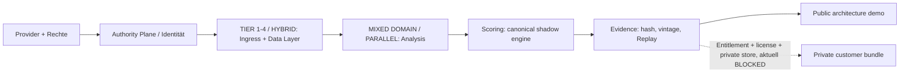

# BLUEPRINT-CATALOG — Architekturpakete und geschützte Delivery

> **Source-derived / Dokumentationsstand 2026-10-11.** Baseline: [main@6b13ed9c0c54](https://github.com/SvenKulessa/Capital-AI/tree/6b13ed9c0c54c1497ce20e2fa0e0a8a3378d89b9); Autorität: [AGENTS.md](https://github.com/SvenKulessa/Capital-AI/blob/6b13ed9c0c54c1497ce20e2fa0e0a8a3378d89b9/AGENTS.md). `VERIFIED` = geprüfter Source-Code; produktiver Betrieb, externe Providerrechte, Tarife, Handelssignale, Return-Claims und Live-Backtests sind ohne externe Evidence `NOT_PROVEN`. Diese Dateien fügen **keinen** zweiten Scorer, kein Runtime-Gate und keine Produktfreischaltung hinzu.

## Produkt- und Reifegrenzen

**Sieben** Blueprint-Evidence-Verträge aus [`src/data/blueprintEvidenceContracts.ts`](../../src/data/blueprintEvidenceContracts.ts); alle `state=BLOCKED`. Die öffentlichen `public/downloads/blueprints/*.md` sind **Architekturinformationen**, keine produktiv verfügbaren Downloads oder Rights-/Deployment-Evidence. Das Produkt [Screener Blueprint Bundle v0.1](../docs/product/SCREENER-BLUEPRINT-BUNDLE-V0.1.md) ist zusätzlich ein eigenes **synthetisches Marketing-/YAML-Preview**, kein achter aktiver Runtime-Blueprint.

Die aktuelle [Delivery Policy](../../src/data/blueprintDeliveryPolicy.ts) setzt `publicFullSource=false`, `publicStaticDownloads=false`, `currentCommerceAdmission=false`. Eine Käufer-Auslieferung ist derzeit **BLOCKED**. Ein sichtbares Badge, Diagramm, Pricing-Schema oder Checkout-Test entsperrt sie nicht.

## Blueprint-Katalog (abgeleitet, keine zweite Produktregistry)

| Code / öffentliches Konzept | Zweck | Input → Output | Formel-/Gewichtsbezug | Qualitätsmetriken / Evidence | Status |
|---|---|---|---|---|---|
| [`TIER_1_4_LIVE`](../public/downloads/blueprints/TIER_1_4_LIVE.md) | Vier-Schichten-Live-Datenpfad | raw quotes + provider rights / sequence → conflated tier data → fan-out | Conflation/Latency: Messmetrik, keine Score-Gewichtung / Gewicht `NOT_PROVEN` | Frische, Sequenzlücken, End-to-End-Latenz (gemessen), Replay | `BLOCKED` |
| [`AUTHORITY_PLANE`](../public/downloads/blueprints/AUTHORITY_PLANE.md) | Multi-Provider Authority/Consensus | vergleichbare multi-provider facts / IDs → canonical snapshot + consensus evidence | Quorum / Abweichung; kein fiktiver Consensus-Score / Gewicht `NOT_PROVEN` | Providerzahl, Semantic Identity, Hash-Binding, Replay | `BLOCKED` |
| [`HYBRID`](../public/downloads/blueprints/HYBRID.md) | Hot State + History | validated stream/history + TTL → versionierte Query/Feature-Readmodelle | Cache/History-Aggregation versioniert, kein festgelegter Score / Gewicht `NOT_PROVEN` | Cache hit/miss, Freshness, Backfill, Restore | `BLOCKED` |
| [`MIXED_DOMAIN`](../public/downloads/blueprints/MIXED_DOMAIN.md) | Cross-Asset Market Data | FX, crypto, equity etc + Rechte → asset-class-übergreifender Canonical Contract | asset-spezifisches Profil statt gemischter Gewichte / Gewicht `NOT_PROVEN` | Identity-/Unit-Kompatibilität, Rights, Frequenz | `BLOCKED` |
| [`PARALLEL_HOMOGENEOUS`](../public/downloads/blueprints/PARALLEL_HOMOGENEOUS.md) | Redundante gleichartige Feeds | mehrere äquivalente admitted facts → deduplizierte/validierte Feed-Wahl | Dedupe/Failover-Konsens, keine Defaultgewichtung / Gewicht `NOT_PROVEN` | Disconnect-/Failover-Test, Late Ticks, Agreement | `BLOCKED` |
| [`PARALLEL_MIXED`](../public/downloads/blueprints/PARALLEL_MIXED.md) | Preis + News + Fundamental + AI | multimodale Inputs + PIT + Lizenzen → Feature/Evidence-Kontext für Scorer | nur deklarierte Family Weights aus ScoringConfig / Gewicht `NOT_PROVEN` | News-PIT, Prompt Boundary, No Double Count, Replay | `BLOCKED` |
| [`INDIVIDUAL_PACKAGE`](../public/downloads/blueprints/INDIVIDUAL_PACKAGE.md) | Individuelle Analysebausteine | purpose-spezifische historische/fundamentale Daten → versioniertes kundenspezifisches Research-Modul | kundenspezifisch `NOT_PROVEN`, nur lehrhafte Formeln / Gewicht `NOT_PROVEN` | PIT, Lookahead, Feldvertrag, Rights | `BLOCKED` |

Die konzeptionellen Rollen, Vorbedingungen, Failure Modes und Acceptance Criteria sind in [`blueprintDocumentationData.ts`](../../src/features/documentation/blueprintDocumentationData.ts) beschrieben; die **verbindlich vorhandenen** Blueprint-Evidence-Felder verbleiben in [`blueprintEvidenceContracts.ts`](../../src/data/blueprintEvidenceContracts.ts). Kein Blueprint erhält ohne explizites Modell eine eigene Scoring-Gewichtung.

## Architekturdiagramm — auslieferbare Schichten, kein produktiver Claim



Textalternative: Datenprovider werden vor der Verarbeitung auf Berechtigung und Instrumentidentität geprüft. Die Varianten Tier 1–4/Hybrid organisieren die Datenebene, Mixed/Parallel Analysis-Feeds, der bestehende Scorer und die Evidence-Engine die nachgelagerte Erklärung. Das Kundenpaket ist noch nicht freigeschaltet.

## Screener Blueprint Bundle v0.1 (zusätzliches Produktkonzept)

- **Konzept:** kombiniertes Data Concept + Scoring/Pattern Playbooks; bestehende öffentliche Vorschau mit YAML-Editor und synthetischem Faktor-Chart. Kein produktives Cross-Asset Scoring oder Trading.
- **Demo-Faktorprofil, explizit unkalibriert:** Fundamental 0.22 · Technical 0.18 · Momentum 0.14 · Liquidity 0.16 · Risk Quality 0.15 · Patterns 0.15. Synthetic signals 80/70/75/90/60/85 ergeben **76.85/100** als Rechenbeispiel, **nicht** als Return/Prognose/Backtest.
- **Daten:** `src/features/home/marketBlueprintDemo.ts`, `src/features/documentation/screenerBlueprintDemo.ts`, Referenz [`docs/product/SCREENER-BLUEPRINT-BUNDLE-V0.1.md`](../docs/product/SCREENER-BLUEPRINT-BUNDLE-V0.1.md).
- **Nicht übernehmen:** Preview-Werte oder `min_confidence=0.65` als Produktregel. Die kanonische Shadow-Confidence-Untergrenze bleibt **0.90**; Feature-Double-Count, falsch benannte Pattern-Detektion, unlizenzierte Kursdaten und fehlende PIT sind Blocker.

## Evidence Contract (bereits im Code vorhanden)

Jeder der sieben Blueprint-Evidence-Einträge enthält `SOURCE_SHA`, `LICENSE_PROVENANCE`, `REPRODUCIBLE_TEST` und `SECURITY_REVIEW` und darauf aufbauende spezifische Kriterien wie `MULTI_PROVIDER_RIGHTS`, `CANONICAL_REPLAY`, `FRESHNESS_CLASSIFICATION`, `FAILOVER_TEST`, `NO_LOOKAHEAD` und `SCORING_REPLAY`.

```text
Blueprint delivery = authenticatedSession
                  AND privateEvidenceContext
                  AND blueprintSpecificEvidenceVerified
                  AND entitlementActive
                  AND commerceSkuAdmitted
                  AND licenseBound
                  AND currentCommerceAdmission
```

Ein einzelner `KEY_VAULT_VERIFIED_PROVIDER`-Kontext oder ein positiver Testsnapshot genügt nicht; die aktuelle Policy verhindert Ausgabe. **BYOK bleibt im aktuellen Kundenprodukt deaktiviert.** Die Source-Delivery-Policy wird von dieser Dokumentation nicht verändert.

## Produktisierung mit nachprüfbarer Monetarisierung

| Ebene | Lieferbar im Source-Stand? | Nächster sachlicher Schritt | Kosten/Rechte |
|---|---|---|---|
| Öffentliche Architektur- und Lernpreview | Quellcode vorhanden | synthetische Demos mit Provenance messen | keine neuen externen Provider aktiviert |
| Bezahlter Blueprint-Bundle-Download | `BLOCKED` | private Artefakte, Server-Entitlement, Contract/License/SKU nachweisen | Storage/Egress, Stripe, Lizenz unbekannt; vor Kostenentscheid Owner |
| Interaktiver Blueprint-Composer | `PLANNED` | versioniertes YAML/Schema in bestehender UI | QA, Tenant Isolation, Hosting-Kosten offen |
| B2B-White-Label- / Data-API | `PLANNED` | Daten-/Derived Rights + API Metering + Verträge | `NOT_PROVEN`, kein Verkauf unlizenzierter Rohdaten |

Die Architekturkonzepte sind als Know-how und Schulungsmaterial monetarisierbar; **Rechte an Marktdaten, bestehenden Modellen oder Abbildungen werden nicht durch den Bundle-Kauf übertragen**. Kein zusätzliches Payment-/Provider-Enablement wird hier ausgelöst.

## Abnahme pro Blueprint (fachlich, kein zusätzlicher Required Check)

1. Terminologie und Scope mit `BLUEPRINT_EVIDENCE_CONTRACTS` und `BLUEPRINT_DELIVERY_POLICY` abgleichen; keine zusätzlichen Freigabe-Gates hinzufügen.
2. Testpfad exakt an Repo-SHA, Dataset/License/Asset, Input/Output und reproduzierbare Ergebnisse binden.
3. Fail-Closed-Ausgabe bei fehlenden Rights, Cache/Staleness, Credentials, Replay und Entitlement testen.
4. Production-/Marketplace-Readback separat und ohne Annahmen; neue kostenpflichtige Ressourcen oder Verträge sind 👋⚙️ Owner-Entscheidungen.

Weiter: [Komponenten](COMPONENT-CATALOG.md) · [Provider](PROVIDER-CATALOG.md) · [Scores](SCORING-CATALOG.md) · [Learning](LEARNING-PATHS.md).
