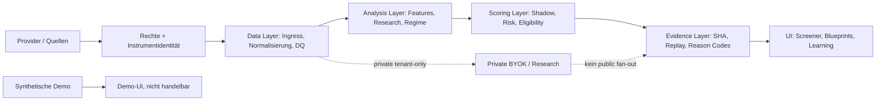

# COMPONENT-CATALOG — Financial Intelligence Architecture

> **Statische Code-Evidence, 2026-10-11.** Baseline: [main@6b13ed9c0c54](https://github.com/SvenKulessa/Capital-AI/tree/6b13ed9c0c54c1497ce20e2fa0e0a8a3378d89b9). Autorität: [AGENTS.md](https://github.com/SvenKulessa/Capital-AI/blob/6b13ed9c0c54c1497ce20e2fa0e0a8a3378d89b9/AGENTS.md) (`SOLO_MAINTAINER_FLOW@1`). Ein Eintrag im Katalog bestätigt weder aktive Runtime noch kommerzielle Providerrechte. Status `VERIFIED` bezeichnet nur explizit geprüften Quellcode; Runtime, Vertragsrechte, Quotas und Zahlungen ohne separaten Nachweis: `NOT_PROVEN`.

## Scope und Status

- **50 kanonische Registry-Komponenten, genau 5 blocked, 45 planned.** Quelle: [`src/contracts/analysisComponentRegistry.ts`](../src/contracts/analysisComponentRegistry.ts). Alle 50 stehen im Registry-Provenance-Modus `unavailable` und haben `lastValidatedAt: null`; es gibt keine als `active` validierte Komponente.
- Die **Registry ist Single Source of Truth für diese 50 IDs**; dieses Dokument ist eine **abgeleitete Ansicht**, keine zweite Activation Registry. Die Skill-Registry [`.agents/skills/registry.json`](../.agents/skills/registry.json) bleibt davon unberührt.
- Im Feld **Version / Defaultgewicht** steht die komponentenlokale deklarierte `calculationVersion` / `weightPolicy.defaultWeight`, **nicht** ein global normiertes oder validiertes Portfolio-/Scoring-Gewicht. Die Summe aller 50 Defaults ist ausdrücklich *kein* Scoring-Modell.
- Das Feld **Qualität / Modus** enthält nur `confidencePolicy.minimumDataSufficiencyRatio` der Registry. Es bestätigt **keine** reale Datenabdeckung; Kalibrierung, Formelimplementierung und Reproduzierbarkeit pro Komponente: `NOT_PROVEN`.

## Zielarchitektur (kein behaupteter Runtime-Zustand)



Textalternative: Provider → Rights-/Asset-Gate → Canonical Facts → Quality/Features → bestehender ScoringEngineService → Evidence/Replay → nicht-actionable UI. Nutzergebundene BYOK-Daten bleiben privat; synthetische Demo-Daten können niemals durch diesen Pfad als geprüfte Live-Daten erscheinen.

Verwandte Anker: [`server/market.mjs`](../server/market.mjs), [`shared/market-contracts.mjs`](../shared/market-contracts.mjs), [`src/services/scoringEngine.ts`](../src/services/scoringEngine.ts), [`src/contracts/pipelineExecution.ts`](../src/contracts/pipelineExecution.ts), [`src/contracts/analysisComponentRegistryValidator.ts`](../src/contracts/analysisComponentRegistryValidator.ts).

## Kanonischer Komponentenkatalog

| # | Komponente | Domain / Lifecycle | Input → Output | Deklarierte Feature-/Formelbasis | Provider-Abhängigkeit | Version / Defaultgewicht | Mindest-Datensuffizienz / Provenance |
|---:|---|---|---|---|---|---|---|
| 01 | `market_integrity_gate` | data-quality / **blocked** | `RawTickStreamContract`, `ExchangeStatusContract` → `IntegrityStatusContract` | `bid_ask_spread`, `sequence_continuity`, `timestamp_jitter` | `binance`, `kraken`, `coinbase`, `twelvedata` | 1.2.0 / 1.00 | 95 % / unavailable |
| 02 | `data_quality_scorer` | data-quality / **planned** | `FeedLatencyMetricContract`, `TickGapContract` → `DataQualityScoreContract` | `latency_jitter_ms`, `missing_ticks_ratio`, `provider_agreement_score` | `binance`, `kraken`, `twelvedata`, `alphavantage` | 1.1.0 / 0.80 | 90 % / unavailable |
| 03 | `liquidity_eligibility_scorer` | risk-controls / **blocked** | `OrderbookDepthContract`, `DailyTurnoverContract` → `LiquidityEligibilityContract` | `turnover_24h_eur`, `orderbook_depth_2pct_eur`, `median_trade_size` | `binance`, `kraken`, `twelvedata` | 1.0.0 / 0.90 | 85 % / unavailable |
| 04 | `spread_slippage_risk_scorer` | risk-controls / **blocked** | `L1TopBookContract`, `TradeExecutionEstimateContract` → `SlippageRiskContract` | `effective_spread_bps`, `modeled_market_impact_50k` | `binance`, `kraken` | 1.0.0 / 0.70 | 90 % / unavailable |
| 05 | `tradability_gate` | risk-controls / **blocked** | `MarketHaltContract`, `RegulatoryTradingStatusContract` → `TradabilityStatusContract` | `exchange_trading_state`, `circuit_breaker_active` | `twelvedata`, `binance` | 1.0.0 / 1.00 | 99 % / unavailable |
| 06 | `multi_timeframe_trend_regime_scorer` | scoring / **planned** | `MultiTimeframeCandlesContract` → `TrendRegimeScoreContract` | `ema_20_50_200_alignment`, `adx_14_strength`, `higher_highs_structure` | `binance`, `twelvedata` | 2.0.0 / 0.25 | 90 % / unavailable |
| 07 | `relative_strength_scorer` | scoring / **planned** | `BenchmarkReturnContract`, `AssetReturnContract` → `RelativeStrengthScoreContract` | `alpha_vs_sp500_60d`, `rs_percentile_rank_in_sector` | `twelvedata` | 1.2.0 / 0.20 | 95 % / unavailable |
| 08 | `momentum_persistence_scorer` | scoring / **planned** | `HistoricalCandlesContract` → `MomentumPersistenceScoreContract` | `rate_of_change_14d`, `hurst_exponent`, `positive_day_ratio_30d` | `binance`, `twelvedata` | 1.1.0 / 0.15 | 90 % / unavailable |
| 09 | `breakout_quality_scorer` | scoring / **planned** | `RecentBreakoutContract`, `VolumeExpansionContract` → `BreakoutQualityScoreContract` | `consolidation_range_duration_days`, `breakout_volume_multiple`, `close_above_resistance_pct` | `binance`, `twelvedata` | 1.0.0 / 0.15 | 85 % / unavailable |
| 10 | `mean_reversion_opportunity_scorer` | scoring / **planned** | `OscillatorContract`, `BollingerBandContract` → `MeanReversionScoreContract` | `rsi_14_oversold`, `z_score_vs_20d_sma`, `bollinger_percent_b` | `binance`, `twelvedata` | 1.0.0 / 0.10 | 90 % / unavailable |
| 11 | `volume_confirmation_scorer` | scoring / **planned** | `IntradayVolumeContract`, `HistoricalAverageVolumeContract` → `VolumeConfirmationScoreContract` | `obv_trend_direction`, `volume_profile_poc_proximity`, `rvol_intraday` | `binance`, `twelvedata` | 1.1.0 / 0.15 | 90 % / unavailable |
| 12 | `volatility_regime_scorer` | risk-controls / **planned** | `ATRContract`, `HistoricalVolatilityContract` → `VolatilityRegimeScoreContract` | `atr_14_percentile`, `parkinson_volatility`, `implied_vs_realized_ratio` | `twelvedata`, `binance` | 1.0.0 / 0.10 | 90 % / unavailable |
| 13 | `support_resistance_proximity_scorer` | scoring / **planned** | `KeyLevelsContract`, `CurrentPriceContract` → `KeyLevelProximityScoreContract` | `distance_to_major_support_pct`, `distance_to_major_resistance_pct`, `level_touch_count` | `binance`, `twelvedata` | 1.0.0 / 0.10 | 85 % / unavailable |
| 14 | `pattern_confidence_scorer` | scoring / **planned** | `ChartPatternDetectionContract` → `PatternConfidenceScoreContract` | `pattern_geometry_symmetry`, `completion_ratio`, `historical_win_rate_in_regime` | `twelvedata` | 1.0.0 / 0.10 | 80 % / unavailable |
| 15 | `vwap_location_scorer` | scoring / **planned** | `IntradayTickVolumeContract` → `VWAPLocationScoreContract` | `price_vs_session_vwap_pct`, `vwap_standard_deviation_band` | `binance`, `kraken` | 1.1.0 / 0.15 | 95 % / unavailable |
| 16 | `market_breadth_scorer` | market-intelligence / **planned** | `ConstituentAdvanceDeclineContract` → `MarketBreadthScoreContract` | `advance_decline_ratio`, `stocks_above_50d_sma_pct`, `new_highs_vs_lows` | `twelvedata` | 1.0.0 / 0.15 | 90 % / unavailable |
| 17 | `sector_rotation_scorer` | market-intelligence / **planned** | `SectorETFReturnsContract` → `SectorRotationScoreContract` | `cyclical_vs_defensive_ratio`, `tech_vs_utilities_spread`, `sector_momentum_rank` | `twelvedata` | 1.1.0 / 0.15 | 95 % / unavailable |
| 18 | `correlation_diversification_scorer` | risk-controls / **planned** | `CrossAssetCorrelationMatrixContract` → `CorrelationDiversificationScoreContract` | `rolling_correlation_btc_sp500`, `gold_equity_decoupling_index` | `twelvedata`, `binance` | 1.0.0 / 0.10 | 90 % / unavailable |
| 19 | `cross_asset_regime_scorer` | market-intelligence / **planned** | `MacroYieldCurveContract`, `DXYContract`, `CommodityIndexContract` → `CrossAssetRegimeScoreContract` | `us_10y_2y_yield_spread`, `dxy_strength_trend`, `crude_oil_momentum` | `fred`, `twelvedata` | 1.0.0 / 0.15 | 95 % / unavailable |
| 20 | `macro_surprise_scorer` | market-intelligence / **planned** | `EconomicReleaseVsConsensusContract` → `MacroSurpriseScoreContract` | `cpi_surprise_delta`, `nfp_surprise_zscore`, `rate_decision_deviation` | `fred` | 1.0.0 / 0.20 | 95 % / unavailable |
| 21 | `economic_calendar_risk_scorer` | risk-controls / **planned** | `UpcomingEventsContract` → `EventRiskScoreContract` | `hours_until_fomc_decision`, `tier1_event_clustering_index` | `fred` | 1.0.0 / 0.10 | 95 % / unavailable |
| 22 | `entity_resolution_engine` | asset-master / **planned** | `RawNewsHeadlineContract`, `SocialMentionContract` → `ResolvedEntityContract` | `fuzzy_symbol_matching_confidence`, `isin_figi_lei_lookup` | `gemini`, `internal_master_data` | 2.1.0 / 1.00 | 92 % / unavailable |
| 23 | `news_relevance_scorer` | market-intelligence / **planned** | `NewsArticleBodyContract` → `NewsRelevanceScoreContract` | `entity_mention_prominence`, `title_vs_body_salience`, `ticker_relevance_pct` | `gemini` | 1.2.0 / 0.20 | 85 % / unavailable |
| 24 | `financial_sentiment_scorer` | market-intelligence / **planned** | `FilteredNewsStreamContract` → `FinancialSentimentScoreContract` | `polarity_score_gemini`, `finbert_domain_sentiment`, `forward_looking_tone` | `gemini` | 2.0.0 / 0.20 | 80 % / unavailable |
| 25 | `sentiment_velocity_scorer` | market-intelligence / **planned** | `SentimentTimeSeriesContract` → `SentimentVelocityScoreContract` | `sentiment_change_1h`, `sentiment_change_24h`, `velocity_acceleration` | `gemini` | 1.0.0 / 0.15 | 80 % / unavailable |
| 26 | `sentiment_dispersion_scorer` | risk-controls / **planned** | `MultiSourceSentimentContract` → `SentimentDispersionScoreContract` | `source_sentiment_variance`, `retail_vs_institutional_divergence` | `gemini` | 1.0.0 / 0.10 | 75 % / unavailable |
| 27 | `news_novelty_scorer` | market-intelligence / **planned** | `ArticleEmbeddingContract`, `HistoricalNewsStoreContract` → `NewsNoveltyScoreContract` | `cosine_distance_to_historical_clusters`, `is_breaking_news` | `gemini` | 1.1.0 / 0.15 | 85 % / unavailable |
| 28 | `source_authority_scorer` | data-quality / **planned** | `PublisherDomainContract` → `SourceAuthorityScoreContract` | `domain_reputation_tier`, `historical_accuracy_rating`, `sec_filing_flag` | `internal_master_data` | 1.0.0 / 0.20 | 95 % / unavailable |
| 29 | `event_detection_classification_engine` | market-intelligence / **planned** | `StructuredNewsEventContract` → `ClassifiedEventContract` | `event_type_taxonomy`, `merger_acquisition_flag`, `lawsuit_penalty_flag` | `gemini` | 1.3.0 / 0.25 | 88 % / unavailable |
| 30 | `event_impact_scorer` | scoring / **planned** | `ClassifiedEventContract`, `MarketCapContract` → `EventImpactScoreContract` | `estimated_ebitda_impact_pct`, `regulatory_threat_level` | `gemini` | 1.1.0 / 0.20 | 82 % / unavailable |
| 31 | `catalyst_strength_scorer` | scoring / **planned** | `UpcomingCatalystCalendarContract` → `CatalystStrengthScoreContract` | `days_to_catalyst`, `historical_catalyst_volatility_move` | `internal_master_data` | 1.0.0 / 0.15 | 85 % / unavailable |
| 32 | `market_reaction_validator` | data-quality / **planned** | `ClassifiedEventContract`, `PostEventTickWindowContract` → `MarketReactionValidationContract` | `initial_reaction_direction`, `reversal_in_15m_flag`, `abnormal_trading_volume` | `binance`, `twelvedata` | 1.0.0 / 0.15 | 90 % / unavailable |
| 33 | `narrative_emergence_scorer` | market-intelligence / **planned** | `TopicClusteringStreamContract` → `NarrativeEmergenceScoreContract` | `new_topic_growth_rate_48h`, `cross_channel_adoption_rate` | `gemini` | 1.0.0 / 0.15 | 80 % / unavailable |
| 34 | `narrative_saturation_scorer` | risk-controls / **planned** | `TopicFrequencyContract` → `NarrativeSaturationScoreContract` | `mainstream_media_saturation_index`, `search_trend_exhaustion` | `gemini` | 1.0.0 / 0.10 | 80 % / unavailable |
| 35 | `social_attention_velocity_scorer` | market-intelligence / **planned** | `SocialMentionVolumeContract` → `SocialAttentionVelocityScoreContract` | `mention_zscore_vs_30d`, `retweet_spread_velocity` | `internal_master_data` | 1.0.0 / 0.10 | 75 % / unavailable |
| 36 | `social_engagement_quality_scorer` | data-quality / **planned** | `SocialAuthorProfilesContract` → `SocialEngagementQualityScoreContract` | `account_age_distribution`, `follower_to_following_ratio`, `verified_author_ratio` | `internal_master_data` | 1.0.0 / 0.10 | 75 % / unavailable |
| 37 | `bot_manipulation_risk_scorer` | risk-controls / **planned** | `SocialTimeFrequencyContract`, `OrderbookSpoofingContract` → `ManipulationRiskScoreContract` | `sybil_attack_probability`, `pump_and_dump_pattern_similarity` | `internal_master_data`, `gemini` | 1.2.0 / 0.15 | 85 % / unavailable |
| 38 | `fundamental_quality_scorer` | scoring / **planned** | `SEC10K10QFinancialsContract` → `FundamentalQualityScoreContract` | `piotroski_f_score`, `return_on_equity_10y_median`, `free_cash_flow_margin` | `sec_edgar`, `financialmodelingprep` | 2.0.0 / 0.35 | 95 % / unavailable |
| 39 | `growth_acceleration_scorer` | scoring / **planned** | `QuarterlyFinancialsSeriesContract` → `GrowthAccelerationScoreContract` | `revenue_growth_yoy_sequential_delta`, `eps_growth_3y_cagr` | `sec_edgar`, `financialmodelingprep` | 1.1.0 / 0.25 | 95 % / unavailable |
| 40 | `valuation_peer_comparison_scorer` | scoring / **planned** | `CompanyMultiplesContract`, `SectorPeersMultiplesContract` → `ValuationScoreContract` | `pe_ratio_vs_sector_median`, `ev_to_ebitda_percentile`, `peg_ratio` | `financialmodelingprep` | 1.2.0 / 0.25 | 92 % / unavailable |
| 41 | `earnings_revision_scorer` | scoring / **planned** | `ConsensusEstimatesContract` → `EarningsRevisionScoreContract` | `eps_estimate_upward_revisions_30d`, `revenue_revision_diffusion_index` | `financialmodelingprep` | 1.0.0 / 0.20 | 90 % / unavailable |
| 42 | `earnings_surprise_guidance_scorer` | scoring / **planned** | `EarningsHistoryContract` → `EarningsSurpriseScoreContract` | `last_earnings_surprise_pct`, `forward_guidance_raised_flag` | `financialmodelingprep`, `sec_edgar` | 1.0.0 / 0.20 | 90 % / unavailable |
| 43 | `financial_distress_scorer` | risk-controls / **planned** | `BalanceSheetDebtContract` → `FinancialDistressScoreContract` | `altman_z_score`, `interest_coverage_ratio`, `debt_to_equity` | `sec_edgar`, `financialmodelingprep` | 1.1.0 / 0.25 | 95 % / unavailable |
| 44 | `insider_institutional_flow_scorer` | market-intelligence / **planned** | `SECForm4Contract`, `SEC13FHoldingsContract` → `InsiderInstitutionalFlowScoreContract` | `insider_net_buying_ratio_90d`, `institutional_ownership_change_qoq` | `sec_edgar` | 1.1.0 / 0.20 | 88 % / unavailable |
| 45 | `options_positioning_gamma_scorer` | market-intelligence / **planned** | `OptionsChainContract` → `GammaPositioningScoreContract` | `gamma_exposure_gex_regime`, `put_call_ratio_open_interest`, `max_pain_price_distance` | `twelvedata` | 1.0.0 / 0.20 | 85 % / unavailable |
| 46 | `open_interest_funding_regime_scorer` | market-intelligence / **planned** | `FuturesOpenInterestContract`, `PerpetualFundingRateContract` → `PerpetualMarketRegimeScoreContract` | `funding_rate_annualized`, `oi_weighted_by_market_cap`, `liquidation_cascade_risk_score` | `binance`, `kraken` | 1.2.0 / 0.25 | 92 % / unavailable |
| 47 | `orderflow_liquidity_imbalance_scorer` | scoring / **planned** | `L2OrderbookDeltaContract`, `AggregatedTradesContract` → `OrderflowImbalanceScoreContract` | `cumulative_volume_delta_cvd`, `bid_ask_imbalance_ratio_l2`, `iceberg_order_detection_flag` | `binance`, `kraken` | 1.3.0 / 0.25 | 90 % / unavailable |
| 48 | `onchain_flow_holder_behavior_scorer` | market-intelligence / **planned** | `OnChainWalletTransferContract`, `ExchangeReserveContract` → `OnChainHoldersScoreContract` | `exchange_net_inflow_outflow_btc`, `long_term_holder_supply_pct`, `whale_wallet_accumulation_30d` | `binance`, `internal_master_data` | 1.2.0 / 0.25 | 85 % / unavailable |
| 49 | `protocol_fundamentals_tokenomics_scorer` | scoring / **planned** | `DefiTvlFeesContract`, `TokenEmissionScheduleContract` → `TokenomicsScoreContract` | `tvl_growth_30d`, `protocol_revenue_vs_market_cap`, `annual_token_inflation_rate` | `internal_master_data` | 1.1.0 / 0.20 | 88 % / unavailable |
| 50 | `final_rank_confidence_evidence_scorer` | ranking / **blocked** | `CompositeScoresContract`, `EligibilityContract`, `EvidenceHashesContract` → `CanonicalActionableRankContract` | `weighted_composite_score`, `total_evidence_sha256`, `aggregate_data_confidence` | `internal_consensus_engine` | 3.0.0 / 1.00 | 90 % / unavailable |

**Formelstatus aller 50 Registry-Komponenten:** Die Feature-Namen sind **nur deklarative mathematische Eingangsgrößen**. Pro-ID-Rechenfunktion, normalisierte Faktortransformation, Kalibrierung und ausführbare Korrelation zu `calculationVersion` sind mangels Registry-Activation **`NOT_PROVEN`**; keine Feature-Bezeichnung darf als implementierte Formel verkauft werden. Weitere technische Grenzwerte pro Komponente (Refresh-Intervall, max. Staleness, Timeout, Risk-Veto/-Penalty, Confidence-Halbwertszeit, Reason Codes) werden **unverändert aus der Registry** gelesen, nicht hier als parallele Richtlinie gepflegt.

## Weitere vorhandene ausführbare oder typisierte Komponenten (keine zusätzlichen 50 Registry-IDs)

| Modul / Codeanker | Input | Output | Mathematische Grundlage bzw. Gewicht | Qualitäts-/Sicherheitsstatus |
|---|---|---|---|---|
| [Public Source Policy](../server/open-source-market-policy.mjs) | Rechtsevidence und Capability | admissible/blocked source | Boolesche Rechte-/Instrument-Gates, kein Score | ECB-Referenz und Wikidata-Metadaten im Code zugelassen; Live-Runtime `NOT_PROVEN` |
| [Spot Protocol Wire](../server/spot-provider-wire.mjs) | REST/WS-Tradeframes, Mapping | normalisierter Tick | endliche Preise, strikte Zeiten/Mapping | Fail-closed; öffentliche Binance-/Kraken-Datenrechte nicht zugelassen |
| [Canonical Spot Ingress](../server/market-spot-ingestion.mjs) | zugelassener Tick, Zeit, Provider | `QuoteFact`, `evidenceId` | `QuoteFactSchema`, `isFresh`, Persist/Replay | Quelle+Symbol+Transport+Runtime-Gates vor I/O |
| [ECB Reference Ingress](../server/market.mjs) | ECB-Tagesreferenzkurse | QuoteFact, Cache/Replay | Referenzzeit und Idempotenzprüfung, **kein Tick- oder Execution-Preis** | `MARKET_QUOTES_ENABLED` und ECB-Flag erforderlich |
| [Provider Adapter Registry](../src/services/providerAdapters.ts) | Adapter + Rights Admission | auswählbarer Adapter | Keine Scoreformel | Produktionsadapter-Map startet leer; explizite Admission |
| [Feature Store](../src/services/featureStore.ts) | qualifizierte Features | Snapshot/Lookup | Keine globale Faktorformel | Source-Pfad, Runtime `NOT_PROVEN` |
| [Raw Feature Calculator](../src/services/rawFeatureCalculator.ts) | Rohdaten und Feature-Verträge | abgeleitete Merkmale | Deterministischer Source-Pfad; einzelne Formeln siehe Code | Ausgabe ≠ automatisch live/admitted |
| [Real Market Signals](../src/platform/FinanceScoringResearch/realMarketSignals.ts) | Price/Volume/Supply/History | 0–100 Subscores + ReturnStats | `log10(cap)`, turnover, ROC, SMA, RSI und renormierter gewichteter Mittelwert | Eingabeprüfung; keine Berechtigung für publizierten Score |
| [Source Research Factor Composer](../src/platform/FinanceScoringResearch/FinanceFactorWeights.ts) | faktorbasierte `values` + EvidenceRefs | Research-Composite + Fingerprints | `sum(w_i x_i)/sum(w_i verfügbar)`; exakte Gewichte im [Scoring Catalog](SCORING-CATALOG.md) | `scoreEligible=false`, `productionEligible=false` |
| [Canonical Scoring Engine](../src/services/scoringEngine.ts) | PipelineSnapshot / FeatureValue / Rights | ShadowScore oder FinalRankResult | Sechs Scorefamilien, Confidence-Minimum, Risk-Penalty | Kein publishable Rank; `scoreEligible=false` |
| [Evidence Engine](../src/services/evidenceEngine.ts) | Input-/Output-/Config-Fingerprints | Evidence-Referenz | kryptographisches Hash-/Lineage-Prinzip | nicht automatisch durable Prod-Replay |
| [Blueprint Evidence Contracts](../src/data/blueprintEvidenceContracts.ts) | Blueprint + Source/Rechte/Test-Evidence | Blocked/Requirement Set | Konjunktion der Required Evidence, kein Score | Sieben Blueprint-Einträge `BLOCKED` |
| [Screener & Explainability UI](../src/features/screener/EnterpriseScorerDashboard.tsx) | freigegebene Score-/Unavailability-Modelle | Anzeige/Erklärung | reine UI-Projektion | Dashboard-Existenz ≠ Live-Scoring |
| [Learning Modules](../shared/learning-journey.mjs) | redaktionelle Lektionen / synthetische Werte | Lernpfade | dokumentierte Lehrformeln, ausdrücklich synthetisch | keine Anlageberatung, keine Live-Kurse |

## Durchgehender Komponentenvertrag für jede spätere Aktivierung

```ts
type IntelligenceComponentEvidence = {
  componentId: string;                 // Referenz auf CANONICAL_50_COMPONENTS
  inputContractIds: readonly string[];
  outputContractId: string;
  providerDatasetIds: readonly string[];
  instrumentId: string;                 // inkl. Assetklasse, Venue, Quote-Währung
  observedAt: string; receivedAt: string; evaluatedAt: string;
  formulaVersion: string; weightVersion: string;
  nominalWeights: Readonly<Record<string, number>>;
  effectiveWeights: Readonly<Record<string, number>>;
  dataCompleteness: number; freshnessMs: number;
  providerAgreement: number | null;
  rightsEvidenceRefs: readonly string[];
  rawEvidenceRefs: readonly string[];
  resultEvidenceHash: string;
  mode: 'simulated' | 'research' | 'delayed' | 'live';
  reasonCodes: readonly string[];
};
```

**Das ist ein Dokumentationsvorschlag, kein implementierter oder zusätzlich verpflichtender Contract.** Eingaben ohne Evidenz bleiben blockiert. Mehr Details: [Provider](PROVIDER-CATALOG.md), [Scoring](SCORING-CATALOG.md), [Blueprints](BLUEPRINT-CATALOG.md), [Learning](LEARNING-PATHS.md).

## Prüfkriterien

1. Statisches Source-Audit: genau 50 unique `componentId`, 50 Ein-/Ausgabekontrakte, Gewichte und DQ-Metadaten unverändert referenziert; Diff gegen Registry.
2. Bei tatsächlicher Aktivierung: Validator ohne ungelöste `CONTRACT_REFERENCE_UNRESOLVED`, `PROVIDER_NOT_PRODUCTION_ADMITTED`, `FEATURE_REFERENCE_UNRESOLVED` oder `ASSET_CLASS_UNRESOLVED`; **kein neuer Development-Gate**.
3. Keine Veröffentlichung von `live`, Renditen oder Recommendations ohne separate Rights-/Data-/Runtime-/Regulatory-Evidence.
