# LEARNING-PATHS — Financial Intelligence Learning Architecture

> **Source-derived / Dokumentationsstand 2026-10-11.** Baseline: [main@6b13ed9c0c54](https://github.com/SvenKulessa/Capital-AI/tree/6b13ed9c0c54c1497ce20e2fa0e0a8a3378d89b9); Autorität: [AGENTS.md](https://github.com/SvenKulessa/Capital-AI/blob/6b13ed9c0c54c1497ce20e2fa0e0a8a3378d89b9/AGENTS.md). `VERIFIED` = geprüfter Source-Code; produktiver Betrieb, externe Providerrechte, Tarife, Handelssignale, Return-Claims und Live-Backtests sind ohne externe Evidence `NOT_PROVEN`. Diese Dateien fügen **keinen** zweiten Scorer, kein Runtime-Gate und keine Produktfreischaltung hinzu.

## Bestand: sechs bereits veröffentlichte methodische Lernschritte

Diese sechs Einträge sind **aus [`LEARNING_JOURNEY`](../../shared/learning-journey.mjs) abgeleitet**, nicht eine weitere Curriculum-Quelle. Die React-Projektion ist [`src/features/learning/LearningJourney.tsx`](../../src/features/learning/LearningJourney.tsx), mit serverseitiger HTML-Fallback-Darstellung.

| Stufe | ID | Bestehendes Modul | Lernziel | Quellpfad | Datenstatus |
|---:|---|---|---|---|---|
| 1 | `finanzbegriffe` | Finanzbegriffe: Spread und Ausführung verstehen | Notierung, Gebühren und Ausführung auseinanderhalten. | Redaktionelles Modul: `shared/learning-journey.mjs` | synthetisch / kostenlos |
| 2 | `datenqualitaet` | Datenqualität: Herkunft und Datenvertrag prüfen | Quelle, Zeitpunkt, Einheit und Nutzungsrecht vor einer Berechnung prüfen. | Redaktionelles Modul: `shared/learning-journey.mjs` | synthetisch / kostenlos |
| 3 | `normalisierung` | Normalisierung: Faktoren auf eine gemeinsame Skala bringen | Skalierung berechnen und ihre Grenzen benennen. | Redaktionelles Modul: `shared/learning-journey.mjs` | synthetisch / kostenlos |
| 4 | `gewichtung` | Gewichteter Score: Faktoren verständlich kombinieren | Gewichte prüfen und Sensitivität statt Renditeversprechen erklären. | Redaktionelles Modul: `shared/learning-journey.mjs` | synthetisch / kostenlos |
| 5 | `volatilitaet` | Risiko und Volatilität: Streuung statt Vorhersage | Historische Streuung von Verlustwahrscheinlichkeit unterscheiden. | Redaktionelles Modul: `shared/learning-journey.mjs` | synthetisch / kostenlos |
| 6 | `validierung` | Backtesting: Modelle ohne Zukunftswissen prüfen | Trainingsdaten, unabhängige Prüfung und Interpretationsgrenzen trennen. | Redaktionelles Modul: `shared/learning-journey.mjs` | synthetisch / kostenlos |

**Bestehende Ergänzungen:** [`src/data/vocabularyData.ts`](../../src/data/vocabularyData.ts) (Begriffe/Definitionen/Formelregeln), [`src/data/chartLearning.ts`](../../src/data/chartLearning.ts) (Chartmuster/Indikatoren mit synthetischen Lernbeispielen), [`src/features/learning/ChartRecognitionQuiz.tsx`](../../src/features/learning/ChartRecognitionQuiz.tsx), [`src/data/learningArticles.ts`](../../src/data/learningArticles.ts), [`src/features/learning/LearningVideos.tsx`](../../src/features/learning/LearningVideos.tsx). Eine Komponente oder Video-Platzhalter ist **kein** Nachweis, dass kostenpflichtige Kurse/Streams freigeschaltet sind.

## Lernpfad-Grafik

```mermaid
flowchart LR
  L1["1 Spread + Basisbegriffe"] --> L2["2 Rechte + Datenqualität"]
  L2 --> L3["3 Normalisierung / Skalierung"]
  L3 --> L4["4 Faktoren + Gewichtung"]
  L4 --> L5["5 Volatilität + Risiko"]
  L5 --> L6["6 Backtesting + PIT"]
  L6 --> A["Advanced A: Provider + Canonical Fact"]
  A --> B["Advanced B: Evidence-first Scoring"]
  B --> C["Advanced C: Blueprint + Produkt"]
```



Textalternative: Lernende beginnen mit Ausführungskosten, prüfen Quellenrechte und DQ, normalisieren Faktoren, berechnen und erklären Gewichtungen, bewerten Risiken und lernen Zeit-/Bias-Grenzen kennen. Die drei Advanced-Pfade sind **hier dokumentierte Erweiterungsvorschläge**, noch keine implementierten Learning-Portal-Funktionen.

## Fortgeschrittene Lernpfade — definiert, aber Produktstatus `PLANNED`

| Lernpfad | Eingangsvoraussetzung / Input | Lehr-Output | Formel-/Gewichtsanker | Qualität / Lernnachweis |
|---|---|---|---|---|
| A — Provider-to-Data | Stufe 1–3, anonymisierte ECB-Referenz oder synthetische QuoteFact | Canonical Asset ID, `observedAt`/`receivedAt`, Rights-/DQ-Prüftabelle | keine Faktoren; Time-Semantik / `QuoteFactSchema` | markiert stale, falsche USD/USDT-Einheit, Rechte unbewiesen |
| B — Analysis-to-Evidence | Stufe 3–6, synthetische FeatureValue-Vektoren | sechs Subscores, Risk-Veto und Evidence-Reason-Codes | `SHADOW_SCORE_CONFIG_V1` ohne Produktfreigabe | Gewichte summieren zu 1, Null-/Veto-/Confidentiality-Fälle |
| C — Blueprint-to-Product | A+B, Public Blueprint Catalog | Architekturdiagramm, Source-/License-/Delivery-Check | Kein eigenes neues Live-Modell | Veröffentlichung getrennt von Lieferung; User-/Rechtegrenzen erhalten |

## Praktische Übungen mit erwarteten Ergebnissen (synthetisch)

### Übung 1 — Spread und Datenqualität

```ts
const bid = 99, ask = 101;
const mid = (bid + ask) / 2;
const spreadPct = ((ask - bid) / mid) * 100; // 2 % (synthetisch)
const validBook = bid <= ask && bid > 0;   // true
```

**Input:** synthetische Quotes + Quelle + Zeitstempel. **Output:** 2 %, Valid-Book; bei `bid > ask` wird der Marktwert **nicht** als normale Observation zugelassen. **Gewichtung:** keine. **Qualitätskennzahl:** Valid-Book und Source-Freshness separat, nicht miteinander multiplizieren.

### Übung 2 — Faktor-Gewichtung

```ts
const weights = [0.5, 0.3, 0.2];
const values = [0.8, 0.4, 0.6]; // synthetic
const score = weights.reduce((acc, w, i) => acc + w * values[i], 0); // 0.64
const sumWeights = weights.reduce((a, b) => a + b, 0); // 1
```

**Input:** frei gewählte Lehrfaktoren. **Output:** 0.64 (kein Live-Score). **Qualität:** Summe der Gewichte 1, keine verdoppelten Faktoren und korrekte Skalierung. **Modellversion:** Lehrbeispiel, kein versioniertes produktives CAPITAL-AI-Modell.

### Übung 3 — Scoring mit fehlendem Provider

```ts
const reasons = ['PROVIDER_RIGHTS_UNVERIFIED', 'REQUIRED_INPUT_MISSING'];
const candidateScore = reasons.length === 0 ? 75 : null;
// erwartet null; 75 ist ausschließlich Platzhalter des Unit-Beispiels
```

**Input:** absichtlich unzureichende hypothetische Daten. **Output:** `candidateScore=null` plus Reason Codes. **Gewicht:** nicht angewendet. **Qualitätskriterium:** fail-closed statt historisch plausibel geschätzter Ausgabe.

### Übung 4 — Backtest-Zeitfehler erkennen

Ein Faktor wird um 10:00 bewertet, aber erst um 10:30 publiziert. Erwartung: **PIT-Verletzung**, nicht in den 10:00-Backtest aufnehmen. Transaktionskosten, Bias, Data Vintage und mögliche Strategie-Überanpassung dokumentieren. Keine synthetische Beispiel-Performance als verifizierte Rendite ausgeben.

## Lernziele mit Katalogen koppeln

| Frage aus dem Learning Portal | Primärquelle | Praktische Vertiefung |
|---|---|---|
| Woher stammt der Kurs? | [Provider Catalog](PROVIDER-CATALOG.md) | Quelle, Rights, Instrument / Date Semantics |
| Welcher Teil wird berechnet? | [Component Catalog](COMPONENT-CATALOG.md) | Inputs, Outputs, Feature-Namen, Validierungsstatus |
| Welches Gewicht zählt? | [Scoring Catalog](SCORING-CATALOG.md) | Nominal vs. effektive Gewichte, Risk-Penalty, Confidence |
| Wie hängt die Plattform zusammen? | [Blueprint Catalog](BLUEPRINT-CATALOG.md) | Data/Analysis/Score/Evidence-Pipeline |
| Kann ich es verkaufen oder downloaden? | [Blueprint Delivery Policy](../../src/data/blueprintDeliveryPolicy.ts) | License + SKU + authenticated entitlement (aktuell BLOCKED) |

## Zugriff, Monetarisierung, Qualität

Der im Source-Stand dokumentierte öffentliche Lernpfad und das Glossar bilden die kostenlose Einstiegsstrecke. Produktseitige Vocabulary-/Quiz-Markierungen bleiben nutzergebunden. Die Freischaltung zusätzlicher Chart- oder Kursmodule folgt **den tatsächlich bestehenden** Access-/Entitlement-Regeln in [`src/features/learning/learningPolicy.ts`](../../src/features/learning/learningPolicy.ts), nicht diesem Dokument. Videos gelten bis zur nachgewiesenen Auslieferung als **`NOT_PROVEN`**.

**Monetarisierungsoption:** kostenloses Methodenlernen → bestehendes Vocabulary-Angebot → Blueprint-Demo → später getrennte, lizenz- und entitlement-geprüfte Curriculum-/Blueprint-Produkte. Keine automatische Umstellung auf Paid, keine zusätzlichen Stripe-SKUs und keine ungeprüften Renditeversprechen. Für Commercial Provider-, Storage-/Egress- und Learning-Video-Kosten fehlen belastbare aktuelle Quota-Belege: `NOT_PROVEN`.

**Abnahmekriterien:** Jede Lektion nennt Input, erwarteten Output, Formel, Gewichtskontext, Grenzen und Datenmodus; synthetische Quellen klar getrennt von tatsächlichen Marktdaten; Lernlinks zur laufenden Registry; Barrierefreiheit (Keyboard/Screenreader), Mobile-Swipe und Lernprogress erst nach tatsächlich durchgeführten UI-Tests als `VERIFIED` melden. Keine neuen Required Checks.

Weiter: [Komponenten](COMPONENT-CATALOG.md) · [Provider](PROVIDER-CATALOG.md) · [Scores](SCORING-CATALOG.md) · [Blueprints](BLUEPRINT-CATALOG.md).
