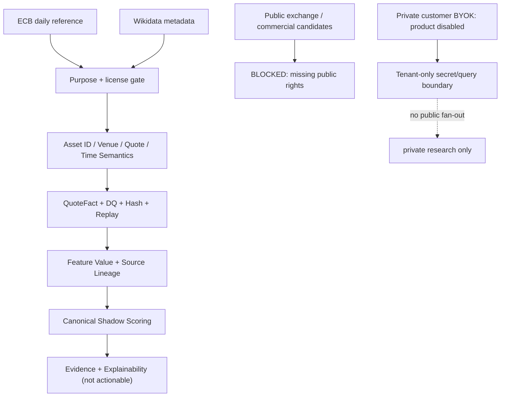

# PROVIDER-CATALOG — Financial Intelligence Sources & Rights

> **Statische Code-Evidence, 2026-10-11.** Baseline: [main@6b13ed9c0c54](https://github.com/SvenKulessa/Capital-AI/tree/6b13ed9c0c54c1497ce20e2fa0e0a8a3378d89b9). Autorität: [AGENTS.md](https://github.com/SvenKulessa/Capital-AI/blob/6b13ed9c0c54c1497ce20e2fa0e0a8a3378d89b9/AGENTS.md) (`SOLO_MAINTAINER_FLOW@1`). Ein Eintrag im Katalog bestätigt weder aktive Runtime noch kommerzielle Providerrechte. Status `VERIFIED` bezeichnet nur explizit geprüften Quellcode; Runtime, Vertragsrechte, Quotas und Zahlungen ohne separaten Nachweis: `NOT_PROVEN`.

## Entscheidend: Vier unabhängige Provider-Sichten

1. [`server/open-source-market-policy.mjs`](../server/open-source-market-policy.mjs) ist der **verbindliche Source-Admission-Pfad** für öffentliche Marktdaten. Code-Admission ≠ überprüfte Production-Antwort.
2. [`src/config/providers/providerRegistry.ts`](../src/config/providers/providerRegistry.ts) enthält **fünf konfigurative Providerverträge** für Fähigkeiten/Health/Budget; ein `healthy`-Default ist kein gemessener Health-Status.
3. [`src/config/providers/privateByokCatalog.ts`](../src/config/providers/privateByokCatalog.ts) führt **20 Private-BYOK-Kandidaten** (`active` bedeutet Credential-Adapter-Katalogstatus; **nicht** Produktfreigabe). **Aktueller beauftragter Produktscope: BYOK deaktiviert; keine Kunden-Provideraktivierung.**
4. [`server/oss-provider-adapters.mjs`](../server/oss-provider-adapters.mjs) führt **vier Software-Sidecars**; deren Open-Source-Lizenz ersetzt **keine** Marktdatenlizenz.

## Rechte- und Laufzeitmatrix (Source-Prüfung, keine externe Vertragsbescheinigung)

| Provider-ID | Quelle | Asset-Umfang | Public Source Admission | Daten-/Ausgaberechte | Frequenz | Quellanker |
|---|---|---|---|---|---|---|
| ecb-reference-rates | ECB-Referenzkurse | Referenz-FX | Quelle im Public Rights/Admission-Policycode admitted | Information und Reference; keine Ausführung | daily/reference,  nicht realtime | `server/ecb-reference-rates.mjs` |
| wikidata-reference | Wikidata | Instrument-Metadaten | Source-Policy admitted | Reference Metadata only, keine Marktkurse | snapshot/reference | `server/open-source-market-policy.mjs` |
| binance | Binance | Crypto Spot, WS/REST | Public legacy BLOCKED (separate private catalog active) | Display/Redistribution NOT_PROVEN | realtime candidate | `server/spot-provider-wire.mjs` |
| kraken | Kraken | Crypto Spot, WS/REST | Public legacy BLOCKED (separate private catalog active) | Display/Redistribution NOT_PROVEN | realtime candidate | `server/spot-provider-wire.mjs` |
| twelvedata | Twelve Data | Equity/Index/FX candidate | Public legacy BLOCKED; private planned | Display/Derived/Hosting NOT_PROVEN | candidate | `src/config/providers/providerRegistry.ts` |
| massive / polygon | Massive (ex Polygon) | Private Equity/Asset Batches | Public legacy BLOCKED; private catalog active | User/plan bound, no public redistribution | private | `server/private-market-batch.mjs` |
| financialdatanet, yfinance, coingecko | Historical/Legacy Sources | various | Public blockedLegacyProviderPaths | NOT_PROVEN | legacy | `server/open-source-market-policy.mjs` |

**Wichtige ECB-Grenze:** `ecb-reference-rates` hat im Repo explizite Rights-/Runtime-Admission-Verweise und `marketQuotes=true`, `scoringPriceInput=true`, aber `realtime=false`, `executionPrice=false`, `decisionEligible=false`. `MARKET_QUOTES_ENABLED` und `MARKET_ECB_REFERENCE_RATES_ENABLED` schalten tatsächliches Ingress bedingt frei. Source-Admission ist nicht gleich aktueller Runtime-Readback.

### Fünf konfigurative Provider (nicht mit admittedSources verwechseln)

| Registry-ID | Name | Funktion | Reale Berechtigung/Laufzeit |
|---|---|---|---|
| `binance_market_data` | Binance Market Data Engine | Konfigurations-/Health-Schema (kein Live-Beweis) | `NOT_PROVEN` |
| `twelve_data_market` | TwelveData Financial Feeds | Konfigurations-/Health-Schema (kein Live-Beweis) | `NOT_PROVEN` |
| `kraken_websocket` | Kraken Financial Ingestion | Konfigurations-/Health-Schema (kein Live-Beweis) | `NOT_PROVEN` |
| `fred_stlouis_fed` | Federal Reserve Bank of St. Louis (FRED) | Konfigurations-/Health-Schema (kein Live-Beweis) | `NOT_PROVEN` |
| `alchemy_ethereum_rpc` | Alchemy Supernode RPC | Konfigurations-/Health-Schema (kein Live-Beweis) | `NOT_PROVEN` |

`src/contracts/analysisComponentRegistryValidator.ts` mappt die Aliasse `binance→binance_market_data`, `kraken→kraken_websocket`, `twelvedata→twelve_data_market`, `fred→fred_stlouis_fed` und `alchemy→alchemy_ethereum_rpc`. Aliasauflösung ist **keine** Production-Admission.

### Private BYOK — vorhandene 20 Einträge, aktuelle Produktoberfläche deaktiviert

| ID | Name | Typ | Code-Katalogstatus | Kunden- und Verteilungsrechte |
|---|---|---|---|---|
| `kraken` | Kraken | Crypto-Börsen | `active` im Quellkatalog | `BLOCKED` Produktbetrieb, Rechte `NOT_PROVEN` |
| `binance` | Binance | Crypto-Börsen | `active` im Quellkatalog | `BLOCKED` Produktbetrieb, Rechte `NOT_PROVEN` |
| `coinbase` | Coinbase Advanced | Crypto-Börsen | `planned` im Quellkatalog | `BLOCKED` Produktbetrieb, Rechte `NOT_PROVEN` |
| `bitstamp` | Bitstamp | Crypto-Börsen | `planned` im Quellkatalog | `BLOCKED` Produktbetrieb, Rechte `NOT_PROVEN` |
| `bybit` | Bybit | Crypto-Börsen | `planned` im Quellkatalog | `BLOCKED` Produktbetrieb, Rechte `NOT_PROVEN` |
| `okx` | OKX | Crypto-Börsen | `planned` im Quellkatalog | `BLOCKED` Produktbetrieb, Rechte `NOT_PROVEN` |
| `alpha_vantage` | Alpha Vantage | Aktien & Marktdaten | `planned` im Quellkatalog | `BLOCKED` Produktbetrieb, Rechte `NOT_PROVEN` |
| `twelve_data` | Twelve Data | Aktien & Marktdaten | `planned` im Quellkatalog | `BLOCKED` Produktbetrieb, Rechte `NOT_PROVEN` |
| `finnhub` | Finnhub | Aktien & Marktdaten | `planned` im Quellkatalog | `BLOCKED` Produktbetrieb, Rechte `NOT_PROVEN` |
| `financial_modeling_prep` | Financial Modeling Prep | Aktien & Marktdaten | `planned` im Quellkatalog | `BLOCKED` Produktbetrieb, Rechte `NOT_PROVEN` |
| `massive` | Massive (Polygon.io) | Aktien & Marktdaten | `active` im Quellkatalog | `BLOCKED` Produktbetrieb, Rechte `NOT_PROVEN` |
| `tiingo` | Tiingo | Aktien & Marktdaten | `planned` im Quellkatalog | `BLOCKED` Produktbetrieb, Rechte `NOT_PROVEN` |
| `eodhd` | EODHD | Aktien & Marktdaten | `planned` im Quellkatalog | `BLOCKED` Produktbetrieb, Rechte `NOT_PROVEN` |
| `marketstack` | Marketstack | Aktien & Marktdaten | `planned` im Quellkatalog | `BLOCKED` Produktbetrieb, Rechte `NOT_PROVEN` |
| `fred` | FRED | Makro & Referenzdaten | `planned` im Quellkatalog | `BLOCKED` Produktbetrieb, Rechte `NOT_PROVEN` |
| `nasdaq_data_link` | Nasdaq Data Link | Makro & Referenzdaten | `planned` im Quellkatalog | `BLOCKED` Produktbetrieb, Rechte `NOT_PROVEN` |
| `coingecko` | CoinGecko | Crypto-Daten | `planned` im Quellkatalog | `BLOCKED` Produktbetrieb, Rechte `NOT_PROVEN` |
| `coinmarketcap` | CoinMarketCap | Crypto-Daten | `planned` im Quellkatalog | `BLOCKED` Produktbetrieb, Rechte `NOT_PROVEN` |
| `cryptocompare` | CryptoCompare | Crypto-Daten | `planned` im Quellkatalog | `BLOCKED` Produktbetrieb, Rechte `NOT_PROVEN` |
| `alchemy` | Alchemy | Web3 / RPC | `planned` im Quellkatalog | `BLOCKED` Produktbetrieb, Rechte `NOT_PROVEN` |

**Einordnung:** `active` ist ausschließlich der Backend/Credential-Capability-Status einzelner privater Adapter; private Schlüssel und Abfrageantworten dürfen niemals über öffentliche Quote- oder Scoring-Feeds, gemeinsamen Cache oder ein Shared-Event-Bus verarbeitet werden. Credential Storage, Verify, Query, Provider-Limits und Tarif-Scopes sind eigene Grenzen. Es liegt keine pauschale Hosting-, Display-, Redistribution-, Derived-Data-, Backtest- oder Commercial-Lizenz vor.

### OSS-Softwareadapter (keine Datenquellen-Admission)

| Sidecar | Schnittstelle | deklarierte Softwarelizenz | Datenberechtigung |
|---|---|---|---|
| CCXT | REST / WebSocket | MIT | `NOT_PROVEN`, Admission erforderlich |
| Hummingbot | REST / WebSocket | Apache-2.0 | `NOT_PROVEN`, Admission erforderlich |
| Cryptofeed | WebSocket | AGPL-3.0-or-later | `NOT_PROVEN`, Packaging-/Copyleft-Prüfung |
| OpenBB | REST | Apache-2.0 | `NOT_PROVEN`, Quelldataset-Lizenzen separat |

Quelle: [`server/oss-provider-adapters.mjs`](../server/oss-provider-adapters.mjs).

## Vollständige referenzierte Abhängigkeitsnamen aus den 50 Komponenten

`alphavantage`, `binance`, `coinbase`, `financialmodelingprep`, `fred`, `gemini`, `internal_consensus_engine`, `internal_master_data`, `kraken`, `sec_edgar`, `twelvedata`.

Diese 11 Namen sind **Abhängigkeiten, keine aktiven oder lizenzierten Feeds**. Beispiele ohne korrespondierenden öffentlichen admitted Provider: Gemini-News/Sentiment, SEC/EDGAR, FRED, FMP, internal_master_data, internal_consensus_engine. Die tatsächlichen Rechte gelten immer **pro Dataset, Instrument, Venue, Zweck, Egress und Vertrag**; eine API-Erreichbarkeit ist dafür kein Ersatz. Finance-Research-Quellen erscheinen ergänzend in [`src/platform/FinanceScoringResearch/FinanceSourceModelCatalog.ts`](../src/platform/FinanceScoringResearch/FinanceSourceModelCatalog.ts); das ist **eine Modellliste, keine Provider-Lizenzliste**.

## Provider → Canonical Data → Scores

Textalternative: nur zugelassene Datenquellen erreichen öffentliche Normalisierung; privater BYOK-Verkehr bleibt isoliert und wird nicht zur allgemeinen Marktdatenversorgung.

## Verträge und Kosten — vor Aufnahme eines neuen Providers je Capability zu erfassen

| Dimension | Required Input zum technischen Urteil | Ungeklärter Stand |
|---|---|---|
| Recht | Tarif/vertragliche Datenkategorie, Public Display, Mobile, Hosting, Cache/Retention, Replay, Redistribution, Derived Analytics, Non-Display, Backtesting | `NOT_PROVEN` für nicht ausdrücklich zugelassene Quellen |
| Mapping | Canonical Instrument-ID, Assetklasse, Venue, Base/Quote, Unit/Scale, Corporate Actions und PIT | Quelle prüfen |
| Time | Observed/Received/Published/Reference Date; realtime/delayed/reference/historical | Quelle prüfen |
| Qualität | Sufficiency, Missingness, Freshness, Latency, Sequenz, Providerabweichung, Liquidität | Keine erfundenen SLAs |
| Security | Public vs Private, Tenant Binding, Request Limits, Key/Secret-Exposure | Fail-closed |
| FinOps | Free-/Paid-Tarif, Calls/Credits, Egress, Seats, Cloud/GPU, Rate-Limit/Overage und Restquote | Preise/Quotas `NOT_PROVEN`; **keine Aktivierung** |

Keiner der fünf Kataloge führt kostenpflichtige Provider-/Cloud-Ressourcen ein. Reine Dokumentation verbraucht nur bestehende Repository-/CI-Ressourcen; verbleibende Freikontingente `NOT_PROVEN`. Finanzrechtliche Anbieter-/Analysedienste werden nur für den tatsächlich veröffentlichten Produktumfang eingeordnet.

## Prüfkriterien

- Produktions-Marktdaten nur, wenn `isAdmittedMarketSource(provider, capability)` plus Instrument/Rechte/Time-Semantics und aktuelle Runtime-Evidence übereinstimmen.
- Keine Vermischung von `BTCUSD` und `BTCUSDT`, Reference-FX und Execution-Quote, Provider-Alias und -Lizenz.
- Ein vermeintlich `active` BYOK-Katalogeintrag setzt **keinen** Kunden-Key-Dialog, Shared-Cache-Feed, öffentlichen Score oder Tarif frei.
- Neue Provider nur nach belegter Zweck-/Dataset-Rechteprüfung und Kosten-/Quota-Schätzung; keine kostenwirksame Aktivierung ohne Owner-Entscheidung.
