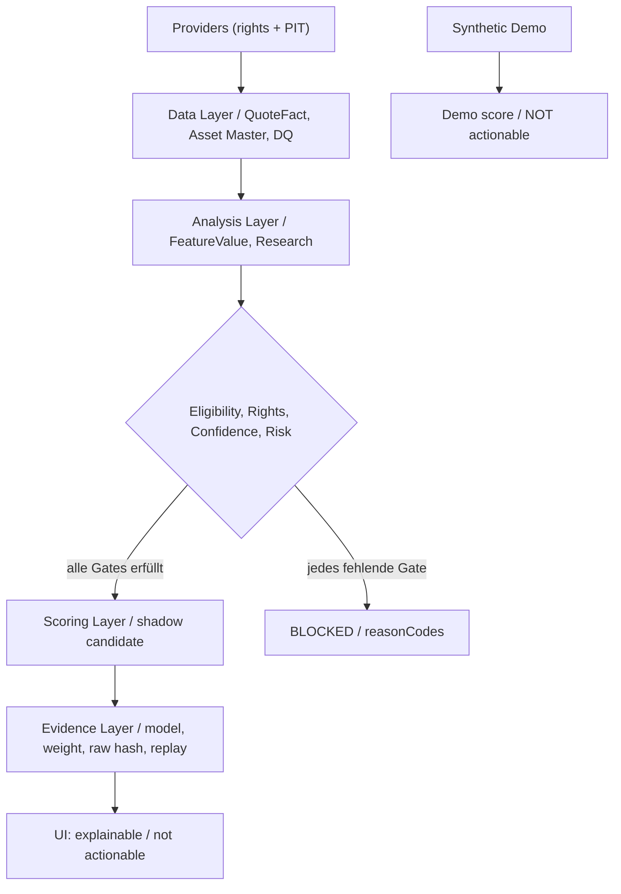

# SCORING-CATALOG — Scores, Gewichte, Formeln und Evidence

> **Source-derived / Dokumentationsstand 2026-10-11.** Baseline: [main@6b13ed9c0c54](https://github.com/SvenKulessa/Capital-AI/tree/6b13ed9c0c54c1497ce20e2fa0e0a8a3378d89b9); Autorität: [AGENTS.md](https://github.com/SvenKulessa/Capital-AI/blob/6b13ed9c0c54c1497ce20e2fa0e0a8a3378d89b9/AGENTS.md). `VERIFIED` = geprüfter Source-Code; produktiver Betrieb, externe Providerrechte, Tarife, Handelssignale, Return-Claims und Live-Backtests sind ohne externe Evidence `NOT_PROVEN`. Diese Dateien fügen **keinen** zweiten Scorer, kein Runtime-Gate und keine Produktfreischaltung hinzu.

## Scoring Authority und Taxonomie

- **Kanonische Score-Authority:** [`src/services/scoringEngine.ts`](../src/services/scoringEngine.ts); `ScoringEngineService.MODEL_VERSION = 4.0.0`, Shadow-Modell `1.0.0`. Quelle und Ausgabe müssen über Contracts/Policy laufen. Ein zweiter produktiver Scoring-Dispatcher wird nicht geschaffen.
- **50 Registry-Komponenten:** siehe [COMPONENT-CATALOG](COMPONENT-CATALOG.md). 45 `planned`, 5 `blocked`; kein live validierter Lifecycle; ihre `defaultWeight`-Metadaten sind **nicht** die hier ausgewiesenen Kompositgewichte. Einzelne Registry-Featureformeln sind `NOT_PROVEN`.
- **Zehn Finance-Source-Modelle:** [`FinanceSourceModelCatalog.ts`](../src/platform/FinanceScoringResearch/FinanceSourceModelCatalog.ts) enthält Source-Champions/Challengers. **Alle** Einträge werden mit `capitalProductionEligible=false`, `capitalScoreEligible=false` exportiert.
- Zusätzlich vorhanden: Commodity- und Sovereign-Research-Evidence-Scorer, DeFi-/Meme-Research, deterministic `realMarketSignals`, Sentiment-Evidence-Projection, Feature-Fingerprint und Scoring-Integrity. Modellcode ist weder eingehendes Live-Dataset noch Modellkalibrierung.
- Ergebnisstatus in Public-UI: Demo/Unavailable und ggf. modellinterne Research-Outputs; **keine verifizierte, actionable Cross-Sectional-Rangliste**.

## Kanonisches Layer-Modell



Textalternative: Provider → Data → Analysis → Rights-/DQ-/Risk-Gates → Shadow-Scoring → Evidence → UI. Fehlerhafte/ungedeckte Daten führen zu Reason Codes statt erfundenem Score.

## 1. Shadow-Score v1 (Baseline, nicht kalibriert)

Quelle: [`src/config/shadowScoreConfig.ts`](../src/config/shadowScoreConfig.ts) und `computeShadowScore` in [`src/services/scoringEngine.ts`](../src/services/scoringEngine.ts).

| Assetklasse, 1d, baseline | Momentum | Technical | Fundamental | Sentiment | Event | Positioning | Σ |
|---|---:|---:|---:|---:|---:|---:|---:|
| Crypto | 0.25 | 0.20 | 0.10 | 0.20 | 0.10 | 0.15 | 1.00 |
| Equity US | 0.15 | 0.20 | 0.35 | 0.10 | 0.10 | 0.10 | 1.00 |
| Equity EU | 0.15 | 0.20 | 0.35 | 0.10 | 0.10 | 0.10 | 1.00 |

Die sechs normierten Shadow-Eingangsfeatures sind `rsi_14`, `vwap_deviation_bps`, `piotroski_f_score`, `sentiment_polarity_gemini`, `event_impact_score`, `orderbook_imbalance_ratio_l2`. Sie sind **Konfigurationsreferenzen** — keine Behauptung, dass alle Provider-Featurewerte verfügbar wären.

```text
confidence = min(
  requiredInputsPresent / requiredInputsExpected,
  min(qualityScore / 100),
  min(max(0, 1 - dataAge / configuredMaxAge)),
  min(1 - providerNormalizedSpread / 100)
)
riskPenalty = min(40, Σ over six risk-families (risk_i × riskWeight_i))
candidateScore = clamp_0_100(
  Σ over six families (normalizedFamilyScore_i × weight_i × confidence)
  - riskPenalty
)
candidateScore = null bei fehlender Eignung, Demo, Rights oder DQ.
```

| Qualitätsdimension | Konfigurierter Policywert | Interpretation |
|---|---:|---|
| `minimumConfidence` | 0.90 | Kein Score darunter |
| `minQualityScore` | 90 / 100 | Einzelner erforderlicher Input |
| `minimumProvidersPerFeature` | 2 | pro Feature, nicht zwei symbolisch unterschiedliche Namen |
| `maxNormalizedDisagreement` | 10 / 100 | Abweichung der Provider-Features |
| `maxRiskScore` | 75 / 100 | Veto jenseits des Maximums |
| `riskPenaltyCeiling` | 40 / 100 | Deckelung |
| `productionApproved` | `false` | Shadow-Only |
| `providers` | `[]` | Keine standardmäßig aktivierte Providerroute |

Risikogewichte: Liquidity 0.20, Spread 0.20, Volatility 0.15, Event 0.15, Integrity 0.15, Manipulation 0.15 (Σ = 1.00). Hard Gates: `market_integrity_pass`, `liquidity_eligible`, `tradability_pass`. Zusätzliche Gates: Zeitordnung, Asset-ID, Source/License, RawReferences, gleiche Feature-Einheit, Mindest-Providerzahl, Nichtduplizierung und `observedAt ≤ evaluatedAt`. **Der zurückgegebene Shadow-Rank bleibt `null`, `eligibility=false`, `publishable=false`.**

## 2. FinalRank-Projektion v4 (kein produktiver Rank)

Quelle [`ScoringEngineService.getWeightProfile`](../src/services/scoringEngine.ts).

| Assetklasse | Momentum | Technical | Fundamental | Sentiment | Event | Positioning |
|---|---:|---:|---:|---:|---:|---:|
| Crypto | 0.25 | 0.20 | 0.10 | 0.20 | 0.10 | 0.15 |
| Equity US / EU | 0.15 | 0.20 | 0.35 | 0.10 | 0.10 | 0.10 |
| Forex / Commodities | 0.20 | 0.30 | 0.05 | 0.15 | 0.20 | 0.10 |
| Other / Default | 0.20 | 0.25 | 0.20 | 0.15 | 0.10 | 0.10 |

```text
riskPenalty = min(40,
  round(max(0, botRisk - 20) * 0.4
      + max(0, spreadRisk - 20) * 0.4))
weighted = Σ(subScore_i × classWeight_i)
finalScore = clamp_0_100(round(weighted × confidence - riskPenalty))
             NUR falls canCompute; andernfalls null.
```

Der Code setzt bei Non-Demo `EVIDENCE_REPLAY_UNAVAILABLE` und prüft nicht aktive Registry-Gates. Die Ausgabe hat in jedem Fall `scoreEligible=false`, `rankEligible=false`, `decisionEligible=false`, `rank=null`. Ein mögliches `demo_fallback` ist **synthetisch und nicht handelbar**, keine Prognose.

## 3. Finance-Source Research Modelle (zehn)

| Source Model ID | Version | Assets | Rolle | `sourceScoreEligible` | `capitalScoreEligible` |
|---|---|---|---|---|---|
| `crypto-technical-provenance` | 0.7.0 | crypto | champion | `true` im *Source*-Modell | `false` |
| `crypto-meme-integrity` | 0.3.0 | crypto | challenger | `false` im *Source*-Modell | `false` |
| `crypto-defi-fundamental` | 0.3.0 | crypto | challenger | `false` im *Source*-Modell | `false` |
| `traditional-scoring` | 2.1.0 | stock/forex/index | champion | `true` im *Source*-Modell | `false` |
| `commodity-evidence-scoring` | 1.0.0 | commodity | champion | `true` im *Source*-Modell | `false` |
| `commodity-energy-hybrid` | 0.1.0 | commodity | challenger | `false` im *Source*-Modell | `false` |
| `commodity-industrial-metals-hybrid` | 0.1.0 | commodity | challenger | `false` im *Source*-Modell | `false` |
| `commodity-precious-metals-hybrid` | 0.1.0 | commodity | challenger | `false` im *Source*-Modell | `false` |
| `commodity-agriculture-hybrid` | 0.1.0 | commodity | challenger | `false` im *Source*-Modell | `false` |
| `sovereign-benchmark-yield-scoring` | 1.0.0 | bond | champion | `true` im *Source*-Modell | `false` |

Die vier Commodity-Kategorie-Challenger, Meme und DeFi bleiben **Research-only**. Die Source-Kennzeichnung `champion` ist eine modellinterne Aliasrolle und erteilt weder eine Capital-AI-Publishing-Freigabe noch Providerrechte. Ein ausführbarer Source-Champion kann zugleich in CAPITAL-AI blockiert sein. Die explizite negative Produktionsprojektion ist auf [`FINANCE_SOURCE_MODEL_CATALOG`](../src/platform/FinanceScoringResearch/FinanceSourceModelCatalog.ts) zurückzuführen.

## 4. Traditional Research-Faktoren und tatsächlich deklarierte Gewichte

Quelle: [`src/platform/FinanceScoringResearch/FinanceFactorWeights.ts`](../src/platform/FinanceScoringResearch/FinanceFactorWeights.ts), `composeFinanceResearchFactors` mit strikter Faktorliste und EvidenceRefs.

| Profil | Faktoren und Nominalgewicht | Ergebnisstatus |
|---|---|---|
| Stock | trend .18 · momentum .14 · breakout_quality .10 · volatility_quality .10 · relative_strength .13 · value .15 · dividend .08 · quality .12 | RESEARCH_READY / RESEARCH_PARTIAL, nicht scoreEligible |
| Forex / Index | trend .30 · momentum .25 · breakout_quality .15 · volatility_quality .15 · relative_strength .15 | gleicher Research-Vertrag |
| Commodity | trend .30 · momentum .25 · breakout_quality .20 · volatility_quality .25 | gleicher Research-Vertrag |
| Sovereign Yield Benchmark | yield_level_percentile .45 · yield_trend .30 · yield_stability .25 | gleicher Research-Vertrag; keine Einzelanleihe |

```text
present = { i | value_i ist finite und zulässig }
effectiveWeight_i = nominalWeight_i / Σ(nominalWeight_j, j∈present)
researchComposite = Σ(value_i × effectiveWeight_i, i∈present)
researchComposite = null, wenn present leer.
```

Fehlende Faktoren werden in `missingFactors`, Faktor-/Gewichts-Fingerprints und EvidenceRefs festgehalten. Eine **vollständige** Menge kennzeichnet `RESEARCH_READY`; das ist nicht dasselbe wie `productionEligible`.

## 5. Bereits implementierte deterministische Primitive

Quelle [`realMarketSignals.ts`](../src/platform/FinanceScoringResearch/realMarketSignals.ts). Diese Funktionen können bei echten, korrekt zugelassenen Daten Werte berechnen, **aktivieren aber keine Registry-Komponente automatisch**.

| Signal | Input | Mathematische Formelbasis | DQ / Grenze |
|---|---|---|---|
| Market Cap | USD market cap | `clamp((log10(cap)-4)/(12.3-4)*100)` | endlich und `>0` |
| Liquidity | USD volume, USD cap | `clamp((volume/cap)/0.30*100)` | cap `>0`; Turnover ≠ Orderbook Depth |
| Tokenomics | circulating/max supply | `clamp(circulating/max*100)` | beide positiv |
| Regime | Change 24h % | `clamp(50+3*change)` | einfache Heuristik |
| Trend | letzter Kurs / SMA | `clamp(50+2*((last/sma)-1)*100)` | `sma > 0`; sonst neutraler Fallback |
| Momentum | ROC % | `clamp(50+1.5*roc)` | vollständiges Fenster |
| Breakout | Last, High, Low | `clamp((last-low)/(high-low)*100)` | `high > low`; sonst neutral |
| Volatility | Tages-Std. log returns % | `clamp(stdevPct/15*100)` | min. drei Preise für gültige log-return-Varianz |
| RSI | Kursdifferenzen | `100-100/(1+avgGain/avgLoss)` | min. drei Kurse; Nullverlust-Fall = 100 |
| Weighted Subscore | belegte Faktorwerte/-gewichte | `Σ(value_i×w_i) / Σ(w_i verfügbar)` | fehlende Werte ausgeschlossen; fehlende volle Evidence = keine Produktion |

**Commodity** verwendet einen konkreten technischen 4-Faktor-Market-Evidence-Scorer mit mindestens 20 History-Punkten und max. 7 Tagen Evidence-Alter: [`commodityEvidenceScoring.ts`](../src/platform/FinanceScoringResearch/commodityEvidenceScoring.ts). **Sovereign** bewertet Yield-Level-Perzentil (.45), Yield-Trend (.30) und Yield-Stability (.25) nach gleichem History-/Age-Gate: [`sovereignBenchmarkEvidenceScoring.ts`](../src/platform/FinanceScoringResearch/sovereignBenchmarkEvidenceScoring.ts). Diese historischen Source-Contracts enthalten `scoringEnabled=true`; das überschreibt **nicht** Capital-AI-Capability- und Publication-Gates.

## 6. Quantität, Data Quality, Reproduzierbarkeit

Ein bewertbarer Datensatz benötigt Quelle/Instrument/Venue/Unit, genaues Evaluation-`asOf`, `observedAt`/`receivedAt`/`publishedAt`, Rights-Evidence, Dataset-Vintage, Availability/Null-Semantik, `featureContractVersion`, Modell- und Gewichtversion, `effectiveWeightFingerprint`, Input-IDs, `reasonCodes` und Reproduktions-Test.

| Prüffeld | Erwartung | Ohne Beleg |
|---|---|---|
| Time / PIT | niemals Information verwenden, die erst nach `asOf` verfügbar war | BLOCKED |
| Provider Agreement | Vergleich nur bei gleicher Instrument-/Währungs-/Venue-Semantik | BLOCKED |
| No leakage | Walk-forward / held-out / vintage korrelierbar | `NOT_PROVEN` |
| Missing features | Null ≠ 0; effektive Renormierung nur dort, wo vertraglich zulässig | BLOCKED oder PARTIAL |
| Robustness | Turnover, Slippage, Kosten, Drawdown, Sensitivität dokumentieren | `NOT_PROVEN` |
| Claims | keine realen Renditen, SLAs, Precision oder Live-Score ohne Messung | BLOCKED |

## Abnahmekriterien und Alternativen

- **Minimal-invasiv (gewählt):** bestehende Score-Authority und Source-Contracts dokumentieren, alle Model-Aliasse und Fail-Closed-Vetos belassen. Keine Token-, GPU-, Lizenz- oder Cloud-Kosten neu ausgelöst.
- **Spätere Option:** vollständig kalibrierte, snapshotgebundene Research-Pipeline mit separater Datensatz-/Lizenzkostenrechnung und Walk-Forward-Evidence. Kosten, Source Availability und regulatorischer Produkt-Scope derzeit `NOT_PROVEN`.
- Formeln und Gewichte auf die Code-Pfade abbilden; gewollte Null-/Veto-Fälle reproduzieren, **keine** Score-Activation aus Dokumentations-PASS ableiten.

Weiter: [Komponenten](COMPONENT-CATALOG.md) · [Provider](PROVIDER-CATALOG.md) · [Blueprints](BLUEPRINT-CATALOG.md) · [Learning](LEARNING-PATHS.md).
