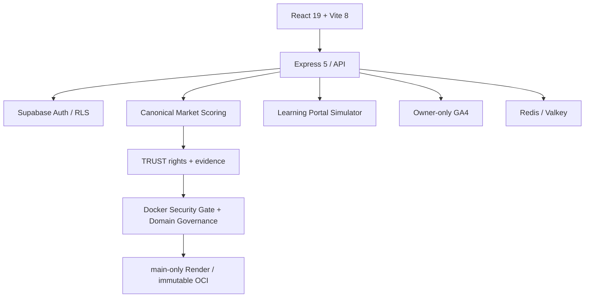

# CAPITAL-AI Strategy 2026: Solo Maintainer v2

Status: design + read-only correlation, NOT_PROVEN for production SLOs or releases.
Baseline main: 0c67045a31d520ea4dd71b8bbcd7d45505828ccb (2026-11-19).
Policy: root AGENTS.md / SOLO_MAINTAINER_FLOW@2. No new Required Checks or permissions.

## 1. Architecture



Design choice: incrementally extend the existing modular monolith; do not replace Vite with Next.js 15, add tRPC gateway, or introduce parallel app auth without isolated contract/performance evaluation. The current stack is Node 26.13.1 pinned in Dockerfile, React 19.3.x, TypeScript 6.0.3, Vite 8.3.x and Express 5.3.x. New framework versions are not implicitly installed.

## 2. Performance, reliability, security

Targets (not measured): p95 TTFB under 800ms and >=99.9% monthly availability. In 30 days, 99.9% permits 43.2 minutes downtime. Measure externally by region, plus 5xx, API p95, synthetic availability and recovery. Cache keys include tenant, user, permission version, source/version, schema and data rights. Never cross-tenant share private cache. Supabase Realtime sends invalidation signals; durable state stays in Postgres.

OWASP Top 10:2025 is the current OWASP project baseline in November 2026. Enforce verified server auth, RLS, existing CSP, ingress/shared rate limits and source/license provenance. Agent IAM: short-lived scoped credentials, explicit owner-only mutations, no client exposure. Continue existing image digest, Trivy, SBOM, attestation and CodeQL checks.

## 3. Existing and new project structure

Existing: AGENTS.md, .agents/skills/registry.json, .github/workflows/build-security.yml, .github/workflows/domain-governance.yml, server/index.mjs, server/security-headers.mjs, server/api-rate-policy.mjs, src/components/HeroEarth3D.tsx, src/components/BrandGlobe.tsx, src/features/learning/FinancialLearningSimulator.tsx, supabase/migrations, Dockerfile.

New:
- scripts/architecture/strategy-2026-pr-correlation.mjs: read-only deterministic PR overlap.
- scripts/architecture/strategy-2026-pr-correlation.test.mjs: positive/negative coverage.
- scripts/architecture/fixtures/open-prs-20261119.json: observed snapshot, not current authority.
- docs/architecture/CAPITAL-AI-STRATEGIE-2026.md: this document.
- docs/architecture/sql/learning-certificates-candidate.sql: non-applied migration candidate.
- docs/architecture/examples/ci-template.yml: documentation example only.
- contracts/strategy2026/learning-certificate.openapi.yaml: future API contract, not running service.

## 4. CI/CD

There is no .github/workflows/ci.yml in this repo. Preserve existing build-security.yml and domain-governance.yml with their active Required Checks. Existing build-security.yml uses pinned actions, npm ci, image scans, SBOM and registry-digest attestations; candidate publishing is explicitly main-only. No second build/publish workflow. Do not import the illustrative CI example into active Actions without proving a gap. Existing rulesets and production evidence remain binding. npm ci is the npm lockfile-frozen command; --frozen-lockfile is not the intended npm flag.

## 5. Database schema

Certificate candidate is private, with auth.users foreign key, assessment version, proof hash, issuer key identifier, revocation and service-role-only table grants. This SQL is NOT in supabase/migrations. Before production: prove verified session and tenant binding, genuine assessment, idempotent issuance, issuer signature verification, backup/restore, RLS and privacy retention. A handwritten-looking image is not a cryptographic or legal signature.

## 6. Feature/API roadmap

- GA4 (#819, #841, #842): correlate shared BFF and Docker files; consent/owner-only.
- Solana risk (#834, overlaps #714 on package.json): retain canonical ScoringEngineService and market-data rights gating.
- Evidence Audit (#815): keep evidence JSON/PDF engine and negative tests in existing PR.
- Android scorer: no open PR in this 12-PR Capital-AI snapshot; use separate versioned DeviceCare contract and data minimization.
- Landing, Buddy, 3D Earth: reuse BrandGlobe and HeroEarth3D, seven-color Universe style; poster fallback, reduced motion, GPU/context-loss tests.
- Simulator: already exists under src/features/learning/FinancialLearningSimulator.tsx with entitlements; no duplicate.
- Certificate: future signed, revocable, evidence-bound certificate, with contract-only schema.
- Monetization: integrate B2B lead consent/measurement only after #821 and owner-controlled licensing evidence.

## 7. Twelve open PRs, six file-overlap edges

#714/#834 (package.json); #810/#826, #810/#840, #826/#840 (roadmap JSON);
#819/#842 (GA4 server+test+panel); #841/#842 (build-security.yml).
Shared file does not establish an actual merge conflict. The read-only script refuses to imply merge eligibility.

Run:
```bash
node --test scripts/architecture/strategy-2026-pr-correlation.test.mjs
node scripts/architecture/strategy-2026-pr-correlation.mjs scripts/architecture/fixtures/open-prs-20261119.json
```

Fresh PR readback and applicable per-PR gates are mandatory before individual merges. Runtime, provider rights, certificate issuance, live SLAs and all 12 PR integrations remain NOT_PROVEN.

## Branch

Requested feature/strategie-ci-cd-solo-maintainer-2-2026 would fail the existing Domain Governance regex.
Compliant: capital-ai-platform/strategie-ci-cd-solo-maintainer-2-20261119.
Suggested title: [CAPITAL-AI-PLATFORM] Strategy 2026 architecture and PR correlation.
