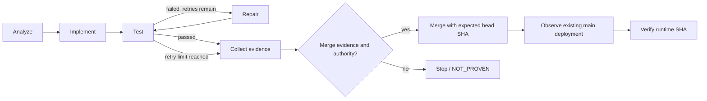

# CAPITAL-AI execution-first LangGraph loop

This is an **actual Python LangGraph StateGraph** that reuses the pinned, existing
`scripts/growth-agent/requirements.lock`; it does not introduce a second agent
framework, production worker, paid provider, new required check or scheduler.

`auto_loop.py` provides `Authority`, `build_graph(actions, authority)` and
`execute(actions, authority, task_id)`. A **trusted, separately authorized**
caller injects adapters with methods:
`analyze`, `implement`, `test`, `repair`, `evidence`, `merge`,
`observe_deployment` and `verify_runtime`.

State flow:



**Security/authorization.** No action is executed without injected callbacks.
`Authority` is trusted and immutable, never inferred from a PR, chat message,
LLM output, tool response or graph state. Its defaults deny all writes, merges
and deployment observation. An explicit read-only mandate wins even when
other booleans are true. The merge node requires **positive** current base/head
SHA evidence, both existing Required Checks, all applicable checks, a mergeable
current main, no HOLD, complete scope and cleared risk boundaries. The caller's
`merge` adapter must use GitHub `expected_head_sha` and report the used
head SHA; the loop verifies the returned acknowledgement. No ruleset bypass.
Absent checks, invalid responses and callback exceptions fail closed.

**Deployment.** The loop never triggers a manual Render deployment. It can
follow the existing main-merge auto-deployment (when explicitly enabled) and
compare the observed deployed SHA with the actual merge SHA before checking
runtime health. `VERIFIED` requires trusted runtime evidence; successful
repository tests alone never imply a live release.

**Durable single-worker checkpointing (optional).**
`execute_durable(actions, authority, task_id, absolute_private_sqlite_path)`
uses the pinned official `SqliteSaver`, private local SQLite files, a
nonblocking OS file lock and stable LangGraph `thread_id`. Re-running the
same finished task returns its persisted state without replaying merge/deploy.
An interrupted graph with pending nodes continues from its checkpoint. Regression tests explicitly pause after implementation and before merge, close the SQLite connection, then resume with a fresh graph and revoked permissions.
The merge node re-evaluates the *current* authority, and the provider adapter
independently revalidates current GitHub evidence and reconciles a merge
completed immediately before a crash. A checkpoint alone is **not** merge
authorization. No database should contain API tokens or private provider
payloads. The local SQLite file must live on persistent trusted storage, never
inside ephemeral Render containers. This is a single-writer solution, not a
distributed worker, scheduler or exactly-once transaction across providers.

**Bounded retries/checkpointing.** At most 0–3 repairs (default two) and a
fixed recursion limit; failed checks stop rather than looping forever.
The default legacy `execute()` keeps its per-invocation in-memory saver for
backward compatibility. `execute_durable()` is the opt-in persistent path.
A scheduled, always-running agent still requires a separately provisioned
and explicitly authorized trusted worker; no new production service is activated.

**Tests:** `python3 -m unittest discover -s scripts/growth-agent -p 'test_*.py'`
using the existing pinned requirements. The existing Google Maintenance and
Local Growth Graph workflow runs those tests on relevant PRs. Its check is
not made Required; Docker Security Gate and Domain Governance stay unchanged.


## Trusted GitHub / Render connector (P0)

`trusted_provider_actions.py` and `run_auto_loop.py` are executable against
the official GitHub and Render REST APIs. They reuse only a trusted runner's
`GITHUB_TOKEN` (scoped GitHub read/merge and optional workflow rerun) and
`RENDER_API_KEY` (read-only service/deploy information) environment variables.
No credentials are checked into the repository or serialized into graph state.

- Scope is pinned to `SvenKulessa/Capital-AI`, a specific PR, exact approved
  head/main SHAs, the existing Render service `srv-dau1rp893c1s73cdhm1g`
  and `https://capital-ai.online/healthz`. Provider data cannot redirect
  HTTP calls or extend this scope.
- `analyze` and `evidence` query current GitHub PR/main/checks and reject
  stale main/heads, draft PRs, HOLDs, missing/pending checks or unapproved
  risk/scope. The two existing Required Checks remain authoritative; other
  applicable failed tests and CodeQL block the merge. Optional, documented
  non-applicable skipped checks are ignored.
- `implement` certifies an already implemented and independently reviewed
  PR head. **It does not generate code**; autonomous source implementation
  still comes from the trusted repository-editing agent before this CLI is
  invoked. `repair` can request a retry only for a specifically pinned,
  failed CI run if explicitly authorized; it cannot change code or approve
  the retried run before the checks actually finish.
- `merge` re-reads GitHub evidence immediately before a guarded squash merge,
  passing the exact expected head SHA. If the tool fails after a successful
  server-side merge, it reconciles the exact merged PR without a duplicate
  request. It never bypasses rulesets or review threads; GitHub protection
  still enforces their completion.
- Render is **read-only**: check that the active main service deployment's
  commit matches the merge SHA, then read the fixed HTTPS health endpoint.
  Only `status=ok` plus matching `runtimeIdentity.sourceSha` and Render
  deployment can produce `VERIFIED`; no manual deploy is triggered.

Example (trusted isolated runner, **read-only by default**):

```bash
python3 scripts/growth-agent/run_auto_loop.py \
  --pr 913 --head <40-hex-reviewed-head> --main <40-hex-current-main> \
  --task platform-913-review --checkpoint /private/agent-state/flow.sqlite
```

For a prepared PR, add `--prepared-head-reviewed`, `--scope-reviewed`,
`--trust-reviewed`, and `--allow-merge` **only after evidence and permission
exist**. Add `--observe-deploy` to read back Render's normal auto-deployment.
Use a new task ID when new CI evidence arrives; a finished checkpoint cannot
be reactivated with higher privileges. The agent must have a writable,
private (mode 0700) durable local directory; database and lock are mode 0600.
Single writer only. Checkpoint recovery does not imply distributed exactly-once
execution; external GitHub idempotency is independently reconciled.

The optional synchronous SQLite saver is the official
`langgraph-checkpoint-sqlite==3.1.3` (MIT) pinned alongside its Python
dependencies in `scripts/growth-agent/requirements.lock`. This changes
the **existing isolated Python test-worker dependency set**, not the Node
production image; GitHub CI installs pinned packages in its existing job.
No new Render service, paid database, GitHub token, credential provisioning,
cron schedule or required check is added. Python package installation and
operational rate limits remain subject to existing rights/cost checks.
