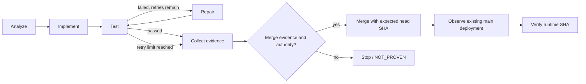

# CAPITAL-AI execution-first LangGraph loop

This is an **actual Python LangGraph StateGraph** that reuses the pinned, existing
`scripts/growth-agent/requirements.lock`; it does not introduce a second agent
framework, production worker, paid provider, new required check or scheduler.

`auto_loop.py` provides `Authority`, `build_graph(actions, authority)` and
`execute(actions, authority, task_id)`. A **trusted, separately authorized**
caller injects adapters with methods:
`analyze`, `implement`, `test`, `repair`, `evidence`, `merge`,
`observe_deployment` and `verify_runtime`.

State flow:

**Security/authorization.** No action is executed without injected callbacks.
`Authority` is trusted and immutable, never inferred from a PR, chat message,
LLM output, tool response or graph state. Its defaults deny all writes, merges
and deployment observation. An explicit read-only mandate wins even when
other booleans are true. The merge node requires **positive** current base/head
SHA evidence, both existing Required Checks, all applicable checks, a mergeable
current main, no HOLD, complete scope and cleared risk boundaries. The caller's
`merge` adapter must use GitHub `expected_head_sha` and report the used
head SHA; the loop verifies the returned acknowledgement. No ruleset bypass.
Absent checks, invalid responses and callback exceptions fail closed.

**Deployment.** The loop never triggers a manual Render deployment. It can
follow the existing main-merge auto-deployment (when explicitly enabled) and
compare the observed deployed SHA with the actual merge SHA before checking
runtime health. `VERIFIED` requires trusted runtime evidence; successful
repository tests alone never imply a live release.

**Bounded retries/checkpointing.** At most 0–3 repairs (default two) and a
fixed recursion limit; failed checks stop rather than looping forever.
LangGraph's in-memory checkpointer is per invocation and **not durable across
process restarts**. Durable storage, a trusted GitHub/Render adapter and
persistent scheduling require separate authorized engineering and validation;
none are claimed active by merging this module.

**Tests:** `python3 -m unittest discover -s scripts/growth-agent -p 'test_*.py'`
using the existing pinned requirements. The existing Google Maintenance and
Local Growth Graph workflow runs those tests on relevant PRs. Its check is
not made Required; Docker Security Gate and Domain Governance stay unchanged.

## Provider adapters and persistent recovery (2026-11-15)

`provider_actions.py` provides `Scope` and `TrustedProviderActions`. The host
injects scoped, authenticated GitHub and Render HTTP transports; the module
**does not** read credentials or allow arbitrary URLs. It verifies the PR,
head/base SHA, current main, required checks and positive trusted risk/scope
assertions again immediately before a SHA-locked squash merge. A stale or
ambiguous result fails closed. Implement/test/repair are explicit host callbacks,
not arbitrary model-supplied shell commands. Render integration observes only
the normal main-triggered deployment; no manual deploy is exposed. Live health
and image provenance remain NOT_PROVEN until a separate runtime readback.

`execute_durable` stores checkpoints in a private, absolute SQLite file,
with a process lock and symlink/permission checks. The SQLite checkpointer is
now pinned in `requirements.lock`. Reuse the same `task_id` and path to resume
an interrupted graph; a completed task is not replayed. This is single-host,
single-writer storage, not a distributed job queue. Crash after a remote merge
but before checkpoint persistence still requires GET-first reconciliation in a
host-specific adapter before any merge retry; **do not** use the current
adapter for unattended retry of an ambiguous merge outcome. No scheduler,
credentials or production agent is enabled by this change.
