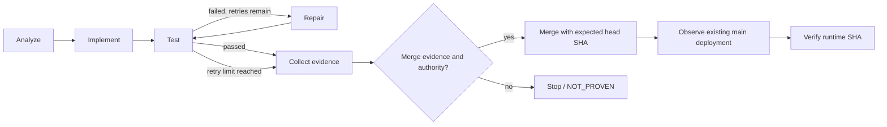

# CAPITAL-AI execution-first LangGraph loop

This is an **actual Python LangGraph StateGraph** that reuses the pinned, existing
`scripts/growth-agent/requirements.lock`; it does not introduce a second agent
framework, production worker, paid provider, new required check or scheduler.

`auto_loop.py` provides `Authority`, `build_graph(actions, authority)` and
`execute(actions, authority, task_id)`. A **trusted, separately authorized**
caller injects adapters with methods:
`analyze`, `implement`, `test`, `repair`, `evidence`, `merge`,
`observe_deployment` and `verify_runtime`.

State flow:



**Security/authorization.** No action is executed without injected callbacks.
`Authority` is trusted and immutable, never inferred from a PR, chat message,
LLM output, tool response or graph state. Its defaults deny all writes, merges
and deployment observation. An explicit read-only mandate wins even when
other booleans are true. The merge node requires **positive** current base/head
SHA evidence, both existing Required Checks, all applicable checks, a mergeable
current main, no HOLD, complete scope and cleared risk boundaries. The caller's
`merge` adapter must use GitHub `expected_head_sha` and report the used
head SHA; the loop verifies the returned acknowledgement. No ruleset bypass.
Absent checks, invalid responses and callback exceptions fail closed.

**Deployment.** The loop never triggers a manual Render deployment. It can
follow the existing main-merge auto-deployment (when explicitly enabled) and
compare the observed deployed SHA with the actual merge SHA before checking
runtime health. `VERIFIED` requires trusted runtime evidence; successful
repository tests alone never imply a live release.

**Bounded retries/checkpointing.** At most 0–3 repairs (default two) and a
fixed recursion limit; failed checks stop rather than looping forever.
LangGraph's in-memory checkpointer is per invocation and **not durable across
process restarts**. Durable storage, a trusted GitHub/Render adapter and
persistent scheduling require separate authorized engineering and validation;
none are claimed active by merging this module.

**Tests:** `python3 -m unittest discover -s scripts/growth-agent -p 'test_*.py'`
using the existing pinned requirements. The existing Google Maintenance and
Local Growth Graph workflow runs those tests on relevant PRs. Its check is
not made Required; Docker Security Gate and Domain Governance stay unchanged.

## Trusted P0 GitHub/Render adapter (2026-11-15)

The Python module `scripts/growth-agent/provider_adapters.py` binds the existing
LangGraph action interface to the real GitHub REST API and Render deployment
readback through a fixed-origin HTTPS client. The **only supported mutation** is
`PUT /repos/SvenKulessa/Capital-AI/pulls/{pr}/merge`, using the expected
PR head SHA. Render reads are strictly GET-only; no manual deployment is issued.

The adapter checks branch naming, current Main and head, actual GitHub check
runs (including required Docker Security Gate and Domain Governance), applicable
checks, unresolved/unknown results and a separately trusted semantic assessment.
An unknown check skip, an incomplete check-run page or an unproven assessment
fails closed. HTTP redirects, alternate provider domains, oversized responses
and invalid JSON fail closed. The adapter only invokes a trusted implement/repair
callback; no PR body, issue text, tool output, model answer or arbitrary command
is executable code.

The existing graph has a single bounded repair loop. The adapter reconciles an
already-merged PR through GET before any repeat PUT, with exact head-SHA matching.
Render deployment evidence must match the actual merged SHA, and runtime verification
requires public `/healthz` to report the matching `runtimeIdentity.sourceSha`.

## Durable P1 checkpoint/resume

`auto_loop.py::execute_durable` uses the official pinned LangGraph
`SqliteSaver`, strict msgpack, and a private 0600 SQLite file in a 0700
directory. An exclusive nonblocking file lock prevents two processes from
running the same store concurrently. Symlinked, shared, or relative checkpoint
paths are rejected. A finished thread is returned without re-invoking any
adapter callback. A pending thread resumes with `invoke(None)` instead of
restarting at START. The remote-merge reconciliation protects the crash window
between a successful PUT and local checkpoint persistence.

The SQLite implementation is intended for one trusted worker on an owner-private
persistent volume. It is not suitable for distributed multi-worker production
deployment and is not activated as an always-on Render process.

## Invoking on an explicitly trusted worker

The entrypoint `scripts/growth-agent/run_reviewed_pr.py` defaults to read-only.
A merge additionally requires `--merge`, credentials from the trusted worker
environment, and a **privately owned, mode 0600**, 15-minute-expiring JSON
assessment file outside the repository. The assessment must bind the exact
PR `head_sha`, `base_sha` and PR number, with schema
`CAPITAL_AI_TRUSTED_PR_ASSESSMENT@1` and four true review flags
`scope_complete`, `trust_boundaries_clear`, `no_active_hold` and
`applicable_checks_green`. The file must originate from a separately performed
real technical review, not copied PR prose or LLM output.

Example (requires authorized separate credentials and a reviewed PR):

```bash
python3 scripts/growth-agent/run_reviewed_pr.py \
  --pr 123 --task-id platform-pr-123 \
  --checkpoint-db /private/state/pr123.sqlite3 \
  --assessment-file /private/approvals/pr123.json \
  --merge --observe-existing-deploy
```

`GITHUB_TOKEN` is required; `RENDER_API_KEY` is used solely for readback.
No tokens, approvals or database contents belong in Git, CI logs or chat.
No additional GitHub Required Checks, cloud workers, external schedulers,
manual deploys or automatic publication were introduced.

**Tests:** Existing `Google Maintenance and Local Growth Graph` CI executes
the offline `test_*.py` suites on relevant PRs using the pinned Python lock.
Existing Docker Security Gate and Domain Governance are unchanged.
