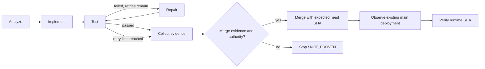

# CAPITAL-AI execution-first LangGraph loop

This is an **actual Python LangGraph StateGraph** that reuses the pinned, existing
`scripts/growth-agent/requirements.lock`; it does not introduce a second agent
framework, production worker, paid provider, new required check or scheduler.

`auto_loop.py` provides `Authority`, `build_graph(actions, authority)` and
`execute(actions, authority, task_id)`. A **trusted, separately authorized**
caller injects adapters with methods:
`analyze`, `implement`, `test`, `repair`, `evidence`, `merge`,
`observe_deployment` and `verify_runtime`.

State flow:

**Security/authorization.** No action is executed without injected callbacks.
`Authority` is trusted and immutable, never inferred from a PR, chat message,
LLM output, tool response or graph state. Its defaults deny all writes, merges
and deployment observation. An explicit read-only mandate wins even when
other booleans are true. The merge node requires **positive** current base/head
SHA evidence, both existing Required Checks, all applicable checks, a mergeable
current main, no HOLD, complete scope and cleared risk boundaries. The caller's
`merge` adapter must use GitHub `expected_head_sha` and report the used
head SHA; the loop verifies the returned acknowledgement. No ruleset bypass.
Absent checks, invalid responses and callback exceptions fail closed.

**Deployment.** The loop never triggers a manual Render deployment. It can
follow the existing main-merge auto-deployment (when explicitly enabled) and
compare the observed deployed SHA with the actual merge SHA before checking
runtime health. `VERIFIED` requires trusted runtime evidence; successful
repository tests alone never imply a live release.

**Durable single-worker checkpointing (optional).**
\`execute_durable(actions, authority, task_id, absolute_private_sqlite_path)\`
uses the pinned official \`SqliteSaver\`, private local SQLite files, a
nonblocking OS file lock and stable LangGraph \`thread_id\`. Re-running the
same finished task returns its persisted state without replaying merge/deploy.
An interrupted graph with pending nodes continues from its checkpoint.
The merge node re-evaluates the *current* authority, and the provider adapter
independently revalidates current GitHub evidence and reconciles a merge
completed immediately before a crash. A checkpoint alone is **not** merge
authorization. No database should contain API tokens or private provider
payloads. The local SQLite file must live on persistent trusted storage, never
inside ephemeral Render containers. This is a single-writer solution, not a
distributed worker, scheduler or exactly-once transaction across providers.

**Bounded retries/checkpointing.** At most 0–3 repairs (default two) and a
fixed recursion limit; failed checks stop rather than looping forever.
The default legacy `execute()` keeps its per-invocation in-memory saver for
backward compatibility. `execute_durable()` is the opt-in persistent path.
A scheduled, always-running agent still requires a separately provisioned
and explicitly authorized trusted worker; no new production service is activated.

**Tests:** `python3 -m unittest discover -s scripts/growth-agent -p 'test_*.py'`
using the existing pinned requirements. The existing Google Maintenance and
Local Growth Graph workflow runs those tests on relevant PRs. Its check is
not made Required; Docker Security Gate and Domain Governance stay unchanged.
