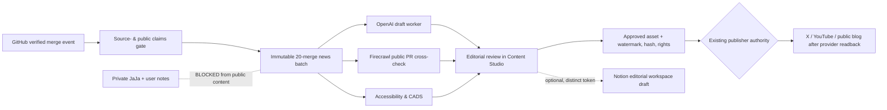

# GROWTH · News Generation Workload Pipeline Review
Date: 2026-10-15 · Scope: read-only architecture review, not production/publisher evidence.

## Evidence baseline on main 68467751155d4a0ee0a9a2d8a971babdfaf19287

- `.github/workflows/merge-milestones.yml` runs on merged PR `closed` for main. For each merged PR, `scripts/growth/social-release-candidate.mjs` constructs a **DRAFT_ONLY** candidate using repository/owner IDs, merge SHA, bounded changed-file inventory and content/skill routing. No auto-publish.
- `scripts/merge-milestone.mjs` has `ROADMAP_INTERVAL=10` and `NEWS_INTERVAL=20`. At NEWS milestones the workflow runs `scripts/growth/pr-merge-social-batch.mjs`, then retains a preview artifact, not a published post. A separate GitHub App can optionally prepare a PR. This can generate draft workload even without Notion.
- `src/data/controlCenterNews.json` is a **snapshot**, not current live news: `mergeCount=420`, `lastBatchPr=470`, `state=DRAFT_NOT_PUBLISHED`. Do not present this as today’s production output.
- `pr-merge-social-batch.mjs` validates source PRs, SHA, nonpublishing contracts and watermark bytes by pinned SHA-256. It launches OpenAI, Firecrawl and Accessibility checks in **parallel** with errors failing closed. OpenAI/Firecrawl network execution requires `SOCIAL_BATCH_EXTERNAL_WORKERS=enabled` plus server-only keys. Worker responses are size-limited and untrusted. CADS quality is technical only.
- `src/contracts/contentEngine.ts` / `src/contracts/contentSocialPackage.ts` and `src/platform/SocialMediaEngine/Publishing/` keep campaign identity, renderer, publisher and approval separate. `src/features/studio/ContentStudioPanel.tsx` is a visible review surface; it is not an independent publication authority.
- `.github/workflows/post-merge-correlation.yml` also subscribes to merged PRs but remains **read-only**, writes report artifacts and does not move branches. The two workflows have separate concurrency groups. On current source, direct cross-workflow branch write collision is NOT_PROVEN; audit actual Actions run IDs if future negative commits recur.
- Owner X social publishing OAuth2 and YouTube upload OAuth are independent provider authorities. Notion sign-in OAuth and Notion notes export are also independent and **must not** inherit publishing or scraping privileges.

## Highest-value optimizations, ordered

| Priority | Candidate | Benefit | Guardrail / implementation status |
| --- | --- | --- | --- |
| P0 | Separate account/private note exports from editorial content | Prevent accidental publication of private learning notes / JaJa conversations | DESIGN_REQUIRED; no private Notion or Supabase note text may enter PR batch |
| P1 | Move canonical event identity into per-run source manifest: merged PR number, merge SHA, source URLs, branch, time, exact artifact digest | Avoid stale `controlCenterNews.json` being mistaken for fresh public news | Candidate exists; full live reconciliation NOT_PROVEN |
| P1 | Pre-filter public PRs by product-impact labels, source coverage, rights and negative claims | 20-merge batches should cover meaningful news, not just dependency churn | NOT_IMPLEMENTED, requires deterministic tests |
| P1 | Enforce explicit worker model/version, budget, retries, token ceilings and quota reconciliation | Safer OpenAI / Firecrawl costs; avoid drift on model name and API | PARTIAL / CODE_UPDATED: model explicitly selected via repository variable `SOCIAL_CONTENT_OPENAI_MODEL` and skipped if missing; live provider/quotas NOT_PROVEN |
| P1 | Draft review UI: grouped feature change, explainability, proof links, media watermark and human approval | Higher-quality blog/short without false Production claims | Contract/preview partial; public post not authorized |
| P2 | Notion **editorial workspace** adapter as optional human-approved sink for internal drafts (different from personal OAuth) | Structured editor calendar and approval handoff | PROPOSED, not a private notes export or provider publisher; workspace-separated credentials and explicit scopes |
| P2 | First-party templates for JaJa explanations + reusable 1-minute learning scripts | Monetizable learning acquisition path | Rights, provenance, adult finance audience and AI labeling required |

## Suggested source-to-channel architecture

## Recommended connectors/skills and product scope

- Existing `GitHub` connector: code, PR, CI and immutable merge content. Prefer signed webhook event readback to unrestricted crawls.
- Existing OpenAI + Firecrawl bounded parallel workers; evaluate cost and real endpoint before enabling. `SOCIAL_BATCH_EXTERNAL_WORKERS` defaults to deny.
- Accessibility engineering and advisory skills, CADS quality checks, legal/license scan, disclosure and consent, brand image byte hashing. Do not treat CADS PASS as rights or publish permission.
- Optional Notion editorial connector only after scoped user consent and separate public/private content boundary. May use a different integration credential from the user-facing Learning Portal export.
- Retain adult finance-learning labeling, synthetic-data markers and verified links; no implied ROI or trading guarantees.

## Verification / next work

This is a source-level audit. Actual 20-merge trigger history, provider spending, Notion workspace connection, any live X/YouTube delivery, latest social artifacts, mobile readback and achieved revenue are **NOT_PROVEN**. Run existing `node --import tsx --test scripts/growth/pr-merge-social-batch.test.mjs` and Github Action evidence on the relevant PR head; do not add another required CI gate.

### Configuration of optional OpenAI worker
The workflow now forwards repository variable `SOCIAL_CONTENT_OPENAI_MODEL` only to the existing 20-merge draft job. In addition to `SOCIAL_BATCH_EXTERNAL_WORKERS=enabled` and server-only `SOCIAL_CONTENT_OPENAI_API_KEY`, a syntactically valid model ID is required. Otherwise `SKIPPED_MODEL_NOT_CONFIGURED` is returned with no OpenAI request. This avoids a stale hard-coded model name; selecting a model still requires independent provider, budget and API compatibility verification. Firecrawl remains separately opt-in, and no publishing authority changes.

No provider was activated; no news was posted; no customer notes were transferred.
