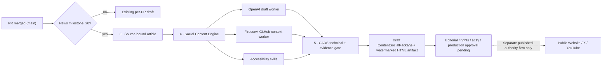

# CAPITAL-AI – GitHub PR-Merge → Social Content Engine → CADS

Stand: 2026-10-15 · Domain GROWTH/PLATFORM/PRODUCT/TRUST · Authority: AGENTS.md (`SOLO_MAINTAINER_FLOW@1`).

## Execution contract

The existing `.github/workflows/merge-milestones.yml` is the **only** merge-count scheduler. It uses `ROADMAP_INTERVAL=10` and `NEWS_INTERVAL=20` in `scripts/merge-milestone.mjs`. Only a newly generated 20-merge **news** milestone triggers `scripts/growth/pr-merge-social-batch.mjs`. Per-merge candidates remain independent; repeated workflow dispatch is read-only and must not publish.

### Concrete effects

- The Social Engine receives a **validated, source-bound** content package (`CAPITAL_AI_CONTENT_SOCIAL_PACKAGE@1`) whose `publicationAuthority` is `SOCIAL_MEDIA_ENGINE_ONLY`. The package includes one canonical SHA-256-verified watermark asset. `approvals=[]` and `deliveries=[]` remain empty.
- Three concurrent worker tasks run via native `Promise.all`: OpenAI draft, Firecrawl public-PR context and local accessibility skills. Provider failures are recorded as `FAILED_CLOSED`; deterministic channel drafts remain available. Firecrawl context is advisory, not a license or release claim.
- The canonical, originally owner-directed globe asset is `public/branding/universe/hero-universe-globe.webp` (1254×1254 original), hash `d510ac752e79314d69475a7645c554625b86ed676b0b04aabbc2869599de8eb4`. Rights evidence: `docs/licenses/CAPITAL-AI-UNIVERSE-HERO-20261015.md`. CSS opacity `0.09`, `alt=""`/decorative, semantic HTML text above the watermark, reduced-motion respected. No text is baked into the watermark.
- CADS checks the immutable campaign/source identity and the actual branded asset bytes after worker completion. It records **technical PASS** separately from `editorialReview=REVIEW_REQUIRED`, `rightsReview=REVIEW_REQUIRED`, `accessibilityReadback=NOT_PROVEN` and `publicationApproval=false`. This is not a WCAG certification, provider-rights attestation or CADS commercial product grade.
- Artifacts are `artifacts/social-content-candidates/merge-batch-<PR>-<SHA>.json` and `.html`, uploaded with 14-day retention. No public pages, tweets, posts, tokens or paid services are created by this path.

### Optional external worker configuration

In the GitHub repository settings, configure:

| Setting | Type | Default | Purpose |
| --- | --- | --- | --- |
| `SOCIAL_BATCH_EXTERNAL_WORKERS` | Actions variable | unset | Must equal `enabled` to permit any provider call |
| `SOCIAL_CONTENT_OPENAI_API_KEY` | Actions secret | unset | Backend-only OpenAI Responses API |
| `SOCIAL_CONTENT_FIRECRAWL_API_KEY` | Actions secret | unset | Backend-only Firecrawl `/v2/scrape` |

The workflow runs with no secrets in deterministic **draft-only** mode. Enabling paid workers requires Owner approval of commercial terms, quota and costs; no automatic usage is enabled merely by merging this code. OpenAI requests use `store:false` and 550 output-token cap; Firecrawl is restricted to **two** exact public PR URLs from the source list per milestone, 10-second timeout each and 1,200-character snippets. Prompt injection, public PR bodies and scraped content are always **untrusted**; no arbitrary URL, private information, GitHub token or raw provider response is forwarded to the model or public content. Provider logs show status only and never expose secrets.

### Tool shortlist through the bounded CADS integration review

| Tool | Suitability | CADS technical scope | State |
| --- | --- | --- | --- |
| OpenAI API | PR drafts, summaries, headlines and X/LinkedIn variants | Server-side auth, token cap, untrusted output, no publishing | OPT_IN_NOT_VERIFIED |
| Firecrawl API | Public GitHub PR-page context and provenance cross-check | Fixed GitHub URLs, two-page cost cap, advisory classification | OPT_IN_NOT_VERIFIED |
| ElevenLabs | Future commercial TTS/Shorts, independent voice rights | Not installed, no automatic audio or third-party voice licenses | DISABLED / RIGHTS_REVIEW_REQUIRED |

No simulated 91/88/82 score is treated as a measured CADS benchmark. The testable technical checks are implemented in `scripts/growth/pr-merge-social-batch.test.mjs`; external provider readbacks and contractual rights remain NOT_PROVEN until configured and actually exercised.

### Orchestrator / skill choices and commercial boundary

The implementation uses **Node.js Promise.all** (existing GitHub Actions runtime) without any new container, queue, subscription or third-party license. For future durable workflows, Temporal TypeScript SDK is MIT-licensed; LangGraph provides graph-oriented agent orchestration; Flowise's open core is Apache-2.0 but its Enterprise parts are commercially licensed. **n8n is fair-code/Sustainable Use License, not OSI open source**; embedding customer-facing n8n configuration in a monetized app may require a commercial license. Firecrawl's self-hosted engine is primarily AGPL-3.0, and its SDKs use separate licenses; this implementation calls its hosted API without bundling its server.

Accessibility routing uses existing `.agents/skills/accessibility-engineering/SKILL.md` and `accessibility-advisory/SKILL.md` with a real file-presence test, a textual alternative for standalone cards, empty alt for the decorative background, conservative static checks and a manual screenreader/contrast review status. The skill registry is **not** a source of publication authority.

### Tests / rollbacks

Run `npm run test:social-merge-batch`, `node --import tsx --test scripts/merge-milestone.test.mjs` and both required PR checks (`Docker Security Gate`, `Domain Governance`). Positive and negative tests cover the exact news threshold, signed-off source references, immutable watermark digest, source/package identity, secretless fallback, mocked parallel provider calls, provider failures, and HTML/XSS escaping. No test simulates a successful external provider login or public publication.

Rollback: revert the single feature merge commit. The workflow then stops creating batch Social Engine artifacts; the original per-PR candidate and 10/20 merge-counter behavior remain intact. Disable `SOCIAL_BATCH_EXTERNAL_WORKERS` immediately to halt any optional paid calls without redeployment.

### Business / monetization fit

Draft summaries can promote the existing Learning Hub and rights-verified Blueprint explainers without inventing scores, live availability or conversion performance. Measure exposure and attributable purchases only behind the existing consent boundaries. Neither a technical CADS PASS nor a social post grants rights to market data, third-party music or AI voices.
