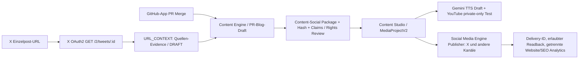

# X als URL Context und als Social Publisher — ein CAPITAL-AI Content-Stack

**Stand:** 2026-10-14 · **Domain:** GROWTH · **Status:** Repository-Implementierung, Live-Readback gesondert

## Eine Content-ID, zwei unterschiedliche X-Rollen

Es bestehen **keine** zwei Publisher-Authorities. Die Content Engine erzeugt Entwürfe,
die migrierte Social Media Engine enthält Media-/Approval- und Publisher-Verträge.
Der bisherige X-Artikel-Test ist ein unabhängiger ownergebundener Einmalpfad,
nicht bereits ein generischer Scheduler oder ein vollfreigegebener Social-Publisher.

## X URL Context: ausgelieferte Schnittstelle

- **UI:** `/api/social-media/x/url-context` — nur verifizierter Owner.
- **POST:** `/api/social-media/x/url-context` mit JSON `{"url":"https://x.com/<username>/status/<post_id>"}`.
- **Read-Provider:** offizielles `GET https://api.x.com/2/tweets/:id`, ein expliziter Post
  pro Anfrage, unveränderliches API-Ziel; kein Timeline-, Profil-, Search- oder Crawl-Aufruf.
- **Authentisierung:** bestehender X Edge Vault mit AES-256-GCM, Owner-IAM, On-Demand-Refresh
  und `SOCIAL_X_PAID_READ_APPROVED=true`. Kein Browser-Token, keine neue OAuth-App.
- **Source Policy:** `shared/x-url-context.mjs` und
  `src/contracts/growthProviderRuntime.ts` erlauben ausschließlich exakte öffentliche X-Post-URLs.
  Canonicalisierung auf `x.com`; keine Parameter, Fragmente, Umleitungen oder unbekannten Hosts.
- **Normalisierung:** Post-ID, Author-ID und Username müssen zur angefragten URL passen;
  `protected`, `possibly_sensitive` und zurückgehaltene Daten werden abgewiesen.
  Ausgaben: max. 1500 Zeichen, Text-Hash, Quelle, Erfassungszeit, niemals Voll-Crawl.
- **Evidenz:** `UNTRUSTED_EXTERNAL_CONTEXT`, `REVIEW_REQUIRED` für Claims und Rechte,
  `publicPublishAllowed:false`, keine automatische Kontaktaufnahme oder Follow-Aktion.
  Fremde X-Texte werden nicht als eigene CAPITAL-AI-Fakten gespeichert oder automatisch
  in öffentliche Blogartikel kopiert.

Die X-URL darf nur **als Kontext** in den vorhandenen Gemini/GROWTH-Draft-Workflow gelangen.
Der Gemini Marketing Gateway versteht X nun als Draft-Ausgabekanal; der allgemeine
`GROWTH_AI_PRODUCTION_NOT_ADMITTED`-Gate bleibt unverändert.
Nutzung externer X-Posts ist keine pauschale Lizenz für Reproduktion.

## Vorhandene weiteren Pipeline-Stationen

| Station | Aktuelle technische Grundlage | Noch nicht nachgewiesen |
|---|---|---|
| GitHub App PR→Blog | `merge-milestones.yml`, `social-release-candidate.mjs`, Blog-Editor | Automatischer öffentlicher Blogrelease |
| Content Autopilot | `contentEngine.ts`, `growth-ai-gateway.ts` | produktive Gemini-Inference-Freigabe |
| Migrierte Social Engine | `MediaProjectV2`, `MediaProjectPublisherBridge`, `socialPublisherAdapter` | universeller Scheduler und öffentliche Delivery |
| YouTube | ownergebundener privater Upload, OAuth-Resolver und Readback | öffentliche automatische Shorts |
| Gemini TTS | `createGeminiTtsDraft` und Landing-Storyboard | tatsächlich erzeugte Audiodatei, Lizenz-/Budget-Freigabe |
| X Publisher | `provider-publish.mjs` und ownergebundener Einmal-Artikeltest | allgemeiner X-Scheduler / automatischer Post-Readback |
| Analytics & SEO | vorhandene Attributions-/SEO-Verträge | bestätigte GSC-/GA4-Property und echte Conversion |

## Providerkosten

OAuth2-Token selbst erzeugen **keine pauschale Zusatzgebühr**. X-API-Lese- und
Schreiboperationen können nach dem jeweils aktuellen X-Pay-Per-Use-Modell
Kosten auslösen. Der Owner meldet 20 USD Testguthaben; eine live ausgelesene
Credit-Balance oder bindende Spend-Cap ist hier **NOT_PROVEN**.
Der neue URL Context löst **nur bei explizitem Owner-POST** einen X-Read aus.
Er begrenzt nicht die Summe aller möglichen Owner-Requests, daher bleibt die
Betragsbegrenzung in X Developer Console wichtig.

Gemini-TTS-/Video-Generierung verursachen gegebenenfalls separate Inference-,
Audio-Token-, GPU-, Medien-/Speicher- und Distributionskosten, die **nicht**
im X-Guthaben enthalten sind. Es wird keine Generierung und kein YouTube-Upload
durch diese URL-Context-Änderung ausgelöst.

X-Dokumentation:
- https://docs.x.com/x-api/posts/get-post-by-id
- https://docs.x.com/x-api/getting-started/pricing

## Betrieb und Rücknahme

1. Nach erfolgreichem Docker Security Gate und Domain Governance auf main mergen.
2. Render Main-/Runtime-SHA und die ownergesperrte URL-Context-Seite nachweisen.
3. Nur für eine manuell angegebene gültige X-Post-URL eine freigegebene, kostenpflichtige
   GET-Abfrage ausführen und die Provider-Evidence auf Post-ID/Autor prüfen.
4. Kein Automatismus für X-Feeds, Fremdaccounts, Follows, Replies oder Werbe-DMs.
5. Rücknahme über Merge-Revert. Bei ausstehender Budget-/Providerfreigabe bleibt
   `SOCIAL_X_PAID_READ_APPROVED=false` die vorhandene Sperre.

**Akzeptanztests:** `npm run test:x-oauth`, `npm run test:growth-ai`,
`npm run test:roadmap`; X-URL-Context-Tests in `test:security`.
Regelwerk: `AGENTS.md` / `SOLO_MAINTAINER_FLOW@1`.

**Nicht aus diesem PR ableitbar:** ein live veröffentlichter X-Artikel,
neuer Gmail-/Nodemailer-Versand, autonomes Folgen/Antworten, TTS-Audio oder YouTube-Short.
