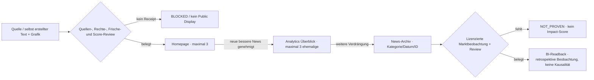

# CAPITAL-AI – Chat-/Roadmap-Konsolidierung und MARKET-Umsetzung (15.11.2026)

**Baseline:** [main@21e7a8d4567876bd5b61cc6c95d20bda3ac18539](https://github.com/SvenKulessa/Capital-AI/commit/21e7a8d4567876bd5b61cc6c95d20bda3ac18539), read 2026-11-15. **Engineering authority:** root `AGENTS.md`, `SOLO_MAINTAINER_FLOW@2`. Dieses Dokument ist eine **zeitpunktbezogene Reconciliation**, kein zusätzliches Gate, keine rechtliche Freigabe und kein Nachweis einer Live-Veröffentlichung.

## Geltungsbereich und belegte Quellen

Aus den bisherigen CAPITAL-AI-Chataufträgen wurden die Ziele **Homepage unter dem Hero**, täglich geprüfte News und vierstündiges Kandidaten-Scoring, Content Engine, Analytics-Hub-Überblick mit drei älteren News, kategorisiertes News-Archiv mit Kalender, nachträglicher Marktimpact, MARKET-Daten- und Scoringrechte sowie Social-/SEO-/Commerce-Abhängigkeiten gebündelt. Status wird nur durch nachweisbare Repo-Dateien, GitHub PRs/Checks bzw. separat belegte Runtime aufgewertet. Ein Chatauftrag ist kein Beleg für einen ausgeführten Commit.

Geprüfte Projektquellen auf Main: `src/features/home/HomePage.tsx`, `src/features/home/HomeEditorialNews.tsx`, `server/market.mjs`, `CAPITAL-AI-MARKET/SCORING-CATALOG.md`, `src/data/roadmapCurrentMainState.ts`, `src/data/socialContentRoadmap.ts`, `docs/compliance/ROADMAP-RECONCILIATION-20261106.md`, `AGENTS.md`.

## Abgleich gegen den Basis-Main und offene PRs

| Auftrag / bestehende Roadmap | Main 21e7a8d | In Arbeit / belegter Gap | Status |
| --- | --- | --- | --- |
| Homepage `Marktnews verstehen` | `HomeEditorialNews.tsx` zeigt eingetragene News/Grafiken; Main selbst ist **kein** unabhängiger Lizenzbeleg | [PR #739](https://github.com/SvenKulessa/Capital-AI/pull/739) bindet Content Engine, News-Scores, Source-/Graphic-Freshness und separates Rechte-Ledger; reale Display-Reviews sind leer | `REVIEW_REQUIRED` |
| DAILY + 4h Relevanz | Bestehende Selektor-/Scoring-Dateien; lokale Tests sind keine echten Marktfeeds | Nur neuere, besser bewertete, quellengedeckte Kandidaten; keinen parallelen Scheduler einführen; Candidate-Run und Homepage-Persistenz noch getrennt | `NOT_PROVEN` für Live-Update |
| News-Lifecycle / Analytics Hub | Auf der Main-Baseline noch nicht im Analytics-Hub integriert | [PR #752](https://github.com/SvenKulessa/Capital-AI/pull/752): drei Überblicksslots, Archivebene Kategorie/Jahr/Monat/Tag, BI-CSV, deterministische Index-/Datei-Materialisierung; initial leer | `IN_PROGRESS` |
| Archiv- und Marktimpact-Rechte | Kein bestätigter öffentlicher Archiv-/Impact-Review | Im PR #752 getrennte Public-Review-Receipts für **Artikeltext, Attribution-Link und Grafik**; zusätzlich eigene exakte Impact-Bewertung; falsche `APPROVED`/`VERIFIED`-Flags werden nicht als Veröffentlichung akzeptiert | `BLOCKED` für echte Inhalte |
| Krypto-Signale XRP/SOL/POL | Keine belegte für diese öffentliche Nutzung lizenzierte OHLC-Quelle | [PR #714](https://github.com/SvenKulessa/Capital-AI/pull/714) ist Draft; erforderlich sind 25 abgeschlossene aktuelle EUR-Stundenkerzen pro Asset, letzter Stand ≤ 2 Stunden, kommerzielle Scoring-/Derivative-/Veröffentlichungsrechte | `BLOCKED` |
| `AP-FIN-01`, `CA-MARKET-FINANCE-SCORING-DATA-FOLLOWUP` | Research-/Shadow-Scoring und 50-Komponenten-Planung existieren, **kein** freigeschaltetes Trading-Ranking | Source-Capability `marketQuotes`/`scoringPriceInput`, DQ, Replay, PIT, Gegenprüfung, Kalibrierung und Lizenzrechte fehlen weiterhin | `NOT_PROVEN` für Production |
| `CA-GROWTH-CONTENT-ENGINE`, Social Studio | Content Engine, Medien-Renderer und Design-Konzepte vorhanden | X/YouTube-Publishing, Rechteketten, Nutzer-Consent, Budget und Live-Attribution getrennt abnehmen; ein Draft-Paket veröffentlicht sich nicht selbst | `IN_PROGRESS` |
| Trust / Runtime / Commerce | Auth-, Backup-, OCI- und Checkout-Bausteine existieren | Runtime-Image-Digest und vollständiger isolierter Restore separat nachweisen; Free-Tier Leaked-Password-Protection auf HOLD; keine implizite Freigabe durch MARKET | `NOT_PROVEN` / `HOLD` |

Andere Projektaufträge wie `SvenKulessa/AI-DeviceCare` und dessen Android-Emulator-/APK-Abnahme bleiben im eigenen Repository, nicht in dieser MARKET-PR implementiert. Cross-Domain-Abhängigkeiten sind nach `AGENTS.md` keine eigene Übergabeinstanz.

## Datenfluss: eine geprüft freigegebene Nachricht, eine Historie

Die Archiveinträge sind ausschließlich nach unabhängigem Inhalts-/Quellen-/Grafik-Receipt öffentlich. Ein interner Editorial-Score oder Marketing-CADS-PASS ist **keine** Rechte- oder Publikationsfreigabe. Der BI-Export enthält bei nicht belegtem Impact einen leeren numerischen Wert, **nicht null als beobachteten Null-Effekt**. Archive-Nachrichten werden nicht aus ungeprüftem Drittanbieter-Scraping generiert.

## Aktueller Umsetzungsslice – PR #752

1. **P0 – öffentliches Rechte-Gate:** Archiv-Reviews für `story/source/graphic` unterscheiden und an denselben vollständigen Content-/Source-/Graphic-Snapshot binden. Marktimpact erhält eigene, ebenfalls snapshotgebundene Receipt-Autorität. Der Ledger startet leer.
2. **P1 – Homepage-Inhalt, ohne Held-Elemente zu verändern:** Unter `HomeEditorialNews` eine leicht verständliche MARKET-Transparenz-Sektion mit Learning-Hub-CTA, Scoring-Grundlagen und Hinweis auf die Rechteprüfung des Archivs einblenden. Keine Kurszahlen, Rendite-/Tradingclaims oder unzulässige Fremdgrafiken. Hero, BrandGlobe und Hub-Navigation unberührt.
3. **P1 – Regression:** Positiv-/Negativtests für Provenance, Einzelrechte, veränderte Grafiken, verfälschte Impact-Zahlen, Dateisystem-/CSV-Injektion sowie bestehende PR-CI und die Frontend-Viewports 320/390/1440 verwenden. Bis zur Auswertung: `NOT_PROVEN` statt `PASS`.

## Abhängigkeiten und abschließbare Folgearbeit

- **P0 Rechte:** Echtes Rechteinhaber- bzw. redaktionelles Content-Receipt in #739 für XRPL und den eigenständigen Polygon-Text inkl. Grafik- und Markennutzung; alter Polygon-Beitrag bleibt stale. Keine Hochstufung ohne konkrete Nachweise.
- **P1 MARKET:** #752 mit #739-Freigabevertrag zusammenführen, bevor erstmals öffentlich freigegebene Homepage-Verdrängungen, Archiv-Einträge oder BI-Impact angezeigt werden. Ein lokal geschriebenes JSON ist kein verifizierter produktiver Datenspeicher.
- **P1 Krypto-Daten:** #714 erst nach kommerziell zulässiger EUR-Stundenkerzenquelle, Provenance/DQ/Freshness, Negativtests und Owner-Freigabe für Rechte und Kosten fortsetzen. NATS/Rust-Provider Bridge bleibt deaktiviert.
- **P2 Monetarisierung/Analytics:** Learning-Hub-CTA und UTM/GA4-Attribution gegen echte Consent-Ereignisse messen, ohne durch synthetische Interaktionen Conversion-Claims zu erzeugen.

**Abschlussgrenze:** Dieser Branch ist Entwicklungs-/Review-Evidence. Kein Live-Deploy, kein Merge, keine DB-/Secret-Mutation und keine Freigabe nicht lizenzierter Inhalte allein durch diese Dokumentation. Rollback: Revert der geänderten Dateien im Scope von PR #752.
