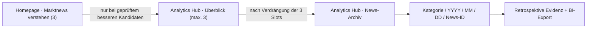

# CAPITAL-AI · News Lifecycle, Analytics-Hub und BI (2026-11-15)

## Zielbild

- Ein und dieselbe immutable News-ID und der vollständige Quell-/Grafiksnapshot wandern durch die Phasen. **Kein automatisches Löschen** beim News-Wechsel.
- `shared/news-lifecycle.mjs` verarbeitet eine bereits durch `selectHomeEdition` geprüfte neue Homepage-Edition. Der Index ist versioniert: `src/features/analysis/newsLifecycleIndex.json`.
- `node scripts/growth/news-lifecycle-cli.mjs YYYY-MM-DD reviewed-candidates.json` gibt **gemeinsam** die resultierende Homepage-Edition und den News-Index als JSON zur Review aus (ohne Änderungen). Mit `--write` kann ein bewusst aufgerufener lokaler Review-Schritt die beiden JSON-Dateien und die freigegebenen Archiv-Snapshots in `data/news-archive/<Kategorie>/<YYYY>/<MM>/<DD>/<ID>.json` schreiben. Kein Provider-Call, Deployment oder externes Publishing. Nicht freigegebene Historie blockiert `--write`. Der bestehende Editor-/Schedulerpfad muss diese kombinierte Ausgabe bei künftigen Änderungen integrieren; die vorherige reine Homepage-Ausgabe darf nicht für produktive Ersetzungen verwendet werden, weil sonst Historie verloren geht.
- Zielpfad für die dauerhafte ordnerbasierte Objektablage: `news-archive/<kategorie>/<YYYY>/<MM>/<DD>/<news-id>.json`. Der deterministische `archivePath` wird vom expliziten lokalen Materializer unter `data/` abgelegt. Ein physischer End-to-End-Lauf mit realen freigegebenen Nachrichten, Git-Commit des erzeugten Snapshots und produktives Storage-/DB-Backend sind **NOT_PROVEN**. Mehrere Dateirenames bilden noch **keine echte transaktionale Datenbankoperation**. Bis dahin bleibt der auf dem Branch versionierte Index maßgeblich.
- Die drei Plätze im Analytics-Überblick werden bei weiteren Ersetzungen zyklisch frei; der verdrängte vierte Datensatz und älter wandern nach Archiv. Keine Doppelerfassung oder Replay.

## Rechte und Sichtbarkeit

Jede automatisch verschobene News erhält `rights.status=REVIEW_REQUIRED` und `marketImpact.status=NOT_PROVEN`. Die öffentliche UI prüft ein unabhängiges, am vollständigen Nachrichtensnapshot gebundenes `NEWS_ARCHIVE_PUBLIC_REVIEWS`-Ledger zusätzlich zu Rechte-Metadaten. Das echte Ledger ist leer; ein selbst gesetztes `APPROVED` wird verworfen. Dasselbe gilt für Marktimpact mit eigenem `NEWS_IMPACT_PUBLIC_REVIEWS`-Ledger. Keine selbst autorisierende Einreichung, kein Providerabruf, kein neuer Scheduler, keine Produktiv-SQL- oder Storage-Änderungen. Der Rechte-/Provenance-Gate in offenem PR #739 wird vor einer Veröffentlichung gegen exakte Artikel-/Grafik-Snapshots integriert und geprüft. **Nicht allein aufgrund eines JSON-Flags veröffentlichen.** Der Index startet leer, weil bislang keine Verdrängung aus der Homepage nachgewiesen wurde. Das ist kein künstlicher Datenbestand.

## Marktimpact · nachträglicher Bewertungsprozess

Der ursprüngliche redaktionelle `relevance`/`impact` (0–5) ist **kein gemessener Markteinfluss**. Die retrospektive Beobachtung benötigt einen identifizierten gehandelten Vermögenswert, Benchmark, zwei tatsächliche Preissnapshots mit Datum, Datenquellenreferenz und erlaubten Nutzungsrechten.

- Fenster: **1 / 7 / 30 Tage** nach Publikation. `observedAt` muss genau auf den jeweiligen Datumshorizont fallen; `assessedAt` darf später liegen. Für eine wissenschaftliche Event-Study sind zusätzlich Vorereignis-Fenster, konkurrierende Ereignisse, eine Zeitstempelgenauigkeit unter einem Tag und geeignete Benchmark-Modelle zu prüfen.
- Beobachtung: Asset-Return in % und Benchmark-Return in %. Relative Veränderung in Prozentpunkten = Asset-Return minus Benchmark-Return.
- Vorschlagswert 0–100: **55 % magnitude** (relative Bewegung, bei 10 Prozentpunkten gedeckelt), **25 % persistence** (0–5 mit Messnachweis), **20 % breadth** (0–5 mit Messnachweis).
- Automatischer Output bleibt `REVIEW_REQUIRED`, `verifiedScore=null`, auch wenn ein Vorschlagswert errechnet werden konnte. Eine korrelative Reaktion begründet **keine Kausalwirkung einer Meldung**. Faktoren, Benchmarkwahl, Ausreißer und spätere Korrekturen sind pro Assessment versioniert zu dokumentieren; Re-Scoring überschreibt den früheren Readback nicht.
- BI-Modell: eine Faktentabelle `fact_news` mit ID, Quelle, Datum, Kategorie und Lebenszyklus; optional `fact_news_market_impact` auf Grain **News-ID × Asset × Benchmark × Messfenster × Bewertungszeitpunkt**. Primärschlüssel und Fremdschlüssel sichern reproduzierbare Zeitreihen. Kein Join auf Nutzer-/Account-Daten.
- Die öffentliche CSV-Ansicht exportiert nur freigegebene Archiv-Metadaten, keine lizenzpflichtigen Marktdaten. `NOT_PROVEN` wird als leerer Score exportiert, niemals als 0.

## Abnahme und Rücknahme

Tests: Slot-Grenze, Sequenz über vier Ersetzungen, unveränderliche IDs, Replay, ungültige Pfade, fehlende Marktdatenrechte, verzerrte Zeitstempel, keine unbelegten Scores, CSV-Formel-Injection, kanonische Hub-Route. Ein browserbasiertes Viewport-Readback 320/390/1440 und CI/Security-Gates sind vor Merge zusätzlich auszuwerten.

Rollback: Feature-Branch/Commit revertieren; der bestehende Homepage-Selektor bleibt unverändert. Kein Deployment ohne GitHub-Gates und Rechtefreigabe.
