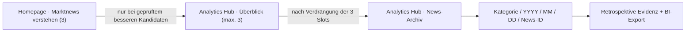

# CAPITAL-AI · News Lifecycle, Analytics-Hub und BI (2026-11-15)

**Reconciliation:** Aktueller Referenz-Main für #739-Schutz `136bfec79d0beedeee71ab25e01c304a2bc7b453`; der MARKET-Artefaktpfad bleibt bis PR-/CI-Abnahme DRAFT, echte Content-Receipts und Live-Nachweis sind weiterhin NOT_PROVEN.

## Zielbild

- Ein und dieselbe immutable News-ID und der vollständige Quell-/Grafiksnapshot wandern durch die Phasen. **Kein automatisches Löschen** beim News-Wechsel.
- `shared/news-lifecycle.mjs` verarbeitet eine bereits durch `selectHomeEdition` geprüfte neue Homepage-Edition. Der Index ist versioniert: `src/features/analysis/newsLifecycleIndex.json`.
- `node scripts/growth/news-lifecycle-cli.mjs YYYY-MM-DD reviewed-candidates.json` gibt **gemeinsam** die resultierende Homepage-Edition und den News-Index als JSON zur Review aus (ohne Änderungen). Mit `--write` kann ein bewusst aufgerufener lokaler Review-Schritt die beiden JSON-Dateien und die freigegebenen Archiv-Snapshots in `data/news-archive/<Kategorie>/<YYYY>/<MM>/<DD>/<ID>.json` schreiben. Kein Provider-Call, Deployment oder externes Publishing. Nicht freigegebene Historie blockiert `--write`. Der bestehende Editor-/Schedulerpfad muss diese kombinierte Ausgabe bei künftigen Änderungen integrieren; die vorherige reine Homepage-Ausgabe darf nicht für produktive Ersetzungen verwendet werden, weil sonst Historie verloren geht.
- Zielpfad für die dauerhafte ordnerbasierte Objektablage: `news-archive/<kategorie>/<YYYY>/<MM>/<DD>/<news-id>.json`. Der deterministische `archivePath` wird vom expliziten lokalen Materializer unter `data/` abgelegt. Ein physischer End-to-End-Lauf mit realen freigegebenen Nachrichten, Git-Commit des erzeugten Snapshots und produktives Storage-/DB-Backend sind **NOT_PROVEN**. Die lokale WAL-Transaktion stellt nach Commit beziehungsweise Recovery einen kohärenten Dateisatz her, ist aber **keine transaktionale Datenbank und keine atomare Live-Lesesicht während einzelner Datei-Renames**. Der versionierte Index bleibt maßgeblich.
- Die drei Plätze im Analytics-Überblick werden bei weiteren Ersetzungen zyklisch frei; der verdrängte vierte Datensatz und älter wandern nach Archiv. Keine Doppelerfassung oder Replay.

## Rechte und Sichtbarkeit

Jede automatisch verschobene News erhält `rights.status=REVIEW_REQUIRED` und `marketImpact.status=NOT_PROVEN`. Die öffentliche UI prüft ein unabhängiges, am vollständigen Nachrichtensnapshot gebundenes `NEWS_ARCHIVE_PUBLIC_REVIEWS`-Ledger zusätzlich zu Rechte-Metadaten. Das echte Ledger ist leer; ein selbst gesetztes `APPROVED` wird verworfen. Dasselbe gilt für Marktimpact mit eigenem `NEWS_IMPACT_PUBLIC_REVIEWS`-Ledger. Keine selbst autorisierende Einreichung, kein Providerabruf, kein neuer Scheduler, keine Produktiv-SQL- oder Storage-Änderungen. Der Rechte-/Provenance-Gate wurde mit [PR #739](https://github.com/SvenKulessa/Capital-AI/pull/739) als fail-closed Homepage-Projektion in main (Merge `136bfec79d0beedeee71ab25e01c304a2bc7b453`) integriert. Die Lifecycle-CLI lässt neue Kandidaten ausschließlich durch den **separaten** `homeRightsAdmitted`-Vertrag und das weiterhin leere `HOME_PUBLIC_DISPLAY_REVIEWS`-Ledger zu; fehlt dieser Vertrag oder ein gültiger Content-Snapshot, bleibt die vorherige Edition unverändert. Der lokale Materializer prüft dieselbe Grenze unabhängig erneut, sodass direkter Aufruf mit leerem Archiv den Schutz nicht umgeht. Beide Prüfungen sind technisch fail-closed, stellen **keine Rechtsfreigabe** dar. **Nicht allein aufgrund eines JSON-Flags veröffentlichen.** Der Index startet leer, weil bislang keine Verdrängung aus der Homepage nachgewiesen wurde. Das ist kein künstlicher Datenbestand.

## Marktimpact · nachträglicher Bewertungsprozess

Der ursprüngliche redaktionelle `relevance`/`impact` (0–5) ist **kein gemessener Markteinfluss**. Die retrospektive Beobachtung benötigt einen identifizierten gehandelten Vermögenswert, Benchmark, zwei tatsächliche Preissnapshots mit Datum, Datenquellenreferenz und erlaubten Nutzungsrechten.

- Fenster: **1 / 7 / 30 Tage** nach Publikation. `observedAt` muss genau auf den jeweiligen Datumshorizont fallen; `assessedAt` darf später liegen. Für eine wissenschaftliche Event-Study sind zusätzlich Vorereignis-Fenster, konkurrierende Ereignisse, eine Zeitstempelgenauigkeit unter einem Tag und geeignete Benchmark-Modelle zu prüfen.
- Beobachtung: Asset-Return in % und Benchmark-Return in %. Relative Veränderung in Prozentpunkten = Asset-Return minus Benchmark-Return.
- Vorschlagswert 0–100: **55 % magnitude** (relative Bewegung, bei 10 Prozentpunkten gedeckelt), **25 % persistence** (0–5 mit Messnachweis), **20 % breadth** (0–5 mit Messnachweis).
- Automatischer Output bleibt `REVIEW_REQUIRED`, `verifiedScore=null`, auch wenn ein Vorschlagswert errechnet werden konnte. Eine korrelative Reaktion begründet **keine Kausalwirkung einer Meldung**. Faktoren, Benchmarkwahl, Ausreißer und spätere Korrekturen sind pro Assessment versioniert zu dokumentieren; Re-Scoring überschreibt den früheren Readback nicht.
- BI-Modell: eine Faktentabelle `fact_news` mit ID, Quelle, Datum, Kategorie und Lebenszyklus; optional `fact_news_market_impact` auf Grain **News-ID × Asset × Benchmark × Messfenster × Bewertungszeitpunkt**. Primärschlüssel und Fremdschlüssel sichern reproduzierbare Zeitreihen. Kein Join auf Nutzer-/Account-Daten.
- Die öffentliche CSV-Ansicht exportiert nur freigegebene Archiv-Metadaten, keine lizenzpflichtigen Marktdaten. `NOT_PROVEN` wird als leerer Score exportiert, niemals als 0.

## Abnahme und Rücknahme

Tests: Slot-Grenze, Sequenz über vier Ersetzungen, unveränderliche IDs, Replay, ungültige Pfade, fehlende Marktdatenrechte, verzerrte Zeitstempel, keine unbelegten Scores, CSV-Formel-Injection, kanonische Hub-Route. Ein browserbasiertes Viewport-Readback 320/390/1440 und CI/Security-Gates sind vor Merge zusätzlich auszuwerten.

Rollback: Feature-Branch/Commit revertieren; der bestehende Homepage-Selektor bleibt unverändert. Kein Deployment ohne GitHub-Gates und Rechtefreigabe.

## Offline-Persistenz · Crash-Recovery-Slice 19.11.2026

**Geltungsbereich:** ausschließlich der explizite lokale `--write`-Pfad und seine synthetischen Tests. Die reguläre Homepage-/Archiv-/Grafik-Rechteprüfung bleibt vor jeder realen Write-Transaktion bindend. Der neue Low-Level-Transaktionsadapter besitzt selbst **keine** Content-/Lizenz-/Publikationsautorität und wird in Tests nur in isolierten temporären Verzeichnissen mit synthetischen News verwendet.

- `scripts/growth/news-lifecycle-transaction.mjs` verwendet ein privates, nicht versioniertes Journal `.news-lifecycle-private/` (Verzeichnis `0700`, Journal `0600`, SHA-256 der Vorher-/Nachher-Inhalte, Größen- und Pfadallowlist). `.gitignore` schließt es explizit aus.
- Der Offline-Writer prüft die letzte Edition und den letzten Index zusammen, berechnet die erwartete Retire-Transition erneut und nutzt einen Compare-and-Swap-ähnlichen Baseline-Vergleich vor dem Schreiben. Aktive konkurrierende Writer oder ein unvollständiger Journalzustand werden **fail-closed** abgewiesen.
- Neues Journal wird vollständig geschrieben und synchronisiert, bevor es per atomarem Verzeichnis-Rename als `pending` sichtbar wird. Dateiänderungen verwenden temporäre Dateien, Datei-/Verzeichnis-`fsync` und einzelne atomare Renames. Erst nach vollständiger Materialisierung legt der Writer einen dauerhaften Commit-Marker an.
- Ein `SIGKILL` **vor** dem Commit-Marker führt bei der nächsten expliziten Recovery zum alten vollständigen Zustand zurück; ein Crash **nach** dem Marker bestätigt und erhält den neuen vollständigen Zustand. Unerwartete Fremdänderungen, ungültige Hashes oder Symlinks blockieren Recovery, statt Daten zu überschreiben. Erfolgreich abgewickelte Journals werden vor dem rekursiven Aufräumen atomar umbenannt, damit ein Crash beim Cleanup keinen defekten `pending`-Marker hinterlässt.
- Ein normaler CLI-Aufruf prüft zuerst auf notwendige Recovery. Eine explizite Wiederherstellung ist möglich mit `node scripts/growth/news-lifecycle-cli.mjs --recover`; nur nach Prüfung des Resultats erneut `--write` verwenden. Der Modus ist für den isolierten Solo-Maintainer-Workflow **single-host / single-writer** bestimmt, nicht für NFS, verteilte Worker, Datenbank-Transaktionen oder paralleles Provider-Publishing.
- Tests im bestehenden `scripts/growth/news-lifecycle.test.mjs`-Pfad: synthetisch fünf Verdrängungen Home → Overview (maximal 3) → Archiv (Kategorie/Datum), Persistenz der unveränderlichen Snapshots, echte Child-`SIGKILL`-Abbrüche während der Dateien und nach Commit, Rollback, Replay/Idempotenz, Fremdänderungen, Symlink-Denial und abgelehnte stale Baselines.

**Grenzen:** Während einer ausstehenden Multi-Datei-Transaktion existiert **keine atomare Sicht für Leser, die die JSON-Dateien direkt öffnen**. Der CLI-Leseweg prüft zuerst die Recovery-Sperre; das Frontend verwendet weiterhin beim Build versionierte statische JSON-Projektionen. Echte produktive Persistenz, ausfallsichere verteilte Leser, reale Rechte-Receipts, gefüllte öffentlich zugelassene Archiv-UI und lizenzierte Marktimpact-Daten bleiben bis zu separater Nachweisführung `NOT_PROVEN` beziehungsweise `BLOCKED`. Die Offline-WAL ist kein neues Live-Storage-Backend, kein Freibrief für Editor-/Scheduler-Write-through und keine Veröffentlichungsfreigabe.
