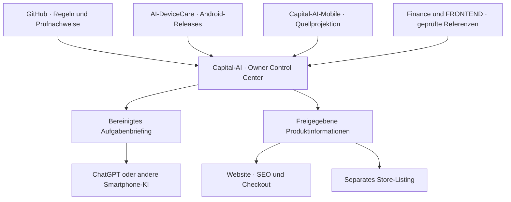

# CAPITAL-AI Ecosystem · Architektur, Roadmap und Vermarktung

**Stand 10.11.2026 · Planung bis Juni 2027 · ADR-Empfehlung zur Entscheidung**
**Prioritäten:** Security → Governance → Architektur → Produkt → Umsatz.
**Primary Domain:** PLATFORM. Fachliche Beiträge aus TRUST, PRODUCT, MARKET und GROWTH.
**Planannahme:** 6–8 Stunden pro Arbeitswoche, ein aktiver Implementierungs-PR. Termine sind überprüfbare Arbeitspakete. Betriebs- und Vertriebsstatus bleiben evidenzgebunden.

## Vision, Mission und Branding

**Vision.** CAPITAL-AI macht nachvollziehbare Finanzbildung, vertrauenswürdige Softwareauslieferung und datensparsame Gerätepflege von Web, Chat und Smartphone aus zugänglich.

**Mission.** Wir entwickeln belegbare, wartbare Produkte und verkaufen nur Leistungen, deren Inhalt, Nutzungsrechte, Auslieferung und Support überprüft sind. Governance wird im Repository und in bestehenden Prüfungen nachvollziehbar. Kunden sehen klare Produktgrenzen und den tatsächlichen Lieferstatus.

| Marke | Rolle und Positionierung | Vertriebsfläche |
| --- | --- | --- |
| CAPITAL-AI Ecosystem | Dach für Produkte, Entwicklerwerkzeuge und öffentlich belegte Methoden. | capital-ai.online als gemeinsamer Einstieg. |
| CAPITAL-AI Learning, Blueprints und Market Intelligence | Lernen, nachvollziehbare Analyse und wiederverwendbare Komponenten. Finanzclaims an Daten- und Methodiknachweis binden. | Bestehende Learning-, Blueprint- und Pricing-Pfade. |
| CAPITAL-AI Governance | Arbeitstitel für einen belegbaren Lieferpfad und eine begleitete Einrichtung für kleine GitHub-Teams. | B2B-Kontakt und Direktvertrieb zuerst. |
| AI-DeviceCare · Teil des CAPITAL-AI Ecosystem | Eigenständige Android-Gerätepflege mit lokaler Diagnose, klaren Systemgrenzen und ausdrücklicher Zustimmung für privilegierte Aktionen. | Eigene Produktseite nach Freigabe. Google Play als Kandidat. AI-DeviceCare+ erhält einen eigenen B2B-Nutzenbeleg. |

Web behält die bestehenden Dark-/Gold-Rollen. Purple und Magenta dienen als sekundäre Orientierung nach den vorhandenen Design-Tokens. Gerätewarnungen und Status sind als Text verständlich. Vor Fremdverwendung von Marken, Icons, Screenshots oder Designmaterial Herkunft, Lizenz und Zielkanal erfassen.

## ADR-Empfehlung · Zentrale Ecosystem-Steuerung mit eigenständigen Produkt-Releases

**Entscheidungsvorschlag.** Capital-AI ist Integrationspunkt für Navigation, Planungsansicht, öffentlich zulässige Produktinformationen und Web-Commerce. AI-DeviceCare und Capital-AI-Mobile bleiben die Quellen für Android-Code, Freigaben und Signing. Finance und FRONTEND liefern einzeln geprüfte, versionsgebundene Referenzen. Das Control Center ist der erste Client für Governance as Code. Ein späterer ChatGPT-App-Client verwendet eine schmale lesende Schnittstelle, sofern Identität, OAuth und Datenumfang nachgewiesen sind.

**Begründung.** Der bestehende Control-Center-Pfad verbindet Rollenprüfung und Roadmap-Nachweise. Web-Commerce, SEO-Policy und Content-Pipeline sind bereits vorhanden. Eine gemeinsame Quellcode-Migration würde Android- und Web-Releases koppeln und neue Signing- und Rechtefragen aufwerfen. Ein eigenständiger Governance-Backenddienst würde zusätzliche Pflege, Betriebskosten und Berechtigungsgrenzen einführen. Beide Optionen bleiben bis zu einem messbaren Bedarf zurückgestellt.

Der Pfad zu freigegebenen Produktinformationen ist Zielarchitektur. Ein Planungsstatus im Control Center ändert den Veröffentlichungs- oder Commerce-Status nicht.

**Rücknahme.** Die Ecosystem-Ansicht kann per Code-Revert aus der Roadmap entfernt werden. Sie führt keine Migration und keine neue Provider-Anbindung ein. Spätere Angebotspfade verwenden vorhandene Checkout-Schalter und entziehen Berechtigungen über die jeweilige Channel-Autorität.

## Verifizierte Quellen und offene Abhängigkeiten

| Quelle | Belegt | Separat zu prüfen |
| --- | --- | --- |
| [Capital-AI main ae2f40b5](https://github.com/SvenKulessa/Capital-AI/commit/ae2f40b59c2358a32c3d8d953a096d1e2194f4b2) und [#647](https://github.com/SvenKulessa/Capital-AI/pull/647) | Gemergter Consent-Commerce-Funnel mit vorhandenen Learning-, Blueprint- und SaaS-Pfaden. | Aktueller Render-Readback am selben SHA, realer Checkout, Kauf, Auslieferung, GA4-Eingang und Refund. |
| [Owner-Roadmap #598](https://github.com/SvenKulessa/Capital-AI/issues/598) | Vorhandener GitHub-Lineage- und bereinigter Exportpfad mit Negativtests. | Aktuelle authentifizierte Abnahme des freigabefähigen Exportumfangs. |
| [AI-DeviceCare main 1cf88783](https://github.com/SvenKulessa/AI-DeviceCare/commit/1cf88783adc78089bd32be1f3f07f86face32342), [#4](https://github.com/SvenKulessa/AI-DeviceCare/pull/4), [#8](https://github.com/SvenKulessa/AI-DeviceCare/pull/8) | Eigenständiges Produkt-Repo und quellengebundener Entwurfspfad. #8 baut auf der Basis von #4 auf. | Korrekte Build-Identität, Android-15-Abnahme, Geräte-/OEM-Grenzen, Signing und Play-Freigabe. |
| [Capital-AI-Mobile #3](https://github.com/SvenKulessa/Capital-AI-Mobile/pull/3), [Finance-Lizenz](https://github.com/SvenKulessa/Finance/blob/dcef421fe6e350a3a2ade61d0299aad9ecca213c/LICENSE), [FRONTEND-Asset-Lizenz](https://github.com/SvenKulessa/FRONTEND/blob/9999b2f13293eed060a382abad5a952155b21b20/DESIGN_AND_ASSET_LICENSE.md) | Vorhandene Quellen für Mobile-Projektion, Scoring und Design. | Rechtekette je konkretem Code-, Daten- oder Asset-Transfer. |
| Copilot-Freigabelink aus der Anlage | Titel mit Gerätebezug ZTE Z2459. Der Abruf führt zur Microsoft-Anmeldung. | Das eigentliche Gerätekonzept und die enthaltenen Anforderungen sind `BLOCKED`, bis eine lesbare Fassung vorliegt. |

## Produkt-, Artefakt- und Marketplace-Portfolio

Diese Matrix erfasst identifizierte Angebote und Entwicklungslinien. Für **jedes neue Artefakt** wird vor öffentlicher Aufnahme eine Produktzeile mit Quellpfad und SHA, Artefakttyp, Zielgruppe, Lizenz und Drittquellen, Region/Kanal, Preisautorität, Zustellung, Support und aktuellem Status ergänzt. Einzeldateien können sich einem bestehenden Bundle zuordnen lassen. Ungeklärte Artefakte bleiben intern. Preise und kommerzielle Freigaben stammen aus dem jeweiligen echten Katalog oder Vertrag.

| Prio | Produkt oder Artefakt | Erlös- und Marketplace-Kandidat | Umsetzung und Nachweis |
| --- | --- | --- | --- |
| P0/P1 | Rechtegebundene Analyse-Blueprints, Templates und Dokumentpakete | Web-Direktverkauf je vorhandener Katalogposition, B2B-Lizenz für Pakete mit Support. | Bestehende Blueprint-Commerce- und öffentliche Artefakt-Policy verwenden. Öffentliche Metadaten, Vollartefakt serverseitig geschützt. Katalogposition, Rechte, Auth, idempotente Auslieferung und Refund/Entzug prüfen. |
| P1 | Learning Hub, Vokabel-/Formelmaterial, Grafiken, Masterclass | Learning-Webcheckout für vorhandene Lernangebote. Kurs-/Asset-Bundles oder Teamlizenz nach Rechteprüfung. | Suchintention an vorhandene Lernseiten binden. Lesbare Vorschau und Quellen, Einzelnutzerisolation, Rechte für Medien und zugängliche Auslieferung prüfen. |
| P1 | Capital-AI SaaS, Screener und 50 Analysekomponenten | Bestehende Stripe-Abos und B2B-Angebote für klar definierte Komponenten. | Produktive Datenquellen, Scoring-Version, erlaubte Verarbeitung und Weitergabe, Preiskatalog, Tenant-Isolation und Entitlement-Readback je Angebot prüfen. Demo- oder Mock-Daten sind im Pilotumfang ausgeschlossen. |
| P1 | CADS GitHub App und Governance-/Policy-Werkzeuge | Bestehender CADS-Marketplace-Pfad. Separates Governance-Paket zuerst als begleitete B2B-Einrichtung verkaufen, wenn Nachfrage belegt ist. | GitHub-App-Owner, minimaler Installationsscope, Publisher-Verifikation, Financial Onboarding, Plan-IDs, Webhook und Kündigung prüfen. Für das Governance-Paket zwei Repo-Fälle und sanitisierten Beispielreport nachweisen. |
| P1 | AI-DeviceCare M1 | Google Play als Kandidat für Free und Starter. Bezahlumfang an freigegebene lokale Batterie-, Geräte- und Berechtigungsfunktionen binden. | #4 vor #8, Geräte- und Signing-Evidence, Store-Material, Datenschutz-/Data-Safety-Angaben sowie Billing-Kanal und Entitlement getrennt abnehmen. |
| P2 | AI-DeviceCare+ und spätere Netz-/Schutzfunktionen | B2B-Vertrieb für getrennt autorisierte Geräteverwaltung. Zusätzliche Endkundentarife nur nach konkretem Nutzenbeleg. | Tenant-/Rollenmodell, Enrollment, unabhängige Datenschutzprüfung, Energieaufwand und Supportkosten. Malware-, VPN- und Blocklist-Claims erst nach belastbaren Tests und Rechteprüfung. |
| P2 | Capital-AI-Mobile | Privater Begleitkanal. Eigenständige Store-Listung oder Abo-Zusatznutzen nach Nachfrage- und Rechteprüfung. | Quellprojektion #3, PKCE, Offline-Verhalten, echter Daten-/Top-400-Beleg und bestehende Signatur prüfen. Keine Kundenauslieferung aus dem Quellabgleich ableiten. |
| P2 | ChatGPT Governance-App und JaJa Buddy mit Notion | ChatGPT App-Verzeichnis als Discovery-Kanal nach Review. Notion Gallery separat für eine öffentlich zulässige Integration prüfen. Erlöshypothese ist eine vertragliche B2B-Einrichtung. | ChatGPT-Client zuerst nur lesend. Notion-Login und Produktintegration separat behandeln, OAuth-Scopes, Redirects, Tenant-Binding und Autorisierung prüfen. Digitale In-App-Monetarisierung und zugelassene Kaufwege zum Submission-Zeitpunkt neu verifizieren. |
| P1/P2 | Social Content Engine, Editorial, Instagram-/X-/YouTube-Material und Brand-Kits | Organische Nachfrage für Web-Angebote. Eigenständiges kommerzielles Asset-Bundle erst nach Lizenzprüfung. | Quell- und Hashbindung aus bestehendem Social Package, redaktionelle Freigabe, Alt-Texte/Untertitel, plattformspezifische Rechte und Publishing-Receipt. Privatentwurf und Veröffentlichung sind getrennte Zustände. |
| P2 | Finance-/FRONTEND-Bausteine, Reports, SVGs und Designmaterial | Bausteine für lizenzierte Web-Bundles oder eine kundenspezifische Leistung. | Keine pauschale Bundle-Freigabe. Autor, Herkunft, Asset-Digest, zulässige Bearbeitung und konkrete Weitergaberechte pro Datei prüfen. |
| P2 | OCI-Images, Integrationsadapter und Softwarepakete | Interne Wiederverwendung, eventuell B2B-Support nach nachgewiesener kommerzieller Zulässigkeit. | OCI-Digest und SBOM an Zielpaket binden. Lizenz- und Veröffentlichungsrechte für Schichten getrennt prüfen, insbesondere [#624](https://github.com/SvenKulessa/Capital-AI/pull/624). |
| P2 | Roadmap, ADRs, Audit-Reports, Governance-Schema und Schulungsmaterial | Öffentlicher redigierter Leitfaden als Einstieg. Bezahltes Setup, Schulung oder Audit-Aufbereitung mit klarer Leistungsbeschreibung. | Nur freigegebene Quellreferenzen und freigegebene redigierte Beispiele. Interne Evidence und vertrauliche Kundendaten bleiben in ihrem autorisierten Bereich. |

### SEO, Marketing, E-Commerce und Vertrieb

1. **Produktwahrheit vor Indexierung.** Für das erste lieferbare Learning- oder Blueprint-Angebot eine echte Katalogposition bestimmen. Canonical, interne Links, Sitemap, Robots/Noindex, Mobile und Accessibility im vorhandenen SEO-Pfad prüfen. Product-/Offer-Markup nur bei sachlich passenden sichtbaren Daten. Erfolgreicher HTTP-Readback, Crawl und tatsächliche Indexierung sind verschiedene Nachweise.
2. **Ein Angebot, eine Akquisestrecke.** Produktseite → freigegebener Fachinhalt → CTA → Checkout oder qualifizierte B2B-Anfrage. Vorhandene Content- und Social-Engine für quellgebundene Entwürfe nutzen. Aussagen zu Rendite, Sicherheitsleistung und Reichweite an überprüfbare Nachweise binden. Kanäle nach realer Attribution bewerten.
3. **Auslieferung aus bestehender Autorität.** Stripe ist Autorität für Web-Zahlung und serverseitige Web-Berechtigung, Marketplace und Play für ihre jeweiligen Angebote. Signierte Events, Produktzuordnung, Idempotenz, Refund/Widerruf und berechtigter Download müssen nachvollziehbar sein. Ein Checkout-Return oder Analytics-Ereignis erteilt keine Berechtigung.
4. **Messen und verkaufen.** `view_item`, `begin_checkout`, `generate_lead` und `purchase` nur nach vorhandener Consent- und Receipt-Logik auswerten. Für B2B qualifizierte Anfrage, begrenzten Leistungsumfang, Zustellung, Support und Deckungsbeitrag dokumentieren. Paid-Kampagnen und kostenpflichtige Provider-Aktivierung kommen erst nach geklärtem Budget und Nachweis der Baseline infrage.
5. **Marktvalidierung.** Fünf Gespräche, mindestens drei mit wiederkehrendem Problem und zwei Zusagen für bezahlte Piloten nach zwei reproduzierbaren internen Fällen. 390 € und 690 € bleiben Hypothesen aus der ursprünglichen Roadmap. Provisionen, Support, Zahlungs- und Betriebsaufwand beim Deckungsbeitrag einrechnen.

## Governance as Code auf Smartphone und im Chat

- **Direkt nutzbarer Einstieg.** Im Owner-Control-Center unter Roadmap die Ecosystem-Meilensteine lesen. Das öffentliche Aufgabenbriefing lässt sich manuell kopieren und in ChatGPT oder einer anderen Android-KI-App einfügen. Der Text ist fest definiert und bezieht keine Session, Kundendaten, privaten Repo-Inhalte, Tokens oder Laufzeit-Payloads. Der Empfänger hat keine durch den Export erteilte Schreibberechtigung. Ergebnisse kommen als Entwurf zurück und werden gegen Repo-Quellen überprüft.
- **Konkreter Android-Abnahmeschnitt.** ZTE Z2459 als vom Owner benanntes Testgerät aufnehmen. Modell und Android-Version in den Geräteeinstellungen bestätigen. Am relevanten signierten Build Einstieg, Berechtigung erteilt/verweigert, nicht unterstützte Fähigkeit, Systemleisten, TalkBack, Energie und Offline-Start prüfen. Root, ADB und Accessibility-Automatisierung außerhalb normaler Bedienung sind für diesen Ablauf ausgeschlossen. Andere OEMs werden erst mit eigenem Testbeleg ausgewiesen.
- **Späterer App-Client.** Read-only OAuth mit minimalem Scope und derselben Owner-/Tenant-Autorisierung wie die Web-App. Jeder Aufruf wird serverseitig geprüft. Antworten enthalten nur freigegebene Felder und SHA-/Quellbezug. Fremde Inhalte gelten als Daten. Authentifizierte Responses, Paketlisten, Gerätesignale und Secrets bleiben außerhalb allgemeiner KI-Apps. Android App Links erst nach nachweisbarer Paket-, Zertifikat- und Domain-Zuordnung ergänzen.
- **Regelvollzug.** Root-`AGENTS.md@main` und bestehende Repo-Checks definieren die Autorität. Jede weitere Ansicht ist Projektion. Kein neuer Pflichtcheck und keine zusätzliche Freigabestufe. Für Capital-AI gelten die vorhandenen `Docker Security Gate` und `Domain Governance` sowie anwendbare native Regeln. Für DeviceCare gelten seine eigene Policy, Module und Release-Evidence. Hosting, Datenbank, Store und Checkout werden getrennt freigegeben.

## Zeitplan und Abnahmepunkte

| Zeitraum | Paket und Lead | Prüffähiges Ergebnis |
| --- | --- | --- |
| 10.–20.11.2026 | P0 · TRUST/PLATFORM · Baseline und Abhängigkeiten | Main-/Runtime-/Rechte-Abgleich, #598-Evidence, öffentlich teilbares Smartphone-Briefing und Widerspruchsmatrix. OCC #548 bleibt bis zum verschlüsselten Backup-/Restore-Beleg und separater SQL-Autorisierung blockiert. |
| 23.11.–11.12.2026 | P1 · PRODUCT/MARKET/GROWTH · Erstes Web-Angebot | Eine reale Katalogposition aus dem bestehenden Learning-/Blueprint-Pfad mit Rechten, Auslieferung, Widerruf und SEO-Readback. #647 liefert die Grundlage für Consent und Events. |
| 14.12.2026–15.01.2027 | P1 · PRODUCT/TRUST · DeviceCare Android | #4 am passenden Build und auf Android 15 prüfen. #8 nach Basisabnahme mit OEM-/API-Fallbacks. Jahreswechsel ist Puffer. |
| 18.01.–12.02.2027 | P1 · PLATFORM/GROWTH · Governance- und Vertriebspilot | Nachweisformat an zwei Repos, Baseline regulärer PRs, zwei geprüfte Beispielfälle, Kundengespräche und Vertriebskriterien. |
| Februar–März 2027 | P2 · PRODUCT/TRUST · Apps und Marketplace-Readiness | Review- und Kostenentscheidung für ChatGPT, CADS, Notion und Play. Pro Kanal Rechte, Onboarding, Billing und Rollback dokumentieren. |
| April–Juni 2027 | P2 · GROWTH/PRODUCT · Erstes nachgewiesenes Listing oder bezahlter Pilot | Ein belegter Vertriebskanal mit tatsächlichem Release-/Kaufnachweis, Supportablauf und Deckungsbeitrag. Termin abhängig von externer Freigabe und Nachfrage. |

## Risiken und Governance-Auswirkungen

| Risiko | Zuständige Domain | Gegenmaßnahme und Abnahme |
| --- | --- | --- |
| Geheimnisse oder Geräte-/Kundendaten erreichen externe KI | TRUST · PLATFORM | Fester Exporttext, serverseitige Autorisierung für spätere Clients, kein Zugriff auf private App-Daten durch Export. |
| Finanz-, Malware-, Datenschutz- oder Leistungsclaims übersteigen die tatsächliche Funktion | TRUST · MARKET · PRODUCT | Öffentliche Texte an freigegebene Quelle, Build und Evidenzstatus binden. Nicht belegte Funktionen bleiben außerhalb von Listings. |
| Doppeltes Billing oder unberechtigter Download | PRODUCT · TRUST · GROWTH | Kanal und Produkt-ID eindeutig führen, signierte Ereignisse und Entitlement-Readback, Wiederholung, Refund und Entzug prüfen. |
| Falsche Rechtekette bei Repo-Transfer oder Veröffentlichung | MARKET · TRUST | Lizenz- und Providerrechte je Artefakt und Kanal prüfen. SBOM, Datenherkunft und Brand-Nutzung separat erfassen. |
| Gültiger GitHub-Stand wird als Live- oder Store-Freigabe gelesen | PLATFORM · TRUST | Quellcommit, CI, Deployment, Funktionsnachweis, Store-Review und Rechte getrennt anzeigen. |
| Ein Solo Maintainer wird durch zu viele Kanäle überlastet | PLATFORM · GROWTH | Ein aktiver Implementierungs-PR. Ein Web-Angebot zuerst. Bestehende Render-, GitHub-, Stripe- und SEO-Ressourcen nutzen. Neue laufende Kosten benötigen einen konkreten Bedarfs- und Kostenbeleg. |

**Umsetzungskriterien für diese ADR.** Owner-Roadmap zeigt den Integrationsplan, der Export enthält nur bewusst freigegebenen Text, und bestehende Roadmap-Lineage-Tests bleiben aussagefähig. Vor produktiver Wirkung den regulären Merge- und Runtime-Readback durchführen. Ein kanalspezifisches Listing oder Zahlungsangebot wird mit eigener Evidence entschieden.

## Erweiterung vom 13.11.2026 · Docs-as-Code, Google Drive und IaC

**Prüfbasis:** `main@ed11b7525eee7a998843313227e59d2e95bc720d`, Root-`AGENTS.md` (`SOLO_MAINTAINER_FLOW@2`), `src/data/roadmapData.ts`, `src/data/roadmapCurrentMainState.ts`, offene PRs #548/#624/#688/#691/#692/#694/#695 und lesende Drive-Ordnerinventur vom 13.11.2026. Diese Erweiterung ist **ein Roadmap-Plan, keine Synchronizer-Implementierung, kein Drive-/GCloud-Schreibnachweis und keine neue verpflichtende CI-Prüfung**.

### Abgleich und Entscheidung

| Thema | Vorhandener Stand und Konflikt | Entscheidung | Evidenzstatus |
| --- | --- | --- | --- |
| Fünf Domains | PRODUCT, MARKET, PLATFORM, TRUST, GROWTH sind in `roadmapData.ts` vorhanden; `AGENTS.md` allein autorisiert den Engineering-Flow. | Governance, DeviceCare und Commerce bleiben **Fähigkeits-/Produktbereiche**, keine zusätzlichen Primary Domains oder konkurrierende Policies. | VERIFIED (Quellstruktur); Runtime getrennt |
| Android-Quellcode | Ecosystem-ADR empfiehlt unabhängige AI-DeviceCare-/Mobile-Releases statt Web-/Android-Monorepo. | Kein Android-Quellcode-Import durch das Migration Pack. Nur versionierte Produktmetadaten, Links und autorisierte Artefakt-/Lizenzreferenzen. | VERIFIED (ADR); Import NOT_PROVEN |
| Google Drive | Unter bestehendem Owner-Ordner `CAPITAL-AI` sind `PRODUCT`, `MARKET`, `PLATFORM`, `TRUST`, `GROWTH`, `Learning-Hub`, `Evidence` und `PRIVATE-BACKUPS` vorhanden. | Bestehende Ordner wiederverwenden; vorgeschlagene numerische Unterordner nur nach Mapping/Owner-Abnahme, keine parallele unkontrollierte Hierarchie. | VERIFIED (lesende Ordnerinventur); Sync NOT_PROVEN |
| Drive-Synchronizer | Im gegenwärtigen `main` wurde bei Code-Suche weder `drive_sync` noch `googleapiclient` als Synchronizer nachgewiesen. Separater verschlüsselter Backup-Pfad vorhanden. | Neue Dokumentenprojektion isoliert vom vorhandenen `scripts/platform/drive-encrypt.sh` und `PRIVATE-BACKUPS`. Keine Wiederverwendung von Backup-Rechten für Dokumenten-Sync. | NOT_PROVEN (Implementierung) |
| Bidirektional vs. GitHub-Quelle | Ein direkter Drive-Rückschreibweg würde die GitHub-Source-of-Truth, Reviews und Versionierung unterlaufen. | **Phase 1:** GitHub → Drive; **Phase 2:** Drive-Änderungen nur in eine private Review-/Diff-Queue, danach regulärer Feature-Branch/PR. Kein direktes Drive → `main`. | DESIGN / NOT_PROVEN |
| Google Cloud/Terraform | GCloud ist eine mögliche Zusatzumgebung; Render/Supabase bleiben bestehende Produktpfade. Muster `terraform apply -auto-approve` auf `main` wäre nicht akzeptabel. | Zuerst `fmt`/`validate`/Plan ohne Mutation und ohne neue Cloud-Ressourcen. GCloud-Apply/Cloud-Run-Pfad nur nach separater Identitäts-, Kosten-, Sicherheits- und Betriebsentscheidung. | PLAN ONLY |
| Monetarisierung | Blueprint-Commerce und Learning Hub besitzen bereits definierte Produkt- und Rechtepfade; neue PDFs sind nicht automatisch verkaufbare SKUs. | Öffentliche Katalog-/Vorschaudokumente und private Käuferartefakte strikt trennen. Vollartefakt nur serverseitig nach Entitlement, Lizenz und Rechteprüfung ausliefern. | OFFEN je Produkt |

### Neue versionierte Arbeitspakete und Abhängigkeiten

Die sieben IDs sind **Plan-Arbeitspakete** und werden im selben Feature-Branch als `planning` / `UNGEKLÄRT` über das bestehende `src/data/roadmapData.ts`- und Reconciliation-System in die interaktive Control-Center-Roadmap projiziert. Das ist **noch keine Main-, Runtime- oder Drive-Verifikation**. Es entsteht kein zweiter autoritativer Roadmap-Datenbestand.

| ID | Prio / Domain | Kleinster vollständiger Slice | Abhängigkeiten | Nachweis und Abschlusskriterium |
| --- | --- | --- | --- | --- |
| CA-PLATFORM-DOCSYNC-01 | P1 · PLATFORM + TRUST | Aktuelle `docs/`-Pfad- und Drive-Ordnerinventur, Klassifizierung PUBLIC/INTERNAL/RESTRICTED/SECRET, Mapping + Exclusions als versioniertes Manifest. | Root-`AGENTS.md`, bestehende Roadmap; Backup-/Private-Knowledge-Grenzen, #664 | Synthetische Tests für Traversal, Symlinks, PII-/Secret-Ausschluss, ungültige Pfade, Doppelpfade und private Dokumente. `dry-run` mit null Drive-Schreiboperationen. |
| CA-PLATFORM-DOCSYNC-02 | P1 · PLATFORM | Einweg-Drive-Tree-Synchronizer mit `--dry-run` als Vorgabe, idempotentem Create/Update/Skip, stabilen IDs, paginierter Ordner-/Dateisuche, Hash-/Revision-Abgleich, atomic state und redacteten Logs. | DOCSYNC-01, festgelegte Auth-Identität und Zielordnerrechte | Wiederholter identischer Lauf erzeugt 0 Writes; abweichende lokale Datei exakt 1 Update; doppelte Remote-Namen führen fail-closed zu `BLOCKED`; Quota-/429-/5xx-Retries und beschädigter State getestet. Keine Orphan-Deletes. |
| CA-TRUST-DOCSYNC-03 | P1 · TRUST + PLATFORM | Identitäts-/Rechtevertrag: Owner-OAuth mit minimalem verwaltbarem Scope **oder** ausdrücklich autorisiertes Shared Drive mit scoped Service Account; sichere Secret-Übergabe und getrennte Runtimes. | DOCSYNC-01, Owner-Providerfreigabe | Zugriff nur auf freigegebenen Baum; keine `service-account.json` im Repo, keine Schlüssel in `state.json`/Logs, Cross-Folder-/Cross-User-Negativtests; Credential-Revoke-/Rollback-Nachweis. |
| CA-GROWTH-DOCBUILD-04 | P2 · GROWTH + PRODUCT | Markdown-Index, deterministischer PDF-Build, Provenance-Manifest (`sourceSha`, Pfad, Artefakt-SHA-256, Tool-Version, Rechteklasse), private/public Ausgabe getrennt. | DOCSYNC-01/02 und reale Asset-/Lizenzrechte; #388 | Wiederholbarer lokaler Build; PDF-Text/Links/Accessibility und Repro-Hashes; keine Secret-/Kundendaten-Ausgabe; Website/Knowledge erhält nur redigierte Freigaben. |
| CA-PLATFORM-DOCREVIEW-05 | P2 · PLATFORM + TRUST | Delta-Erfassung von Drive-Änderungen über Changes-Token, ETag/Revision und dreiwegefähige Konflikt-Erkennung; Drive → GitHub nur als Prüfungsvorschlag. | DOCSYNC-02/03 | Edit/Edit-, Delete/Edit-, Rename-, Move-, Duplicate- und ungültige Token-/Rechtefälle getestet. Kein automatisch überschriebenes GitHub-Original; kein Drive-Löschen. |
| CA-PLATFORM-IAC-06 | P2 · PLATFORM + TRUST | Bestehende Google-Cloud-OIDC-Arbeit prüfen, Terraform-Modul nur für begrenzte Sandbox-Planung modellieren, Backend/State/Rechte/Kosten/Rollback spezifizieren. | #664, bestehende GCloud-OIDC- und Render-Evidence, Budget-/Ownerentscheidung | `terraform fmt -check`, `validate`, statische Security-Checks und unverändernder Plan; **kein `apply`**, kein Public Ingress, keine feste globale Bucket-Kollision, kein unkontrolliertes Billing. |
| CA-PRODUCT-ECOSYSTEM-07 | P2 · PRODUCT + GROWTH | Produktkatalog/Website-Sitemap und Drive-Knowledge-Projektion über freigegebene Metadaten statt neue Store-/Billing-Autorität erweitern. | DOCBUILD-04, #682, Blueprint-Entitlement, Lizenz und Checkout-Readbacks | Katalog-/Vorschau-Snapshot, Tenant-/Entitlement-/Refund-Negativtests, SEO-/Mobile-/Accessibility-Readback; keine neue SKU/Veröffentlichung ohne belegte Rechte. |

**Arbeitsreihenfolge:** DOCSYNC-01 → DOCSYNC-03 → DOCSYNC-02 → DOCBUILD-04; DOCREVIEW-05 erst nach stabiler Einwegsynchronisation. IAC-06 ist davon unabhängig, bleibt aber kosten- und produktionsseitig gesperrt. ECOSYSTEM-07 folgt vorhandener Commerce- und Rechte-Evidence. Bestehende P0-Arbeit wie #664 (Backup/Rechte), #682 (Stripe-Tenant-Isolation) und #658 (Social-Isolation) hat gegenüber dieser neuen P1/P2-Automatisierung Vorrang. Kein neues Repo-Gate, kein massenhaftes Seed-Paket und keine automatische Public-Publishing-Kette.

### Synchronizer-Vertrag für die Umsetzung

- **Root-Mapping:** Exakte freigegebene Folder-ID aus der Zielumgebung und Owner-/Drive-Typ als Konfiguration; keine Beispiel-ID wie `123456789` produktiv verwenden. Vorhandene Struktur respektieren. Dateien nach **relativem Pfad + stabiler Drive-ID**, nicht bloß nach Dateiname abgleichen. Google-Drive-Namen sind nicht global eindeutig.
- **Authentifizierung:** `drive.file` nach tatsächlichen Zugriffsbedingungen prüfen; bei bestehendem My Drive ist nicht automatisch Service-Account-Schreibzugriff gegeben. Google dokumentiert, dass Service Accounts nicht als gewöhnliche My-Drive-Dateieigentümer verwendet werden sollen; nutze dediziertes Shared Drive oder zeitlich begrenzten User-OAuth-Flow mit ausdrücklich gewährten Rechten. Keine breit berechtigten langlebigen JSON-Schlüssel in Acode, Git oder CI.
- **State:** `state.json` nicht als commitpflichtige oder geheime Datei behandeln; lokal/privat außerhalb des verfolgten Arbeitsbaums oder im kontrollierten, verschlüsselten CI-State. Versioniertes Schema, atomare Schreibvorgänge, Sperre gegen parallele Läufe, Quell-SHA, Drive-ID, Datei-Hash, Remote-Revision/ETag, zuletzt bestätigte Operation und Changes-Page-Token. Crash-Sicherheit und State-Rebuild aus erlaubtem Baum testen.
- **Änderungserkennung:** Lokale SHA-256-Prüfung und providerseitige Metadaten; Drive `changes.getStartPageToken`/`changes.list` mit vollständiger Pagination und `newStartPageToken` für Remote-Deltas. `list`-Suche paginieren, Namen/Filter korrekt escapen; Remote-Konflikte nicht durch „erstes Suchergebnis“ kaschieren. Idempotenz mit `appProperties`, Revision/ETag und nachvollziehbarer Retry-Strategie prüfen.
- **Governance:** Dry Run standardmäßig **aktiv**; produktive Schreiboperationen nur mit explizitem `--apply` und autorisierter Identität. `delete_remote_orphans=false` fest. Nur freigegebene PUBLIC-/INTERNAL-Dokumentklassen; keine Produktionsbackups, Vault-, Auth-, Finanzkunden-, personenbezogenen oder schutzbedürftigen Evidenzdaten in den normalen Dokumentenbaum.
- **Audit:** Maschinenlesbare sanitiserte Ergebnisse `CREATE/UPDATE/SKIP/CONFLICT/BLOCKED`, Quell-SHA, Ziel-ID, Zeit, Klassifikation, Hash und Testbeleg. Audit-Log ohne Tokens, E-Mail-Adressen, Inhaltsproben oder private Pfade; Zugriffsprotokolle separat rechtlich bewerten. Kein `VERIFIED` allein wegen erfolgreichem Upload-HTTP-Status.
- **Release:** Bestehende GitHub-PR-/CI-Rulesets gelten. Drive-Apply nicht in untrusted PR-/Fork-Workflows; separater eingeschränkter Ausführungskontext. Terraform-/GCloud-Apply, Drive-Publishing und Commerce-Aktivierung sind drei verschiedene Mutationsgrenzen.

### Anpassung des bestehenden Zeitplans

| Zeitraum | Zusatzpunkt ohne Verdrängung existierender Releases | Freigabekriterium |
| --- | --- | --- |
| 13.–20.11.2026 | P1 DOCSYNC-01: Architektur-/Drive-Inventur und Datenklassifizierung; bestehende P0-Rechteprüfungen weiterhin zuerst. | Dokumentierte Mapping- und Ausschlussregeln; rein lesende Evidence. |
| 23.11.–11.12.2026 | P1 DOCSYNC-03/02: isolierter, synthetischer Einweg-Dry-Run; GitHub Source of Truth. | Unit-/Security-/Negative-Tests, idempotente Run-Evidence; keine echten Drive-Writes. |
| 14.12.2026–15.01.2027 | P2 DOCBUILD-04: private/public Markdown-/PDF- und Indexprojektion, parallel zur eigenständigen Android-Release-Abnahme. | Quellen-/Lizenz-/Hashbindung; redigierte Artefakte. |
| Januar–März 2027 | P2 DOCREVIEW-05 + IAC-06 nur bei belegtem Bedarf, geprüften Rechten und Budget. | Konflikt-Queue beziehungsweise Terraform-Plan; keine automatische Produktionsaktivierung. |
| April–Juni 2027 | P2 ECOSYSTEM-07: kommerziell zulässige Blueprint-/Knowledge-Angebote in bestehende Website und Vertrieb einordnen. | Tatsächliche Entitlement-/Katalog-/Support-/Attribution-Evidence. |

**Minimaler nächster ausführbarer Slice:** Auf einem PLATFORM-Feature-Branch zunächst ein klassifizierendes Pfad-/Drive-Mapping-Manifest und synthetische Tests für Exclusions, doppelte Namen und Dry-Run erstellen. Erst danach einen Synchronizer mit echten Schreibrechten entwickeln. Diese ADR-Erweiterung selbst ändert keine Infrastruktur und führt keine Google-Drive-Mutation aus.

**Technische Referenzen:** [Drive Shared Drives / Service Accounts](https://developers.google.com/workspace/drive/api/guides/about-shareddrives), [Drive Changes API](https://developers.google.com/workspace/drive/api/guides/manage-changes), [Google Cloud Workload Identity Federation](https://docs.cloud.google.com/iam/docs/workload-identity-federation-with-deployment-pipelines).

## Primärquellen

- [Capital-AI AGENTS.md am Prüf-Commit](https://github.com/SvenKulessa/Capital-AI/blob/ae2f40b59c2358a32c3d8d953a096d1e2194f4b2/AGENTS.md)
- [Consent-Commerce-Funnel](../growth/CONSENTED-COMMERCE-20261110.md)
- [Google Search Product Structured Data](https://developers.google.com/search/docs/appearance/structured-data/product)
- [Stripe Checkout Fulfillment](https://docs.stripe.com/checkout/fulfillment)
- [Google Play Payments Policy](https://support.google.com/googleplay/android-developer/answer/9858738)
- [Android App Links](https://developer.android.com/training/app-links/about)
- [GitHub Marketplace für Apps](https://docs.github.com/en/apps/github-marketplace/github-marketplace-overview/about-github-marketplace-for-apps)
- [ChatGPT Apps und Submission](https://openai.com/index/developers-can-now-submit-apps-to-chatgpt/)
