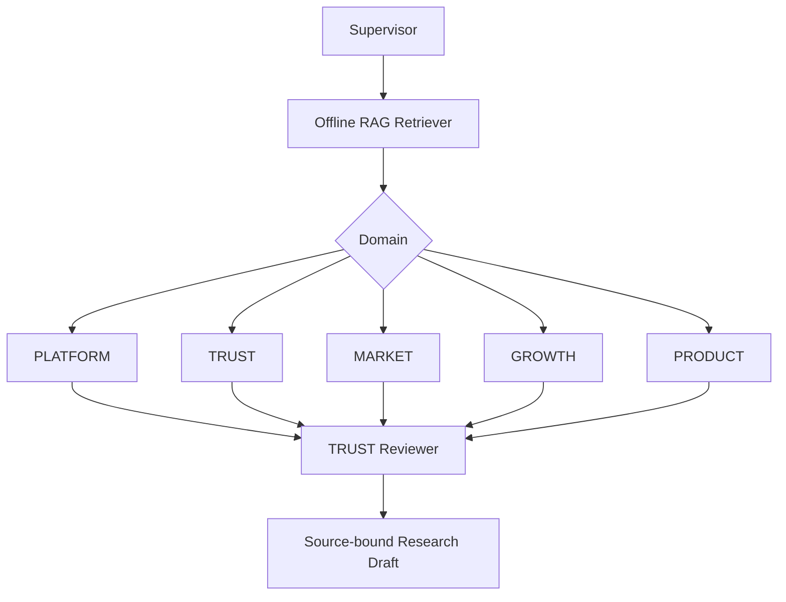

# CAPITAL-AI – Isolierter LangGraph-RAG-Multi-Agent-Worker

Stand: 2026-11-16. Engineering-Grundlage: Root AGENTS.md (SOLO_MAINTAINER_FLOW@2).

## Status und Grenzen

Dieser Slice stellt nur Code für einen **deaktivierten Kandidaten** bereit.
Weder render.yaml noch das bestehende Produktions-Dockerfile werden verändert.
Kein Render-Service, keine Disk, keine GitHub-Berechtigung, kein LLM-Abo oder
Provider-Token wird eingerichtet. Die Rust/NATS-Provider-Bridge bleibt suspendiert.

Der neue `deploy/Dockerfile.langgraph-worker` erzwingt einen zur Buildzeit aufgelösten, unveränderlichen
musl/Alpine-Python-Base-Digest sowie ein aus dem vorhandenen LangGraph-Lock
abgeleitetes, strikt gepinntes `requirements.offline-worker.lock`. Der Worker führt keine
GitHub-, Render-, Supabase- oder LLM-Aufrufe aus. Vor produktivem Einsatz
müssen Image-Scan, Dependency-Evidence und Runtime-Tauglichkeit separat
bestätigt werden. Ohne die ARG-Eingabe `PYTHON_BASE` kann der
Docker-Kandidat bewusst nicht gebaut werden.

Beispiel zum ausschließlich lokalen Build mit immutable linux/amd64-Provenance:

```bash
PYTHON_BASE="python:3.14.7-alpine3.24@sha256:9e9fde4d32eedce0b661d9ab91e826b62dddf28e928c230ec55f1866cac66b01"
docker pull --platform linux/amd64 "$PYTHON_BASE"
docker build --platform linux/amd64 \\
  --build-arg "PYTHON_BASE=$PYTHON_BASE" \\
  --file deploy/Dockerfile.langgraph-worker \\
  --tag capital-ai-offline-worker:local .
```

Der zugehörige Dockerfile-spezifische Build-Kontext ist in
`deploy/Dockerfile.langgraph-worker.dockerignore` eingeschränkt; die
Produktions-`.dockerignore` bleibt unverändert. Ein lokaler Build
aktiviert keinen Render-Service. Das Offline-RAG benötigt keine sqlite-vec-Erweiterung: die auf
musllinux nicht verfügbare optionale Binärdatei wird nur aus dem
Worker-Kandidaten ausgeschlossen. Der bestehende Graph-Lock bleibt unverändert.
Der Worker-Pinset erhöht certifi auf 2026.10.23, da der alte Pin
2026.7.22 nachweislich vom Candidate-Scan als CRITICAL erkannt wurde.
Der glibc-Debian-Kandidat scheiterte am Trivy-Scan mit 47 HIGH OS
und 7 HIGH/CRITICAL Python-Funden (CI 43829291408); das ist keine
Scan-Ausnahme. Auch der Alpine-Kandidat muss den unveränderten Trivy-Gate
bestehen. Ein erfolgreicher Build allein ist keine Security-Freigabe.

## LangGraph und RAG



Der Supervisor verwendet eine feste Domain-Allowlist. Der lokale Retriever
liest ausschließlich kuratierte, öffentliche Repository-Dokumentationspfade.
Er begrenzt Dateigrößen, zerlegt in Acht-Zeilen-Abschnitte, ordnet
lexikalisch nach Trefferzahl und liefert nur bis zu drei Passagen mit
Quellpfad, Zeilenreferenz und vollständigem SHA-256. Retrieval-Texte
sind **untrusted data**, keine Ausführungsanweisungen. Es gibt keine
Netzwerk-Abfrage und kein automatisches LLM. Das ist funktionale,
**extraktive Offline-RAG**, keine semantische Vektorsuche und kein
produktionsfähiger Chat- oder Kunden-RAG-Dienst.

Die fünf Spezialisten sind echte LangGraph-Nodes; TRUST prüft jeden
Rechercheentwurf als gesonderten abschließenden Node. Die Graphantwort
bleibt `RESEARCH_DRAFT` bzw. `NOT_PROVEN`, niemals ein produktives
Verifizierungs- oder Merge-Signal.

## Isolation und Checkpoints

- Container-Prozess-UID/GID **10001:10001**.
- Vorgesehener, eigenständiger Render-Background-Worker mit einem
  persistenten Mount **/var/lib/capital-ai-agent**. Die vorhandene
  `/var/data`-Disk des Webservice darf nicht geteilt werden.
- Am tatsächlichen Worker-Mount müssen `/var/lib/capital-ai-agent`,
  `checkpoints`, `inbox` und `approvals` jeweils dem Worker gehören
  und Modus `0700` besitzen. Ein bestehender symlinkter, öffentlicher
  oder fremd gehaltener Pfad blockiert den Start.
- SQLite und Lockfiles `0600`, `umask 077`, `O_NOFOLLOW`, Single-Writer
  über `flock` und deterministischer Task-Hash. Abgeschlossene
  Checkpoints werden beim Neustart gelesen statt erneut ausgeführt;
  unvollständige Graphläufe können durch `invoke(None)` fortgesetzt werden.
- Produktionsbetrieb `--serve` ist standardmäßig durch
  `CAPITAL_AI_OFFLINE_WORKER_ENABLED=false` gesperrt. Er erfordert einen
  realen Mount und verweigert Umgebungen mit Provider-Schreib-/API-Tokens.
- Task-Eingang: ausschließlich privat abgelegte, fest schematisierte
  JSON-Dateien im lokalen `inbox/`-Verzeichnis. Kein HTTP-Endpunkt,
  kein öffentlicher Queue-Consumer, keine Multi-Tenant-Ingestion.
- Ein produktiver Prozessneustart und dessen Render-Restart-Policy
  sind durch synthetische Python-Tests **nicht** nachgewiesen.

### Synthetisches Task-Beispiel

```json
{
  "schema": "CAPITAL_AI_OFFLINE_RESEARCH@1",
  "task_id": "local-platform-001",
  "domain": "PLATFORM",
  "query": "LangGraph SQLite checkpoint"
}
```

Die Datei muss privat mit Modus `0600` und Eigentümer-UID 10001
(oder identischer Test-UID) abgelegt werden. Ein Operator kann die
Datei erst nach vollständigem Schreiben **atomar umbenennen**.

### Offline-Tests

```bash
python3 -m pip install -r scripts/growth-agent/requirements.lock
python3 -m unittest discover -s scripts/growth-agent -p 'test_*.py'
```

Der vorhandene Workflow `google-maintenance-tests.yml` führt diese
Suite auf PRs mit Änderungen unter `scripts/growth-agent/**` aus.
Zusätzlich gelten die schon vorhandenen Docker-Security- und
Domain-Governance-Checks; es wird kein neues Required Gate hinzugefügt.
Die Tests überprüfen Prompt-Injection als reine Daten, Source-Allowlist,
Symlink/Mode-Fehler, Default-OFF, Token-Denial, Multispezialisten-Routing
und das erneute Öffnen eines abgeschlossenen SQLite-Threads in getrennten
Interpreter-Prozessen. Die vorhandene `test_process_restart.py` prüft
außerdem eine Unterbrechung mit anschließender Fortsetzung.

### Lokaler Dry-Run (nicht Render)

Auf einem isolierten Testhost (mit privaten Testordnern) ist erlaubt:

```bash
python3 scripts/growth-agent/worker_service.py \
  --synthetic-root /ABSOLUTE/PRIVATE/TEST/ROOT \
  --single /ABSOLUTE/PRIVATE/TEST/ROOT/inbox/task.json
```

Es werden lediglich Status, geroutete Agenten und Quellenanzahl ausgegeben.
Kein Provider-Token, Deployment oder Merge ist für diesen Ablauf nötig.

## Abnahme für spätere Aktivierung

1. P0: Auf dem dedizierten Worker-Host UID/GID, 0700, 0600,
   reale Disk-Mount-Identität sowie Owner- und Prozess-Readback bestätigen.
2. P1: Isolierten Build mit bekannten Scan-/Provenance-Nachweisen prüfen
   und einen echten SIGTERM/Neustart bei nicht abgeschlossenem Checkpoint
   mit genau einer abgeschlossenen Aufgabe nachweisen.
3. P1: Kosten, Provider-/Tenant-Isolation und Zweckbindung einer
   optionalen externen LLM-/RAG-Verbindung separat entscheiden.
   GitHub-App-Write-Berechtigungen gehören **nicht** in diesen
   ausschließlich lesenden Offline-Worker.

Rollback vor Aktivierung: Feature-Branch/Commit zurücknehmen.
Bei einer späteren Live-Aktivierung Checkpoints vor dem Stoppen sichern;
eine Datenträgerlöschung ist kein sicherer Rollback.
