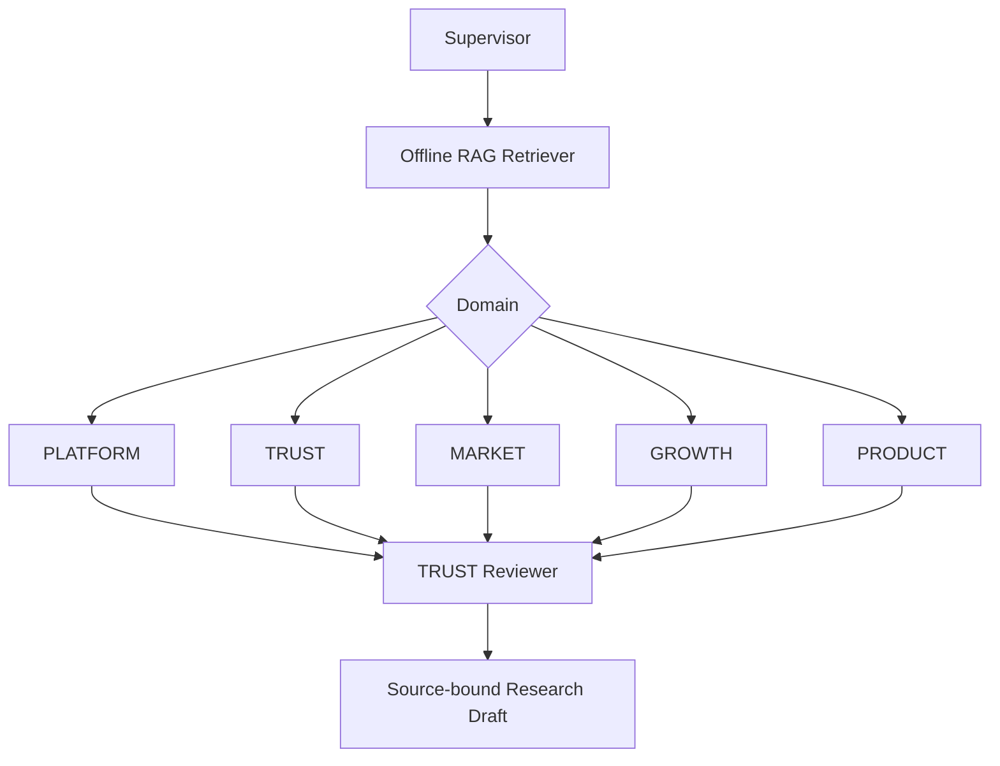

# CAPITAL-AI – Isolierter LangGraph-RAG-Multi-Agent-Worker

Stand: 2026-11-16. Engineering-Grundlage: Root AGENTS.md (SOLO_MAINTAINER_FLOW@2).

## Status und Grenzen

Dieser Slice stellt nur Code für einen **deaktivierten Kandidaten** bereit.
Weder render.yaml noch das bestehende Produktions-Dockerfile werden verändert.
Kein Render-Service, keine Disk, keine GitHub-Berechtigung, kein LLM-Abo oder
Provider-Token wird eingerichtet. Die Rust/NATS-Provider-Bridge bleibt suspendiert.

Der Worker-Kandidat verwendet nun ein zweistufiges, **glibc-basiertes
BellSoft Python 3.14**-Build: das Standardimage installiert den vorhandenen
vollständig versionierten Python-Lock in einem isolierten Installationsziel,
die distroless-Laufzeit übernimmt nur die benötigten Python-Abhängigkeiten.
Die beiden Build-Argumente `PYTHON_BUILD_BASE` und `PYTHON_BASE`
sind verpflichtend. Die bestehende optionale Candidate-CI löst die
OCI-Digests vor dem Build auf, prüft `linux/amd64` und Python 3.14
und benutzt ausschließlich Referenzen im Format `@sha256:...`.
Nach bestandenem unverändertem Trivy-Scan wurden die im Kandidaten-Job
nachgewiesenen `linux/amd64`-Referenzen **dauerhaft im bestehenden
optionalen Candidate-Workflow festgeschrieben**:

- Builder: `bellsoft/hardened-python@sha256:267c24fca93f8882fde084442224fe230231b0c0b095f4b182ecb2d54d6cb72a`
- Runtime: `bellsoft/hardened-python@sha256:bb03a9fdd7fd8e03b3ac887ca6c480d29aba1a4fe99e1eee6501588042e5f2d9`

Diese Digests und das Python-3.14-Profil werden bei jeder relevanten PR-CI
erneut geprüft. Neue Vendor-Tags dürfen den getesteten Build nicht
stillschweigend verändern; künftige Security-Patches erfordern reguläres
Digest-Update mit gleichem Scan-Gate.

Der finale Worker bleibt default-OFF, UID/GID `10001:10001`, ohne
Provider-Zugang. Der distroless-Basiskandidat enthielt unnötige
Paketmanager-/Bootstrap-Artefakte mit gemeldeten verwundbaren
vendored-Paketen. Ausschließlich diese nicht benötigten Pakete
(`pip`, `setuptools`, `wheel`, `ensurepip`) werden aus der
**finalen** Runtime mit einem Python-Exec-Buildschritt entfernt; die
eigentlichen fixierten Worker-Abhängigkeiten in `/opt/worker-packages`
bleiben unverändert. Der Scanner selbst wird weder umkonfiguriert
noch unterdrückt.

Reproduzierbare, unaktivierte Build-Alternative mit exakt aufgelösten
Basis-Digests auf einem isolierten Docker-Host:

```bash
docker pull --platform linux/amd64 bellsoft/hardened-python:3.14-glibc
docker pull --platform linux/amd64 bellsoft/hardened-python:3.14-distroless-glibc
BUILD_BASE="$(docker image inspect --format '{{index .RepoDigests 0}}' bellsoft/hardened-python:3.14-glibc)"
RUNTIME_BASE="$(docker image inspect --format '{{index .RepoDigests 0}}' bellsoft/hardened-python:3.14-distroless-glibc)"
docker build --platform linux/amd64 \
  --build-arg "PYTHON_BUILD_BASE=$BUILD_BASE" \
  --build-arg "PYTHON_BASE=$RUNTIME_BASE" \
  --file deploy/Dockerfile.langgraph-worker \
  --tag capital-ai-offline-worker:local .
```

Vor vollständiger CI-Evidence ist die BellSoft-Variante ausschließlich
ein Experiment. Containerlizenzen und kommerzielle Redistributionsrechte
sind für spätere GHCR-Veröffentlichung gesondert nachzuweisen.
**Kein Publish oder Deployment aus diesem Dokument ableiten.**

Der zugehörige Dockerfile-spezifische Build-Kontext ist in
`deploy/Dockerfile.langgraph-worker.dockerignore` eingeschränkt; die
Produktions-`.dockerignore` bleibt unverändert. Ein lokaler Build
aktiviert keinen Render-Service. Das offizielle langgraph-checkpoint-sqlite==3.1.3 verlangt
sqlite-vec>=0.1.6 bereits zur Installation. Der upstream-Pin sqlite-vec==0.1.9
veröffentlicht nur manylinux/glibc-Wheels, keine musllinux-Wheels. Ein
Alpine-Versuch ohne sqlite-vec scheiterte korrekt an der Paketauflösung
(CI 43867219306). Keine Umgehung mit --no-deps und keine inoffizielle
glibc-Emulation. Der Worker-Pinset bewahrt die Pflichtabhängigkeit und
erhöht allein certifi von 2026.7.22 auf 2026.10.23. Der Debian-Trixie-Kandidat scheiterte weiterhin an 47 HIGH
OS-Befunden ([CI 44475654968](https://github.com/SvenKulessa/Capital-AI/actions/runs/44475654968)).
Die erste BellSoft-Multistage-Iteration beseitigte diese Debian-Befunde,
meldete aber weiterhin sechs Python-Funde (5 HIGH, 1 CRITICAL) in
nicht benötigtem Bootstrap-/Paketmanager-Material
([CI 44477366852](https://github.com/SvenKulessa/Capital-AI/actions/runs/44477366852)).
Der nachfolgende Minimalisierungs-Patch muss erneut mit dem **unveränderten**
Trivy-Command, echtem Exit-Code und allen relevanten CI-Gates geprüft
werden. Ein grüner regulärer Docker Security Gate allein ersetzt diesen
Kandidaten-Scan nicht.

## LangGraph und RAG



Der Supervisor verwendet eine feste Domain-Allowlist. Der lokale Retriever
liest ausschließlich kuratierte, öffentliche Repository-Dokumentationspfade.
Er begrenzt Dateigrößen, zerlegt in Acht-Zeilen-Abschnitte, ordnet
lexikalisch nach Trefferzahl und liefert nur bis zu drei Passagen mit
Quellpfad, Zeilenreferenz und vollständigem SHA-256. Retrieval-Texte
sind **untrusted data**, keine Ausführungsanweisungen. Es gibt keine
Netzwerk-Abfrage und kein automatisches LLM. Das ist funktionale,
**extraktive Offline-RAG**, keine semantische Vektorsuche und kein
produktionsfähiger Chat- oder Kunden-RAG-Dienst.

Die fünf Spezialisten sind echte LangGraph-Nodes; TRUST prüft jeden
Rechercheentwurf als gesonderten abschließenden Node. Die Graphantwort
bleibt `RESEARCH_DRAFT` bzw. `NOT_PROVEN`, niemals ein produktives
Verifizierungs- oder Merge-Signal.

## Isolation und Checkpoints

- Container-Prozess-UID/GID **10001:10001**.
- Vorgesehener, eigenständiger Render-Background-Worker mit einem
  persistenten Mount **/var/lib/capital-ai-agent**. Die vorhandene
  `/var/data`-Disk des Webservice darf nicht geteilt werden.
- Am tatsächlichen Worker-Mount müssen `/var/lib/capital-ai-agent`,
  `checkpoints`, `inbox` und `approvals` jeweils dem Worker gehören
  und Modus `0700` besitzen. Ein bestehender symlinkter, öffentlicher
  oder fremd gehaltener Pfad blockiert den Start.
- SQLite und Lockfiles `0600`, `umask 077`, `O_NOFOLLOW`, Single-Writer
  über `flock` und deterministischer Task-Hash. Abgeschlossene
  Checkpoints werden beim Neustart gelesen statt erneut ausgeführt;
  unvollständige Graphläufe können durch `invoke(None)` fortgesetzt werden.
- Produktionsbetrieb `--serve` ist standardmäßig durch
  `CAPITAL_AI_OFFLINE_WORKER_ENABLED=false` gesperrt. Er erfordert einen
  realen Mount und verweigert Umgebungen mit Provider-Schreib-/API-Tokens.
- Task-Eingang: ausschließlich privat abgelegte, fest schematisierte
  JSON-Dateien im lokalen `inbox/`-Verzeichnis. Kein HTTP-Endpunkt,
  kein öffentlicher Queue-Consumer, keine Multi-Tenant-Ingestion.
- Ein produktiver Prozessneustart und dessen Render-Restart-Policy
  sind durch synthetische Python-Tests **nicht** nachgewiesen.

### Synthetisches Task-Beispiel

```json
{
  "schema": "CAPITAL_AI_OFFLINE_RESEARCH@1",
  "task_id": "local-platform-001",
  "domain": "PLATFORM",
  "query": "LangGraph SQLite checkpoint"
}
```

Die Datei muss privat mit Modus `0600` und Eigentümer-UID 10001
(oder identischer Test-UID) abgelegt werden. Ein Operator kann die
Datei erst nach vollständigem Schreiben **atomar umbenennen**.

### Offline-Tests

```bash
python3 -m pip install -r scripts/growth-agent/requirements.lock
python3 -m unittest discover -s scripts/growth-agent -p 'test_*.py'
```

Der vorhandene Workflow `google-maintenance-tests.yml` führt diese
Suite auf PRs mit Änderungen unter `scripts/growth-agent/**` aus.
Zusätzlich gelten die schon vorhandenen Docker-Security- und
Domain-Governance-Checks; es wird kein neues Required Gate hinzugefügt.
Die Tests überprüfen Prompt-Injection als reine Daten, Source-Allowlist,
Symlink/Mode-Fehler, Default-OFF, Token-Denial, Multispezialisten-Routing
und das erneute Öffnen eines abgeschlossenen SQLite-Threads in getrennten
Interpreter-Prozessen. Die vorhandene `test_process_restart.py` prüft
außerdem eine Unterbrechung mit anschließender Fortsetzung.

### Lokaler Dry-Run (nicht Render)

Auf einem isolierten Testhost (mit privaten Testordnern) ist erlaubt:

```bash
python3 scripts/growth-agent/worker_service.py \
  --synthetic-root /ABSOLUTE/PRIVATE/TEST/ROOT \
  --single /ABSOLUTE/PRIVATE/TEST/ROOT/inbox/task.json
```

Es werden lediglich Status, geroutete Agenten und Quellenanzahl ausgegeben.
Kein Provider-Token, Deployment oder Merge ist für diesen Ablauf nötig.

## Isolierte Candidate-Evidence (19.11.2026)

- Der ursprüngliche Debian-Trixie-Kandidat zeigte 47 HIGH-OS-Befunde.
- BellSoft-Multistage mit Paketen aus dem alten Python-Bootstrap: 5 HIGH,
  1 CRITICAL, daher fehlgeschlagen (Run `44477366852`).
- Minimalisierte BellSoft-Runtime mit den oben festgelegten Digests:
  Kandidaten-Build, Offline-RAG, UID/default-OFF und der **unveränderte**
  Trivy-Scanner erfolgreich (Run `44477933980`).
- Wiederholte Containerabnahme am synchronisierten Branch:
  [Candidate 44478673551](https://github.com/SvenKulessa/Capital-AI/actions/runs/44478673551)
  erfolgreich inklusive synthetischem SQLite-Restart-Test. Drei separate,
  nicht vernetzte Python-Container nutzen denselben bind-gemounteten
  Zustand. Die Checkpoint-Anzahl darf beim erneuten Öffnen nicht wachsen;
  unsichere Verzeichnisrechte und Start ohne Mount müssen scheitern.
- Diese Evidence beweist ausschließlich die **isolierte GitHub-CI**
  und nicht einen vorhandenen Render-Worker, eine Render-Restart-Policy
  oder die Provider-Persistenz der zukünftigen Disk.
- Die Vendor-/Komponentenlizenzen und Redistributierbarkeit sind vor
  GHCR-Veröffentlichung gesondert anhand einer tatsächlich erzeugten
  SBOM zu klären. Öffentliche Images allein erlauben keine pauschale
  kommerzielle Redistributionsfreigabe.

## Abnahme für spätere Aktivierung

1. P0: Auf dem dedizierten Worker-Host UID/GID, 0700, 0600,
   reale Disk-Mount-Identität sowie Owner- und Prozess-Readback bestätigen.
2. P1: Isolierten Build mit bekannten Scan-/Provenance-Nachweisen prüfen
   und einen echten SIGTERM/Neustart bei nicht abgeschlossenem Checkpoint
   mit genau einer abgeschlossenen Aufgabe nachweisen.
3. P1: Kosten, Provider-/Tenant-Isolation und Zweckbindung einer
   optionalen externen LLM-/RAG-Verbindung separat entscheiden.
   GitHub-App-Write-Berechtigungen gehören **nicht** in diesen
   ausschließlich lesenden Offline-Worker.

Rollback vor Aktivierung: Feature-Branch/Commit zurücknehmen.
Bei einer späteren Live-Aktivierung Checkpoints vor dem Stoppen sichern;
eine Datenträgerlöschung ist kein sicherer Rollback.
