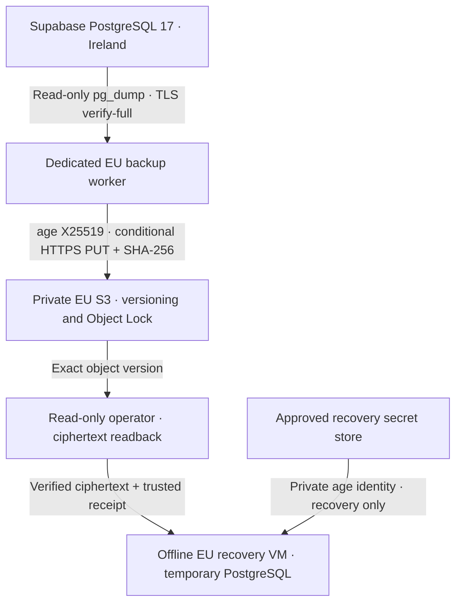

# CAPITAL-AI PostgreSQL backup and recovery

Contract `CAPITAL_AI_POSTGRES_BACKUP@1`. Initial scope is one logical PostgreSQL database. The scheduled worker and the offline recovery drill are independent of the public application and its deployment.



## Current inventory and deployment choice

Supabase Control Plane reported PostgreSQL 17.11 in `eu-west-1`. Render lists the public service in Frankfurt and no backup cron in AICapital. The existing Google Drive backup folder is private and the visible permissions show an owner. A separate writer, enforced retention and EU residency for that folder remain unverified. The existing public age-recipient workflow exercises synthetic data and does not prove custody of the private identity. The existing local Drive encryption helper remains available for its file workflow. This path invokes the same distribution-provided age directly so the production dump can stream through a pipe.

Prefer an existing approved EU worker and existing EU AWS account with a dedicated Object Lock bucket. Their availability and the bucket controls still need confirmation. Supabase's native backups are a useful complementary baseline. Confirm the current plan, retention and isolated clone capability in the dashboard. Supabase Storage lacks S3 versioning, and keeping the only copy in the source project couples failure and deletion. Use a separate trust domain for the archive. A dedicated Frankfurt Render Cron is a potential worker if no approved EU host is available. A new Cron is billed by run time with a USD 1 monthly minimum and requires a separate cost decision. The public Render service and its attached disk are out of the backup and recovery trust domains.

The selected storage path uses S3 Standard and no KMS API call for the client-side age encryption. Monthly ciphertext capacity is approximately average archive size × successful runs/day × retention days, plus lifecycle lag. For budgeting only, a USD 0.025/GB-month assumption gives USD 0.75/month for 30 retained 1 GB objects. Add PUT, GET, retrieval egress, worker capacity, secret-store and monitoring costs. The regional tariff, available account and project egress allowance remain unverified. No paid resource was created by this change.

Verify EU location for the worker, bucket, archive copies, recovery VM, secrets and logs. The owner must check processor terms, authorized recipients and applicable retention and deletion obligations before enrollment. Where applicable, document GDPR Arts. 5, 28 and 32, plus any transfer under Chapter V. Access to a dump includes access to auth records and tenant data. Treat decrypted data and the recovery VM as production-class. For deletion requests, preserve the approved lock deadline and reconcile applicable deletions before any future data reintroduction.

## Production enrollment and first authorized run

1. **Storage administrator** verifies the EU region, bucket owner and separate account, versioning, Object Lock, Block Public Access, bucket-owner-enforced ownership, and a bucket policy denying non-TLS, writes without `If-None-Match: *` and unacceptable retention. Check IAM conditions and negative authorization against a dedicated synthetic fixture. Grant the worker only prefix-scoped `s3:PutObject` and `s3:PutObjectRetention` for bounded COMPLIANCE uploads. Grant a different operator version-scoped reads and retention inspection. Keep lifecycle and deletion policy management separate from those identities. Neither writer nor reader needs delete, policy change or bypass rights. Ensure the lifecycle removes expired current **and noncurrent** versions and expired delete markers. Keep lifecycle expiry at or after the approved lock window, and alert if verification stops or the last safe copy approaches expiry. Test changes with synthetic objects because COMPLIANCE retention cannot be shortened.
2. **DB administrator** approves the one-time enrollment and first real export. Review DB size, acceptable source load and lock window, connection route, certificate and schema coverage. Provide the dedicated `capital_ai_backup` login with `CONNECT` and the minimal schema/table/sequence/large-object grants that cover the inventory. Explicitly review RLS bypass where needed for complete data. The worker refuses a privileged admin role and defaults the session to read-only. Enforce lack of write/DDL privileges on the role itself, including inherited roles, PUBLIC grants and callable write-capable functions. Check that platform-managed schemas are exportable by this role. If a managed object cannot be exported, stop and assess native backup coverage. Avoid silently narrowing the export or substituting a platform admin. Verify the Supabase CA and direct or **session** endpoint on port 5432. For a session pooler use `capital_ai_backup.<project-ref>`.
3. **Key custodian** confirms the age X25519 recipient by fingerprint and runs a challenge roundtrip in the isolated recovery context. Keep the private identity in an approved recovery secret store with a tested independent recovery copy. Expose it only to the authorized recovery account through an owner-only file on volatile storage. A backup worker needs only the public recipient. Pin the root-owned worker package and binaries to reviewed versions. Use distro age, PostgreSQL 17 client/server for the current source major, Python 3.11+ and an AWS CLI v2 build supporting the flags shown in the worker.
4. On the dedicated unprivileged EU host, configure the root-owned service environment with the following keys. Supply the passfile and short-lived AWS identity through the approved host secret store or workload identity. The passfile belongs to the worker and has mode 0600. Keep credentials out of the environment file, command arguments and journal. For AWS outside an instance role, set an approved `AWS_CONFIG_FILE` or `AWS_PROFILE` backed by the approved short-lived identity mechanism.

```ini
CAPITAL_BACKUP_DB_HOST=<approved-direct-or-session-host>
CAPITAL_BACKUP_DB_NAME=postgres
CAPITAL_BACKUP_DB_USER=<dedicated-login>
CAPITAL_BACKUP_DB_CA=/etc/capital-ai/backup/db-ca.crt
CAPITAL_BACKUP_PGPASSFILE=<secret-store-passfile-path>
CAPITAL_BACKUP_AGE_RECIPIENT=<approved-public-age-recipient>
CAPITAL_BACKUP_BUCKET=<approved-private-bucket>
CAPITAL_BACKUP_BUCKET_OWNER=<12-digit-account-id>
CAPITAL_BACKUP_BUCKET_REGION=eu-west-1
CAPITAL_BACKUP_RETENTION_DAYS=30
```

5. Keep `CAPITAL_BACKUP_ENABLE` unset until the separate permission/impact review and authorization of the first genuine export. Install the two systemd units on the approved host and use `systemd-analyze verify`. Set `CAPITAL_BACKUP_ENABLE=approved` for the authorized first manual service start, with the timer still disabled. Review host capacity and restrict host egress to approved endpoints. Keep swap and coredumps disabled. The worker enforces a 1 GiB default ciphertext cap (4 GiB maximum), a 10-second dump lock wait, stage timeouts, and a 28-minute service timeout. The first genuine run remains a separate action.
6. Verify the exact object version independently before scheduling. After successful storage readback and separate schedule authorization, enable the timer. Default cadence is 02:15 UTC daily with up to 15 minutes of jitter. Use a systemd drop-in for frequency, with an empty `OnCalendar=` before the replacement expression. `Persistent=true` can run a missed interval immediately when re-enabled. Configure operations alerting on failed runs and a missing independently verified snapshot beyond the agreed maximum age. Treat a 24-hour cadence as a design setting. An outage, failed dump or delayed readback can exceed that interval.

The worker streams one consistent PostgreSQL custom-format dump into age, stages only ciphertext in private temporary storage and checks both subprocess exit codes. AWS retries a transient PUT at most three total attempts with the same object key and precondition. An ambiguous PUT is a failure until the separate reader reconciles the logged backup ID against the exact version, ciphertext SHA-256 and retention. Avoid automatically re-running ambiguous jobs. A confirmed failure can be retried with a new backup ID within the reviewed load window. Only structured receipts and fixed error codes belong in the private journal. Preserve verified receipts in an append-only operations log independent of the writer. A receipt on its own records an accepted upload. A separate reader must read back the actual bytes.

## Exact-version readback and offline drill

Use the separate reader identity to run the following in a restricted ciphertext staging directory. Compare the independently retained receipt and provider response for the expected bucket owner, version, bytes, checksum, lock mode and retain-until date. The SHA-256 used for restore must come from the trusted, separately retained receipt. An attacker with the public recipient can encrypt a replacement, so an age roundtrip alone does not establish backup provenance.

```bash
umask 077
aws s3api head-object --bucket "$BUCKET" --key "$KEY" --version-id "$VERSION_ID" \
  --expected-bucket-owner "$OWNER" --checksum-mode ENABLED
aws s3api get-object --bucket "$BUCKET" --key "$KEY" --version-id "$VERSION_ID" \
  --expected-bucket-owner "$OWNER" --checksum-mode ENABLED "$CIPHERTEXT_PATH"
sha256sum "$CIPHERTEXT_PATH"
```

Transfer the verified ciphertext and receipt into a dedicated, isolated EU recovery VM with blocked network egress and an isolated mount namespace. Use a dedicated non-root account, no production credentials or application integrations, a read-only system and a private `/dev/shm` sized for the decrypted archive plus the expanded database and PostgreSQL working space. Disable swap, snapshots and core dumps. Provision the exact PostgreSQL major, reviewed patch level, matching encoding/collation and approved extension packages. The drill creates a new cluster and authenticates to its loopback interface with an ephemeral random SCRAM password. Run inside a fresh network namespace with only loopback (for example a restricted systemd transient unit with `PrivateNetwork=yes`). A networked namespace is rejected.

```bash
python3 -B scripts/platform/postgres-backup.py restore-drill "$CIPHERTEXT_PATH" \
  --identity "$RECOVERY_IDENTITY_PATH" --sha256 "$TRUSTED_CIPHERTEXT_SHA256" \
  --source-version "$SOURCE_VERSION_NUM" --bootstrap "$REVIEWED_BOOTSTRAP_SQL" \
  --verify "$REVIEWED_ASSERTIONS_SQL"
```

The bootstrap provisions required role names, membership and database-level ACL/settings from a reviewed inventory, with login and passwords excluded unless explicitly required for the offline exercise. PostgreSQL globals and database-level settings are not recreated automatically by this per-database restore. Preserve object owners and grants. Approve extension binaries and required Supabase-managed features before running restored SQL. Native backups may be required for managed schemas, Vault root keys and full Supabase platform continuity. The logical database archive does not include Storage object bytes, external secrets, edge functions, project settings or PITR/WAL.

Validation SQL must fail on mismatch. Check catalog/schema/extension inventory, row/constraint consistency, roles and memberships, object/database ACLs, RLS, two-tenant data isolation and unauthenticated access denial. Exercise private-notes behavior appropriate to the backed-up schema. For a pre-v2 archive, verify the pre-migration baseline, then evaluate the exact OCC-v2 migration and CAS on a **separate disposable recovery copy** only. Check preserved revisions, successful CAS, stale revision and cross-tenant rejection and Legacy-PUT denial under v2. Synthetic data may be inserted only inside the drill. Never connect a recovery copy to a live application, OAuth callback, email delivery or other external integration.

Record UTC timestamps, restore and validation duration, source/target major, immutable object version, expected and observed SHA-256, scope/coverage and per-check outcomes. Record only counts/statuses, never customer rows, identities, credentials, SQL output or dumps. Measure the real RPO as the age of the latest verified recovered snapshot at the reference incident time. Measure real RTO from incident start through retrieval, restore and validation, including environment and identity preparation. The script reports its narrower offline restore interval. The synthetic fixture timing is not a production objective.

## Stop and rollback

Disable and stop the timer and service on the worker. Unset the enable flag and revoke the worker identity if access containment is required. Preserve locked objects and receipts under the approved policy. If a drill aborts, destroy the offline VM and volatile workspace, including the ephemeral cluster and any temporary secret mounts. Remove the units or revert the repository changes to return to the previous deployment. OCC-v2 PR #548 stays Draft/HOLD. Any cutover review requires separate real production backup and isolated restore evidence plus a separately tested migration and rollback.

## References

- [PostgreSQL 17 pg_dump](https://www.postgresql.org/docs/17/app-pgdump.html), [pg_restore](https://www.postgresql.org/docs/17/app-pgrestore.html)
- [Supabase backups](https://supabase.com/docs/guides/platform/backups), [SSL connection](https://supabase.com/docs/guides/database/psql), [S3 compatibility](https://supabase.com/docs/guides/storage/s3/compatibility)
- [age v1](https://age-encryption.org/v1), [Object Lock](https://docs.aws.amazon.com/AmazonS3/latest/userguide/object-lock.html), [S3 conditional PUT](https://docs.aws.amazon.com/AmazonS3/latest/userguide/conditional-writes.html)
- [Render Cron pricing](https://render.com/docs/cronjobs#compute-plans-and-billing), [S3 cost model](https://aws.amazon.com/s3/pricing/), [GDPR](https://eur-lex.europa.eu/eli/reg/2016/679/oj)
