# CAPITAL-AI P0: verschlüsselter Supabase-Backup-Export

Contract: CAPITAL_AI_STREAM_ENCRYPTED_BACKUP@1. Domains: TRUST / PLATFORM.
Status: **synthetic test only**; no productive Datensicherung, kein Cloud-Upload und kein SQL-Cutover.

## Bestandsaufnahme (11.11.2026)

- Produktivprojekt: Supabase Capital-AI, Ref `ryzywoktpmyhwzxmstyu`, PostgreSQL 17.11, Region `eu-west-1`. Provider-Tarif und tatsächlich vorhandene automatische Backups **NOT_PROVEN**.
- Bereits vorhanden: `scripts/platform/drive-encrypt.sh`, `backup-synthetic-restore-test.sh`, `backup-retention.mjs`, `.github/workflows/drive-encryption-tests.yml`. Diese vorhandenen Nachweise bleiben gültig.
- Privater Drive-Ordner "CAPITAL-AI Supabase Backups" gefunden, **0 enthaltene Dateien** zum Readback-Zeitpunkt. Kein Backup nachgewiesen.
- Google Cloud Storage Bucket, aktiver Secret-Manager-Schlüssel, IAM, Retention-Sperren, Upload-Rückleseprüfung und echtes Produktions-Restore **nicht nachgewiesen**. Kein kostenpflichtiger Dienst wird in diesem PR erstellt.
- Supabase-Backups sind keine unabhängigen Offsite-Kopien. PostgreSQL-Dumps enthalten keine über Supabase Storage gespeicherten **Binärobjekte**. Rollen, ACL, Auth-Konfiguration, Vault/Secrets und Rendering-Konfiguration benötigen separate DR-Evidence.
- OCC-v2-PR #548 bleibt **Draft/HOLD**. Keine Produktionsmigration, kein SQL-Cutover.

## Sicherheitsarchitektur

```mermaid
flowchart LR
 A[Supabase Postgres - freigegebener lesender Zugang] -->|pg_dump STDOUT, kein Klartext-Dump| B[age X25519 Encrypt]
 B -->|Ciphertext + SHA-256 + Manifest| C[Privater Stage, 0600]
 C -. Später nach Owner-/Kostenfreigabe .-> D[Privater Drive-Ordner oder EU-GCS-Bucket]
 D -. Unabhängiger Download + Hash .-> E[Isolierter Recovery-Worker]
 E -. Separater Offline-Recovery-Schlüssel .-> F[Isolierter PostgreSQL Restore + RLS-Check]
```



**Trust boundaries:** Das Backup-Secret gehört ausschließlich auf den kontrollierten Export-Worker. Die öffentliche age-Empfängeradresse darf als Repository-Variable vorliegen; der **private** age-Schlüssel, PostgreSQL-Passwörter, dump SQL, Token und Restore-Secrets gehören niemals nach Git, GitHub Actions-Artefakte oder Chat. Verschlüsseltes Archiv allein ist noch keine verifizierte Wiederherstellung. Die Authentizität prüft erst eine erfolgreiche age-Entschlüsselung; SHA-256 identifiziert unabhängig die unveränderten Chiffrat-Bytes.

## Ausführbare, aber produktiv gesperrte Export-Pipeline

`scripts/platform/backup-stream-encrypt.sh DATABASE_NAME ABSOLUTE_OUTPUT_DIR` piped `pg_dump` direkt in `age --encrypt`, ohne Klartext-Dump-Datei. Erzeugt:

- `capital-ai-supabase-YYYYMMDDTHHMMSSZ-<sha256>.sql.age`
- `backup-manifest-YYYYMMDDTHHMMSSZ-<sha256>.json`

Manifest: `CAPITAL_AI_ENCRYPTED_BACKUP_MANIFEST@1`; Zeitpunkt (UTC), logischer Exportumfang, Stream-Format, age-Algorithmus, pg_dump-Version, Chiffrat-SHA-256 und -Größe, `storageUpload=NOT_CONFIGURED`, `isolatedProductionRestore=NOT_PROVEN`, RTO/RPO `NOT_MEASURED`. Keine Hostnamen, Secrets oder Nutzdaten.

**Default = fail-closed.** Modus `synthetic` benötigt lokale disposable DB `capital_ai_fixture_src_<number>` über den Unix-Socket auf Port 5432 ohne externe Verbindungsvariablen. Modus `production` benötigt eine explizite Owner-Entscheidung (`CAPITAL_BACKUP_PRODUCTION_APPROVED=OWNER_APPROVED_READONLY_EXPORT`), den festgelegten Projekt-Ref, gebundene Supabase-Host/Benutzeridentität, `PGSSLMODE=verify-full`, ein CA-Bundle und eine geschützte `PGPASSFILE` mit Modus 0600. **Der Schalter ersetzt keine IAM-/DB-Rechte oder Ownerfreigabe.** Es wird nichts automatisch ausgeführt.

Die Dateiablage ist nur lokale verschlüsselte Staging-Ablage; noch keine automatisierte Sicherung, kein Cloud-Upload und keine Retention-Löschung. Das bestehende Retention-Modul bleibt reiner `DRY_RUN_ONLY`-Planer. `pg_dump --no-owner --no-privileges` enthält absichtlich **keine** vollständigen Rollen-/ACL-Rechte: Ein realer Restore muss diese separat sichern und validieren.

### Dedicated backup-reader exporter compatibility (not production activation)

The exporter accepts `capital_ai_backup_reader` as a second allowed production identity, in addition to existing `postgres` credentials. Direct connections use `db.ryzywoktpmyhwzxmstyu.supabase.co` and `PGUSER=capital_ai_backup_reader`. Shared **session** pooler connections on port `5432` use the host copied from Supabase Connect and `PGUSER=capital_ai_backup_reader.ryzywoktpmyhwzxmstyu`. Transaction pooler port `6543` is rejected. Production still requires explicit owner authorization, project binding, `PGSSLMODE=verify-full`, a trusted CA and protected mode-0600 `PGPASSFILE`. Inline passwords, libpq host-address/service/option/database overrides are rejected before invoking `pg_dump`.

The pooler host must be a single DNS name. The exporter rejects comma-separated libpq fallback hosts and disables GSS encryption in production so libpq uses certificate-verified TLS.

`node --test scripts/platform/backup-reader-auth.test.mjs` covers accepted routes, rejected host lists and credential overrides, enforced TLS transport settings, and replay/no-clobber. It substitutes local mocks for `pg_dump` and `age`; **it does not prove genuine encryption, connection privileges, or restore**. Existing workflow tests continue to perform real synthetic age/PostgreSQL round trips.

This change does **not** create the role, database privileges, secrets, GCS uploads or a production backup. A role with `BYPASSRLS` and `pg_read_all_data` is not guaranteed strictly read-only: Supabase warns about publicly available extension privileges and overrideable transaction defaults. Before provisioning, verify the smallest sufficient access, including `pg_net`/`pg_cron` negative writes. `pg_dump --no-owner --no-privileges` also needs separate roles/ACL recovery evidence; it excludes Supabase Storage object bytes. OCC-v2 PR #548 remains HOLD.

Reference: https://supabase.com/kb/troubleshooting/pg_dump-fails-with-query-would-be-affected-by-row-level-security-policy-1d5783

Der [isolierte PostgreSQL-17-Berechtigungsvertrag für Issue #664](SUPABASE-BACKUP-READER-CONTRACT.md) dokumentiert die reproduzierten Risiken und den getesteten Exportumfang.

### Datenbankrolle separat vorbereiten

1. Inventarisiere Exportobjekte, RLS, Tabellenbesitzer, Rollenmitgliedschaften sowie effektive Rechte aus `PUBLIC`. Berücksichtige dabei auch die ausführbaren Funktionen in allen für die Rolle erreichbaren Schemas. Prüfe im isolierten PostgreSQL-17-Ziel anhand derselben relevanten Erweiterungen und Grants.
2. Leite `CONNECT`, Schema-`USAGE` und Objekt-`SELECT` aus dem benötigten Exportumfang ab. Vermeide pauschales `pg_read_all_data`, Admin-Mitgliedschaften und Objektbesitz. Prüfe RLS-geschützte Tabellen mit einem echten Dump und vollständigem Restore. `BYPASSRLS` ist ein separates, rollenweites Recht und erfordert eine eigene Bewertung anhand der effektiven Leserechte.
3. Prüfe unter der tatsächlichen Login-Rolle, dass DML, DDL, Rollenwechsel in privilegierte Rollen und schreibende oder externe Funktionen (z. B. `pg_net`, `pg_cron` und anwendungseigene `SECURITY DEFINER`-RPCs) verweigert werden. `default_transaction_read_only` ist dafür kein Nachweis. Ein rollenbezogenes `REVOKE` entzieht keine über `PUBLIC` wirksamen Rechte.
4. Erst nach diesen isolierten Prüfungen das konkrete Grant-/Rollback-Paket zur Produktionsanwendung bewerten. Beim Rückbau den Login sperren, bestehende Sitzungen beenden und die erteilten Grants entfernen. Rechte von Anwendungsrollen bleiben außerhalb dieses Änderungspakets.

## Prüfen

Bereits vorhandenen `Drive Backup Encryption Test` Workflow ausführen (erweitert um den neuen Synthetic-Stream-Test) oder auf einem isolierten Linux-Runner:

```bash
bash scripts/platform/drive-encryption-test.sh
bash scripts/platform/backup-synthetic-restore-test.sh
bash scripts/platform/backup-stream-encrypt-test.sh
node --test scripts/platform/backup-reader-auth.test.mjs
node --test scripts/platform/backup-retention.test.mjs
```

Der neue Test verwendet zwei **isolierte lokale** PostgreSQL-Datenbanken: Roundtrip, alteriertes Chiffrat, falscher Schlüssel, SHA-256, Policy-Erhalt, fehlende Quelle und fehlende Produktionsfreigabe. Er muss im GitHub-Workflow mit echtem `age` und PostgreSQL bestehen. Ein Mock oder lokaler Syntaxcheck ersetzt **keine** solche Evidence.

## Noch erforderliche P0/P1 Owner-Aktionen

1. GCS-vs-Drive-Archivierung und EU-Datenresidenz verbindlich entscheiden, monatliche Kosten innerhalb **5–10 €** einschließlich Speicher, Requests, Retention und Abrufen nach realem Datenvolumen kalkulieren; kein Bucket ohne diese Freigabe. Separaten Backup-Writer / Recovery-Reader mit Least Privilege anlegen.
2. Öffentlichen age-Recipient konfigurieren und zwei getrennte, geschützte Offline-Identitätskopien erstellen. Supabase-Tarif, native Backup-Retention und Source-Backup-Rechte prüfen.
3. Eine **einmalig genehmigte**, echte verschlüsselte Produktionssicherung auf einem privaten, secretfähigen Worker erzeugen und ins offsite Archiv übertragen. Remote-Chiffrat unabhängig abrufen und den SHA-256 nachrechnen.
4. Dasselbe Backup in einen **isolierten**, ausdrücklich autorisierten Recovery-Cluster restaurieren; Daten, RLS, Rollen, Tenant-Isolation, OCC-v2-Revisionen, Auth und Storage-Objekte sowie RTO/RPO nachweisen. Erst danach #548 erneut bewerten.

**Rollback:** Änderung des Skripts, Tests, Workflows und dieses Dokuments per geschütztem Revert. Kein Infrastruktur- oder DB-Zustand verändert.
