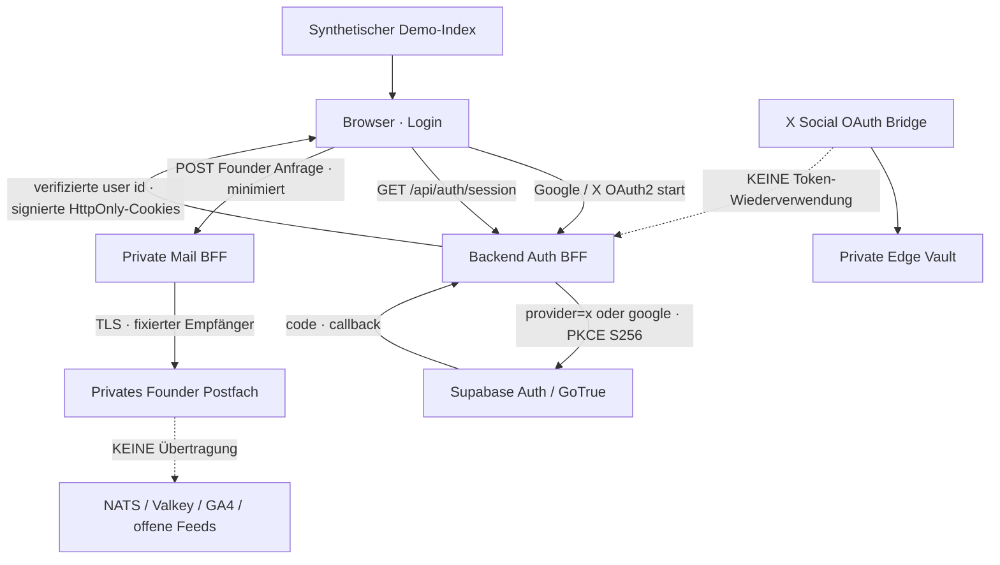

# CAPITAL-AI PLATFORM — X-Login, Founder-Vertrieb und Demo-Evidence

**Stand:** 2026-10-14 · Scope: PLATFORM/Product/Trust, Repository `SvenKulessa/Capital-AI` · Branch `capital-ai-platform/x-login-founder-demo-security-20261014`. Baseline `main@2946a136`; vor PR/Merge erneut mit dann aktuellem `main` abgleichen. **AGENTS.md ist allein autorisierend** (inklusive SOLO_MAINTAINER_FLOW@1 und aktueller P0-PR-Reihenfolge); diese Datei schafft keine neue Admission/Domain/Required Checks.

## Agentenkontext in 60 Sekunden

| Baustein | Single source of truth | Sicherheit / Produktvertrag |
|---|---|---|
| Web-Sitzung | `server/auth.mjs`; `/api/auth/session` | Signierte HttpOnly/Secure/SameSite-Lax-Cookies, PKCE-S256, serverseitige User-Identität/AAL; **kein** Token im Browser oder Eventstream |
| Google- und X-Website-Login | `/api/auth/login/google` bzw. `/api/auth/login/x`; `/api/auth/callback` | GoTrue/Supabase `provider=google` oder `provider=x`; einheitlicher signierter OAuth-State, explizite Registrierungseinwilligungen (POST Same-Origin), MFA-Gate; kein Social-Publishing-Token |
| X Social API | `server/social-media/x-oauth-*.mjs` und Edge Vault | **SEPARAT**: user-gebundene Social-Providerrechte, kein BFF-Session-Login und keine Lizenz für öffentliche Market-Feeds |
| Browserstatus | `src/hooks/useVerifiedSession.ts`; `src/components/Header.tsx` | Nur API-bewiesene anonyme Sitzung zeigt Terminal Login im Learning/Studio; bei Fehler keinen Logout behaupten |
| Demo-Scoring | `MARKET_BLUEPRINTS`, `computeBlueprintDemoIndex` (`src/features/home/marketBlueprintDemo.ts`) | Vier deterministische synthetische 0–100-Beispiele; Scores sind keine Markt-, Investment-, Benchmark- oder Produktionswerte; NATS pausiert |
| Founder-Anfrageprodukt | `src/data/founderOffer.ts`, `src/features/pricing/MonetizationModal.tsx` | **Bruttopreis auf Anfrage** — kein Stripe Price/SKU/Checkout/Entitlement, bestehendes freigegebenes `BrandLogo` mit `/branding/capital-ai-logo.jpg` |
| Kundendaten | `FounderInquiryForm.tsx`; `server/learning-inquiry.mjs`; `shared/legal-identity.mjs` | Minimale Formfelder, explizite Datenschutz-Kenntnisnahme, POST `/api/public/founder-inquiry`; nur private Controller-Adresse `sven.kulessa@capital-ai.online`, keine Public Streams/GA4/Valkey/NATS |
| Rechtliches | `public/datenschutz/index.html`; `public/agb/index.html` | Anbieter/Verantwortlicher Privatperson. Individuelle Angebote keine Vorab-Lizenz, keine automatische Bestellung. Datenschutz/AVV/Retention und echte X-Scopes live gesondert nachweisen |

### Trust-boundaries



Keine neue Zahlung, kein neuer Vertrag mit Dienstleistern, keine neue Datenbanktabelle/Role, keine Aktivierung von NATS/Rust, kein Deploy aus Feature-Branch. Providerdaten und private Anfrage-PII nicht in gemeinsame Caches oder Logging aufnehmen.

## Login-Konfiguration — erst nach isolierten Tests aktivieren

1. X Developer-Konsole: **Sign in with X**, OAuth2 Client ID/Secret und die für Nutzeridentifikation erforderlichen Berechtigungen prüfen; App-Redirect der **Supabase Auth Bridge** lautet `https://ryzywoktpmyhwzxmstyu.supabase.co/auth/v1/callback`. Dies ist **nicht** der öffentliche BFF-Callback.
2. Supabase → Authentication → Providers → X (Twitter): OAuth2 Client ID/Secret per Adminoberfläche, erforderliche E-Mail-Freigabe und aktivierten Provider verifizieren. Keine Credentials in GitHub/Chat/Frontend.
3. Supabase Redirect-Allowlist enthält exakt `https://capital-ai.online/api/auth/callback`; BFF nutzt `PUBLIC_APP_ORIGIN=https://capital-ai.online` und die bereits vorhandenen sicheren Cookie-/PKCE-Konfigurationen.
4. Testkonto: X-Login, erneutes Login, Abbruch, gesperrter Provider, Parallel-Login, Replay/Callback ohne Cookie, Cross-Origin-POST, Passwortreset, MFA-Pflicht, Registrierungsconsent und Tenant-Trennung durchspielen. **X-Account-Verbindung für Social Publishing berechtigt nicht zur Website-Anmeldung und umgekehrt.** Gleiche E-Mail allein ist kein Identitätsbeweis für Account-Linking.
5. Runtime-Readback erst nach merge/gated main Deploy mit zwei Testkonten und validierter Projektkonfiguration; Code- und Mocks sind **nicht** LOGIN_VERIFIED.

## Founder-Kontakt, Lizenzen und Monetarisierung

- **Angebotsstatus:** `INQUIRY_ONLY`; individuelle Leistungsbeschreibung, SLA, Daten-/Blueprint-Umfang, steuerlich zutreffender Bruttopreis und Vertragskonditionen werden **erst nach** Owner-Angebot vereinbart. Keine Automatisierung der Bestellung und kein stiller Verweis auf alte Stripe-Preis-IDs. `/pricing` enthält die Anfrage auf dem Zusatzprodukte-Tab.
- Formular sendet Name, E-Mail, freiwillige Organisation, privates Zeit-/Rückrufinteresse, Klassifizierung (Partner/Kunde/Integration) und freie Anfrage ausschließlich an `/api/public/founder-inquiry`. Server validiert Länge, Same-Origin, Honeypot, limitiert Traffic und bestätigt nur vom SMTP-Server tatsächlich angenommene Zustellung. UUID-Receipt ohne Kundendaten, In-Memory-Expiry 15 Min, keine persistente CRM-/Analytics-Kopie. **Mail-Postfach-Retention und Providerverträge müssen real geprüft werden.**
- Externer Terminbuchungsservice ist **nicht** integriert (kein bestätigter kosten-/DSGVO-geprüfter Dienst); stattdessen optionales Telefonfenster und E-Mail. Für spätere Integration erst Verfügbarkeits-/OAuth-/PII-/Löschkonzept, Auftragsverarbeitung, Free-Tier-/Kostenprüfung und Ownerfreigabe dokumentieren.
- Commercial Licenses: technische Blueprints und die 50 Komponenten werden **nicht** mit Marktdaten/Providerrechten, Markenlizenzen, offenen Repos oder reproduzierbaren Kundendaten gleichgesetzt. Vor individuellen Leistungszusagen Eigentums-/Lizenzrechte, Third-Party-OSS-Notices, kommerzielle Lieferbefugnisse, Exportfähigkeit, geschützte Download-Entitlements und Vertragsinhalt getrennt attestieren. **Keine pauschale kommerzielle Rechtefreigabe.**
- `public/datenschutz/index.html` führt Founder/Partner-Datenkategorien, Rechtsgrundlage Art. 6 Abs. 1 lit. b/f DSGVO, Empfänger, Retention-Grenzen, Auskunft/Löschung. Mailanbieter/Transfers sind kein pauschal verifizierter Vertrag.

## Frontend / Backend / DevSecOps — Befundmatrix

| Kontrolle | Quelle / Beobachtung | Evidence |
|---|---|---|
| Backend Website X Provider-Route, PKCE + Cookie + GoTrue callback | `server/auth.mjs`, `server/auth.test.mjs` | `CODE_PRESENT`, Test-/Live-Success getrennt nachweisen |
| Registrierung: POST Origin, notwendige Einwilligungen und Persistenz | bestehende `storeGoogleSignupConsent` helper wird für beide Provider weitergenutzt | `CODE_PRESENT`; exakte Rechtsversionen in Produktion korrelieren |
| Session-Schaltflächen | `src/hooks/useVerifiedSession.ts`, Learning/Studio | `CODE_PRESENT`; mobile Android Browser-E2E offen |
| Synthetische Demo-Werte | Scorer-fixtures und Studio-Blueprintcards, ohne reale Provider | `CODE_PRESENT`; produktiver Scorer unverändert |
| Founder SMTP privacy lane | `server/learning-inquiry.mjs` / feste Controller-Mail | `CODE_PRESENT`; Live SMTP/Retention offen |
| Container Build / Supply Chain | `Dockerfile`: digest-gepinnte Node/Alpine-Basis; `.dockerignore` Allowlist; bestehende GHCR/Render-Pipeline | `SOURCE_REVIEW`; neues HEAD erfordert eigene vollständige CI |
| Datenbank-Advisor | Supabase Sicherheits-Advisor 2026-10-14: **1 WARN** Passwort-Leak-Schutz deaktiviert; **12 INFO** RLS ohne Policies | `RUNTIME_ADVISOR_OBSERVED`; deny-all RLS kann beabsichtigt sein, keine Blanket Grants |
| Render Betrieb | live bestehender Service `Capital-AI`, Docker aus `main`, Frankfurt, `/healthz`, eine Instanz; letzte beobachtete Live-Deploy-Commit `1b2da809` | `RUNTIME_EXISTING`, nicht Feature-Branch |
| X Provider-Live-Login, Founder SMTP Live, Browser/A11y, geschützte Kundendaten E2E | Noch keine echten usergebundenen Tests | `NOT_PROVEN` |

### Test- und Rollback-Plan

```bash
# CI/Entwickler: Befehle an einem Repo-Checkout; keine Secrets ausgeben
node --test server/auth.test.mjs server/learning-inquiry.test.mjs
node --import tsx --test scripts/market-blueprint-demo.test.mjs
node --run test:security
node --run test:cookie-consent-v3
node --run validate:all
node --run build
# Vor Freigabe: GitHub Actions Docker Security Gate + Domain Governance + anwendbares CodeQL
# Erst nach Merge auf main: /healthz und auth/session + Founder SMTP Readback ohne PII in Logs
```

**Rollback:** Kein Datenbank-Schema, neues Entitlement oder zusätzlicher bezahlter Provider verändert. Auf Feature-Branch revert der Änderungen; nach kontrolliertem Main-Merge ausschließlich neuer Revert-PR nach AGENTS.md und Readback. Bei OAuth-Verweigerung X-Provider im Supabase Auth-Admin deaktivieren, nicht die bestehende Social-Bridge oder Google-Login löschen. Bei Mailausfall Anfrage-Formular via Revert ausblenden, E-Mail-Fallback verfügbar lassen. Keinen ungeprüften Render-/NATS-Restart vornehmen.

## Workmanagement / Owner

- [CAP-5](https://linear.app/capital-ai/issue/CAP-5/trust-founder-inquiry-datenschutz-kontaktformular-und-lizenzmatrix): Founder Datenschutz, Liefer- und kommerzielle Lizenzrechte
- [CAP-6](https://linear.app/capital-ai/issue/CAP-6/platform-x-website-oauth-pkce-mfa-providertrennung-und-security-tests): X Web OAuth / Security / Scopes und Kosten
- [CAP-7](https://linear.app/capital-ai/issue/CAP-7/product-demo-scorings-und-eingeloggte-hub-cta-verifizieren): Demo & Session UX, Android und Accessibility
- [CAP-8](https://linear.app/capital-ai/issue/CAP-8/trustplatform-supabase-auth-password-protection-und-rls-advisor-prufen): Supabase Warnung, RLS isolation/rechtebasierte Prüfungen

👋⚙️ **Owner-Schritte:** X OAuth2 in Supabase/X-Konsole freigeben, Auth-Credentials privat hinterlegen, SMTP Empfang im privaten Postfach und DSGVO-Aufbewahrung prüfen, Bruttoangebot und Leistungsumfang nur individuell vereinbaren. Keine kommerzielle Provider-Lizenz oder Stripe-Neuanlage ohne dokumentierte Eigentümerentscheidung.

**Statusprinzip:** `CODE_PRESENT` ≠ `TEST_PASS` ≠ `RUNTIME_VERIFIED` ≠ `PRODUCTION_READY`. CI/PR und Deploy-Evidence separat erfassen. Zahlen sind synthetische Testannahmen, keine gemessene Leistung. Keine zusätzlichen Required Checks über `AGENTS.md`.
