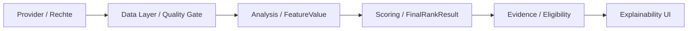

# Financial Intelligence Architecture Hub (PRODUCT)

**Route:** `/architecture-hub` (Alias: `/financial-intelligence`)  
**Scope:** Öffentliches, lesendes Frontend für Architektur, registrierte Komponenten, Blueprint-Modelle und Explainability.  
**Authority:** `AGENTS.md` / `SOLO_MAINTAINER_FLOW@1`.

## Deliverables

| Oberfläche | Wirkung | Read-only Source of Truth |
|---|---|---|
| ARCHITECTURE-HUB | Fünfstufiger interaktiver Fluss von Provider zu Evidence und navigierbare Fachbereiche | `src/features/architecture/architectureViewModel.ts`, `src/contracts/canonicalContracts.ts` |
| BLUEPRINT-EXPLORER | Sieben vorhandene, filterbare Blueprint-Topologien mit verpflichtender Evidence | `src/data/studioData.ts`, `src/data/blueprintEvidenceContracts.ts`, `src/features/documentation/blueprintDocumentationData.ts` |
| COMPONENT-LIBRARY | Die 50 kanonischen Analysekomponenten mit Inputs, Outputs, Version, Features, Provider-Abhängigkeiten, Default-Gewicht und Sperrstatus | `src/contracts/analysisComponentRegistry.ts` |
| EXPLAINABILITY-SYSTEM | Zweck, Features, Default-Gewicht, Eligibility, Veto, Reason Codes und explizite Unterscheidung von Provider-Abhängigkeit und tatsächlicher Quelle | `src/contracts/analysisComponentRegistry.ts`, `src/features/screener/ScoreExplainabilityDrawer.tsx`, `src/features/analysis/scorePresentation.ts` |

Die **Interactive Learning Journey** führt öffentlich und ohne Tracking-/Persistenzbehauptung durch vier Schritte (Quellen, Qualitäts-Gates, Faktoren, Evidence). Die bestehende sechs-stufige Lernreihe unter `/learning` bleibt unverändert und bietet einen Link in den Hub.

## Datengrenzen und Explainability

- **Warum ein Score existiert:** Output-Vertrag, Modellversion, Gate-/Veto-Policies und registrierte Reason Codes einer ausgewählten Komponente.
- **Welche Faktoren wirken:** Registrierte `featureDependencies` und `defaultWeight` als **Konfiguration**, niemals als tatsächlich ausgeführte Ergebnisgewichtung.
- **Welche Quelle genutzt wurde:** Die Registry enthält nur `providerDependencies`. Eine **tatsächlich verwendete** Datenquelle kann nur eine geprüfte `FeatureValue.provenance` einer konkreten Score-Instanz belegen. Im öffentlichen Architektur-Hub lautet dieser Nachweis `NOT_PROVEN`. Der echte Screener verwendet bereits den `ScoreExplainabilityDrawer` mit dem fail-closed `safeScorePresentation`.
- **Keine Berechnung erfunden:** Fehlen konkrete Formel, Eingabedaten, Modellstatus oder Evidence, zeigt die Ansicht keine Runtime-Zahl und keine fingierte Quellenzuordnung. Ein fehlender Score wird nicht als 0 ausgegeben.
- **Blueprints:** `BLUEPRINT_EVIDENCE_CONTRACTS` sperren Lieferung/Production. Öffentliche Beschreibung, Topologie und Anforderungen werden angezeigt; keine Vollquellen, API-Keys, private Provider-Resultate oder vertragswidrige Redistribution.

## Routen und Tests

- `/architecture-hub?tab=overview|blueprints|components|learning|explainability`
- `/architecture` bleibt die vorhandene Pipeline-Rechercheansicht mit Querverweis.
- `/studio` katalogisiert den neuen öffentlichen Hub als zusätzliche Navigation.
- `/learning` verlinkt die interaktive Architektur-Lernreise.
- `npm run test:architecture-hub` – Registry-Aggregation, Suchen, Evidence-Gates, gerendertes Hub-Markup und sichere Deep Links.
- `npm run test:navigation` – zentrale Navigation (plus direkter Route-Test).
- `npm run lint` – TypeScript + Frontend-Grenzen.
- `npm run build` – Vite-Build.

## Architekturentscheidung

**Gewählt:** Lazy-loaded, read-only Frontend-Projektion direkt aus den bestehenden In-Repo-Registries. Das spart Providerzugriffe und zusätzliche Infrastruktur, vermeidet divergierende Schattenkataloge und lässt sich über die Route zurücknehmen.

**Alternative:** Separates Backend-GraphQL-/Graph-Index über Runtime-Daten. Das würde automatisch frische Lineage-Abfragen ermöglichen, aber zusätzliche Auth-, Providerrechte-, Datenverarbeitungs-, Betriebs- und Kostenverträge benötigen; dafür liegen in diesem Auftrag keine bestätigten Production-Rechte vor.

**Nicht enthalten / NOT_PROVEN:** Public Runtime Score-Fetch, reale Feature-Provenienz/Score-Replay, mobile Browser-/Screenreader-Abnahme, regulatorische Produktzulassung, Live-Provider-Entitlements und Benchmark-Performance. Der Hub schaltet nichts davon frei.

**Kosten:** Keine neuen Pakete, Tarife, KI-/Provider-Calls, Datentransfers oder Secrets; lediglich zusätzliche statische JS-Bundlegröße und CI-/Deployment-Ressourcen des bestehenden Pfads. Deren tatsächlicher Umfang ist bis zum Build-Readback `NOT_PROVEN`.
