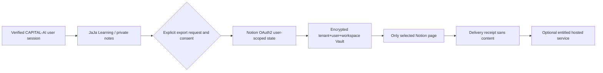

# CA-PRODUCT-JAJA-NOTION-MARKETPLACE · JaJa Buddy × Notion

Status: PLANNING / RIGHTS_REVIEW_REQUIRED / MARKETPLACE_NOT_LISTED
Date: 2026-10-15. Product owner-directed roadmap entry.
Canonical roadmap: `src/data/socialContentRoadmap.ts`.

## Business case and boundaries

A first-party, optional learning-workspace feature can combine JaJa Buddy (learning explanation and user assistance), user-owned CAPITAL-AI notes and explicit export of selected material to a user-selected Notion page. Position as an **external hosted CAPITAL-AI service**, not an assignment, white label, API resale or sublicensing of the proprietary JaJa character, voice, avatar or assets.

Two independent Notion developer connections are configured by the owner but runtime is not proven:

1. **Supabase Notion sign-in** uses `https://<supabase-project>.supabase.co/auth/v1/callback`, user identity capabilities and the existing CAPITAL-AI Supabase PKCE account session. The login application is not a content-export authority.
2. **Learning Hub Notion OAuth** uses the separately proposed `https://capital-ai.online/api/integrations/notion/callback`, explicitly granted content capabilities, backend-controlled CSRF state and per-user workspace tokens. The endpoint, token vault, revoke and export are **not implemented**.

Do not interchange the two client IDs, application secrets or OAuth callbacks. Do not put their credentials, authorization codes or private notes in the repo, telemetry, Social Content Engine, generated articles or Notion Marketplace screenshots. Do not silently link OAuth identities to existing paid accounts: explicit provider linking, verified email/account attribution, MFA and legal consent must be covered separately.

## Hosted SaaS commercial design

| Variant | User outcome | Channel | Commercial status |
| --- | --- | --- | --- |
| Included private notes | CAPITAL-AI local notes and learning favorites | CAPITAL-AI | Existing feature |
| JaJa Learning × Notion export | Explicit user-triggered export to pages selected during Notion consent | CAPITAL-AI hosted service; optional Notion discovery listing | PLANNING |
| Advanced synchronized workspace | Conflict-safe two-way data sync and scheduled digest after revocation/budget design | Separate paid subscription or extension; not forced on base notes | HOLD |
| Resell JaJa persona/voice/brand | Third-party asset sublicensing, white label | None | PROHIBITED by `Chat Buddy/PROPRIETARY.md` |

First-party templates and clear explainability may improve acquisition. Do not claim Notion endorsement, marketplace admission, pricing, paid rights or measured conversion. Marketplace listing, if pursued, requires independent Notion review and applicable brand/license terms. Notion developer listing and Notion template commerce are distinct channels; neither is automatically a Stripe entitlement.

## Architecture and consent

Requirements: state signed/bound to the same browser session; short TTL / single-use; only backend exchanges codes; strict account/tenant/workspace isolation; minimum capabilities; page-selection constraints; rate limiting; encryption, rotation, revocation and deletion; no background export until opt-in; non-public finance inputs must never enter the content/news pipeline.

## Ordered implementation acceptance

1. Public provider callback semantics, auth/session negative tests and non-interchangeability of the two Notion clients.
2. Per-user connection lifecycle: connect/status/disconnect, encrypted token store, revoke, cleanup, RLS and cross-tenant negative cases.
3. Explicit notes export: chosen target page, canonical note schema and idempotent write receipts; error/empty/permission-loss UI.
4. JaJa learning UX: notes and explanations with clear synthetic/educational financial disclaimers, mobile/a11y/manual keyboard QA.
5. Rights, Marketplace review and consent/privacy notices; explicit SKU/Stripe entitlement only after deliverable and support evidence; provider billing/usage caps before scheduling.
6. Cross-check PR #522 (Learning quizzes / JaJa Buddy notes) on fresh main before integrating Buddy state, do not modify its source in parallel.

## Rights and review

`Chat Buddy/PROPRIETARY.md` states JaJa name, figure and voice are non-transferable and not third-party licensable. `docs/product/JAJA-AVATAR-ASSET-LICENSE.md` confirms an owner-approved Grok derivative for CAPITAL-AI use, while original provider terms / third-party clearance remain partly NOT_PROVEN. Branding or generated asset distribution via Marketplace requires review; a service listing must not bundle raw JaJa character assets for standalone redistribution.

Reference docs: https://developers.notion.com/guides/get-started/authorization and https://supabase.com/docs/guides/auth/social-login/auth-notion.
