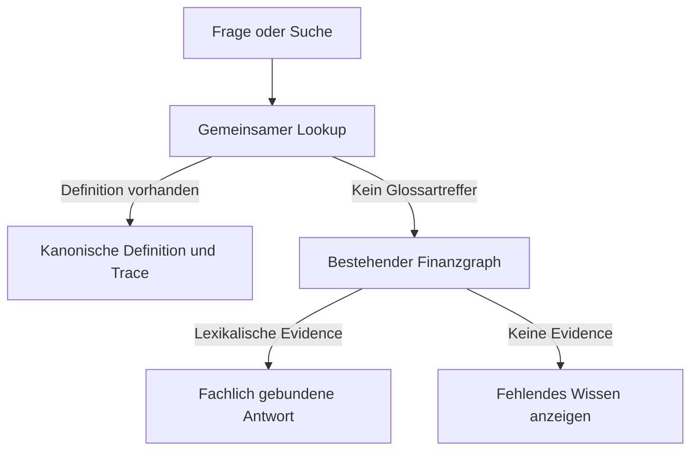

# Gemeinsames Vocabulary und isolierte BI-Piloten — 06.11.2026

Basis: `dcd41e22b2b6df5e1429dbe35c0d3710842f331a`.

## Ergebnis und Grenzen

- **325 → 386 kanonische Begriffe**, 61 neue Einträge mit Kategorie, Niveau,
  Definition, Erklärung, Regel, synthetischem Beispiel, Quellen und drei äquivalenten
  Bezeichnungen/Übersetzungen. Kein neuer Begriff nur zum Auffüllen des Thesaurus.
- Die frühere Liste mit 64 Begriffen wird dedupliziert: Backpressure und LangGraph
  verwenden die bereits vorhandenen IDs. Telemetrie/Telemetry ergänzen den bestehenden
  Eintrag `finance-voc-docmin-0006` statt einer zweiten Definition desselben Konzepts.
- Ein reiner, deterministischer Lookup dient Hub, Modal, lokalem Buddy, dessen
  serverseitiger Ergänzung, Content-Plan und Social-Paket. Er verarbeitet ausschließlich
  den versionierten öffentlichen Katalog, keine privaten Notizen oder Providerdaten.
- `supression` ist eine Suchvariante für die getrennten Marketing-/Security-Bedeutungen.
  `midi` ist eine kontextuelle Suchhilfe für MiFID II; keine Gleichsetzung mit MIDI.
- Kategorien und vorhandene Skill-Projektion bleiben bestehen: Starter, Elite,
  Enterprise und Quant. Die Labels sind keine Tarifberechtigungen.

## Ursache und kontrollierter Wirkpfad

Bisher wurde eine fachlich unbekannte Erklärfrage über Intent-Bias mit DCF/WACC
beantwortet. Zugleich ignorierte die sichtbare Suche vorhandene `searchTags`.
Der gemeinsame Lookup priorisiert einen tatsächlichen Begriffs-/Alias-Treffer.
Ohne lexikalische Graph-Evidence werden keine Finanzknoten aus dem Intent erfunden.
Ein fehlender Begriff wird als fehlendes Wissen behandelt. Der bestehende
reversible Trace bindet die Antwort an die Glossar-ID und den öffentlichen Pfad.



Der Graph beschreibt den implementierten Ablauf. Er behauptet keine Installation
oder Ausführung des externen LangGraph-Frameworks. Deutschsprachige Definitionen
werden im deutschen Buddy verwendet; keine erfundenen Übersetzungen in anderen Sprachen.

Content- und Social-Verträge erhalten denselben begrenzten Vocabulary-Kontext.
Der PR-Merge-Worker bindet passende Definitionen an den tatsächlichen Artikel;
der optionale Text-Worker erhält diese als zusätzlichen geprüften Kontext.
Freigaben, Asset-Identitäten und Veröffentlichungsrechte bleiben unverändert.

## DuckDB: tatsächlich ausgeführter Pilot

`docs/evidence/product/vocabulary-bi-pilot-20261106/duckdb-readback.json` enthält
eine reale Ausführung von DuckDB 2.0.0 unter Python 3.12.14 mit einem Thread und
128 MB konfiguriertem Engine-Speicherlimit. Das ist kein gemessener Gesamt-RAM-Grenzwert.
Der Linux-Wheel wurde unabhängig mit dem SHA-256 aus PyPI verglichen; seine
MIT-Lizenz wurde aus dem Paket gelesen. Das Paket liegt ausschließlich in einer
isolierten Pilotumgebung, nicht im Produktionsimage.

Sechs synthetische Ereignisse, zwei Demo-Mandanten: Parquet-Roundtrip,
mandantengebundene SQL-Aggregation, Ausschluss der anderen Demo-Daten,
leerer unbekannter Mandant, SQL-Injection-Negativfall und Ablehnung eines fehlenden
Mandanten sowie CSV-Roundtrip bestanden. Der exportierte CSV enthält drei
Demo-Ereignisse, aggregiert auf zwei Zeilen. Zusätzlich wird eine lokale Parquet-Stichprobe mit einer Million synthetischer Zeilen erzeugt und auf 500.000 Zeilen des Demo-Mandanten A gefiltert. Dateigröße und Laufzeit stehen im Readback; keine Production-SLA. Keine Secrets, echten Konten,
Marktdatenprovider oder produktiven Datenbankzugänge wurden verwendet.

Diese lokalen SQL-Prüfungen belegen **keine** produktive Authentifizierung oder
Supabase-RLS. Vor einem Kundendienst muss der Tenant serverseitig aus der
verifizierten Sitzung abgeleitet werden. Keine freie SQL-Eingabe für Kunden.

Reproduktion auf passender Linux-x86_64-Umgebung mit CPython >=3.12:

```sh
python -m venv /tmp/capital-ai-bi-pilot
/tmp/capital-ai-bi-pilot/bin/python -m pip install --only-binary=:all: --require-hashes -r deploy/analytics-pilot/requirements-linux-x64.txt
/tmp/capital-ai-bi-pilot/bin/python scripts/analytics/duckdb-pilot.py --source-sha dcd41e22b2b6df5e1429dbe35c0d3710842f331a --output /tmp/capital-ai-bi-results
```

## Firecrawl: Anschluss geprüft, Selfhosting blockiert

- Cloud- und Loopback-Transport teilen denselben API-Contract. Das Hosted-API-Secret
  wird nie an die lokale Instanz weitergereicht. Nur explizit freigegebene öffentliche
  Quellen und maximal zwei PR-Seiten je vorhandenem Merge-Batch; keine Crawl-Jobs.
- Netzwerkzugriff weiterhin nur mit `SOCIAL_BATCH_EXTERNAL_WORKERS=enabled`;
  Cloud zusätzlich mit `FIRECRAWL_API_KEY`. Lokaler Endpunkt ausschließlich
  `http://127.0.0.1:3002` bzw. gleichwertiger Loopback-Adresse. Keine beliebige private URL.
- Transporttests verwenden simulierte HTTP-Antworten und sind **kein** Betriebsnachweis.
- Tatsächlicher Capability-Readback: kein Docker, Podman oder Nerdctl; lokaler API-Port
  nicht erreichbar. Kein Firecrawl-Dienst gestartet, kein echter Scrape ausgeführt.
- Upstream v2.11.0, Commit `ef12eb36b2f3382838dfe0a0c1a5add3d5df7fe5`:
  LICENSE, SELF_HOST.md und Compose gelesen; deren Blob-Identitäten stehen im Readback.
  AGPL-3.0 kommerziell nur unter Lizenzpflichten verwenden. Ein separater HTTP-Prozess
  ist keine pauschale Copyleft-Ausnahme; SDK-/Cloud-/Datenrechte separat beurteilen.
- Upstream enthält ungepinnte Images `redis:alpine` und `rabbitmq:3-management`.
  Vor einem Deployment passende Lizenz-, Image- und Ressourcenprüfung durchführen.
  Kein neuer kostenpflichtiger Dienst und keine Reaktivierung von NATS/Rust.

## Power BI: Importpfad vorbereitet, Ausführung offen

`deploy/analytics-pilot/powerbi-import.pq` ist eine lokale Power-Query-Vorlage für
`synthetic-tenant-a.csv`. Der CSV-Rückimport wurde mit DuckDB geprüft;
Power BI Desktop, DAX-Auswertung, Microsoft-Anmeldung und Embedded-Rendering
wurden **nicht** ausgeführt. Das Template ist kein Power-BI-Betriebsnachweis.

Power BI Desktop ist proprietär; lokale kostenlose Erstellung bedeutet keine
kostenlose Produktionseinbettung. Embedded erfordert geeignete Kapazität und
Lizenzierung. Keine öffentlichen "Publish to web"-Freigaben für private Daten.

## Kosten, Wartbarkeit und Monetarisierung

Empfohlen: erst den kleinen DuckDB-/Parquet-Batch-Pfad mit freigegebenen Daten
vermessen, dann serverseitige Tenant-Bindung und authentifizierte Exporte umsetzen.
Alternative: Power BI für bereits passend lizenzierte M365-B2B-Kunden.
Kosten für Hosting, Speicher, Wartung, externe APIs und Kapazitäten bleiben getrennt
von einer kostenlosen Softwarelizenz zu bewerten. Ein kostenpflichtiges Analyse-
oder Blueprint-Angebot benötigt belegte Lieferfähigkeit, Datenrechte und Entitlements;
dieser Pilot schaltet keinen Verkauf frei.

## Validierung und Rücknahme

Die Lookup-Regressionen prüfen die früher falsche Governance-Antwort, unbekannte
Fragen, Alias-/Wortgrenzen, alle neuen Definitionen und unveränderte Publish-Grenzen.
Die Tests sind in den vorhandenen npm-/Docker-Checks verdrahtet, ohne neuen Gate.
Lokaler Durchlauf: vollständiges `npm test` mit 879 Tests ohne Fehler; separate
Firecrawl-/Merge-Transportprüfungen mit 11 Tests erfolgreich; TypeScript/Frontend-Grenzen
und Produktionsbuild erfolgreich.
Browser-/Mobile-QA ist lokal NOT_PROVEN: Chromium fehlt, und der angebotene
Headless-Shell-Download lieferte kein gültiges ZIP. Keine Bildschirmaufnahme erfunden.
CI, Merge und Live-Readback separat auswerten. Rücknahme durch Revert; keine
Datenbankmigration oder externe Provideraktivierung erforderlich.

## Primärquellen (geprüft am 06.11.2026)

- https://github.com/firecrawl/firecrawl/tree/ef12eb36b2f3382838dfe0a0c1a5add3d5df7fe5
- https://www.gnu.org/licenses/agpl-3.0.en.html
- https://pypi.org/pypi/duckdb/2.0.0/json
- https://duckdb.org/faq
- https://learn.microsoft.com/en-us/power-bi/developer/embedded/embedded-capacity
- Die fachlichen Primärquellen je Definition stehen im Katalog.

## Fortsetzung 07.11.2026

- Branch konfliktfrei auf Main `2736bf98acff8ff19d789f70d44a04f3046f690f` rebasiert.
- Vollständiges npm test, TypeScript und Produktionsbuild erneut erfolgreich.
- Bestehender Browser-Workflow prüft jetzt zusätzlich `land graph`, `supression`,
  `midi` und leere Suchergebnisse auf 320/390/768/1280 Pixel; Screenshots werden
  mit den bestehenden CI-Artefakten ausgegeben. Ausführung in CI separat lesen.
- Lokaler tatsächlicher Browser-Aufruf: NOT_PROVEN (`CHROMIUM_EXITED`); Playwright-
  Download lieferte erneut kein gültiges ZIP. Systeminstallation scheitert an
  setgroups/setegid/seteuid-Berechtigungen. Keine Rechteumgehung versucht.
- Firecrawl-Port 3002: Verbindung verweigert; Docker/Podman/Nerdctl fehlen weiterhin.
  Kein Dienst und kein echter Scrape als VERIFIED ausgeben.
- Power BI Desktop ist in dieser Linux-Laufzeit nicht verfügbar; Importvorlage
  ist weiterhin kein ausgeführter Power-BI-Import. Kein Embedded-Dienst aktiviert.
- Git-CLI besitzt keine Push-Zugangsdaten; Veröffentlichung über die vorhandene
  GitHub-Integration. Frühere lokale SHA ist nach Rebase nicht der neue PR-Head.
