# PRODUCT · Authenticated account drawer, saved notes and Notion feasibility

Date: 2026-10-15
Base main: `198d0f4510751427979a3c263875199a608597b6`
Domain: PRODUCT / Learning Portal and account UX.

## Current repo findings and implementation

- The account navigation was duplicated: signed-in hamburger menu offered Profile and Security while `AccountPageShell` repeated those and other destinations as a horizontal tab strip.
- The signed-in drawer now exposes Profile, Security, Account & Rights, Manage Subscriptions and Private Dashboard as individually navigable account routes. Existing logout remains intact. The account pages no longer render the redundant shared tab strip.
- Labels are localized in the existing six supported languages; no route, user role, Stripe portal authorization or account login boundary changes.
- The existing account-scoped `/api/profile/notes` GET/PUT API remains the only notes store. The dashboard adds a third tab (`Gespeicherte Notizen`) next to `Lernfeld` and `Notizen`, displaying only the last successfully loaded/saved server-acknowledged value. Unsaved textarea drafts never appear there.
- Notes readback checks the returned `userId` against the authenticated user, clears in-memory note data when the session changes, and remounts the dashboard for another user. No notes are embedded into navigation, shared cache or public SEO pages.
- No schema migration or new vendor integration required for the shipped navigation and notes UI.

## Reproduction / acceptance

1. Sign in as an ordinary account and as verified Owner; open the hamburger drawer on a phone-size viewport.
2. Confirm each new drawer entry goes to an authenticated existing route and logout still works. No second account-navigation strip appears within the destination page. Unauthenticated drawer must not show private links.
3. On `/profile/dashboard`, verify keyboard tab movement (ArrowRight/ArrowLeft/Home/End), tap targets, narrow horizontal overflow and 200% font zoom.
4. Edit notes without saving; `Gespeicherte Notizen` must still show the previous server-confirmed value. Submit; only after a successful API acknowledgement should the view update. Reopen/refresh to confirm persistence.
5. Simulate stale session, failed notes requests and second user; private contents must be cleared or fail closed. Existing browser QA fixture has been extended for acknowledged note content and draft isolation.

Existing tests: `scripts/navigation.test.mjs` and optional `scripts/qa/learning-swipe-browser.mjs`. Tests in GitHub Actions and authenticated production browser QA are **NOT_PROVEN** at authoring; a committed regression assertion is not an executed test result. Required checks remain `Docker Security Gate` and `Domain Governance`.

## Notion account connection: feasible, not implemented

**Finding:** Notion supports public OAuth 2.0 connections installed by individual users with explicitly selected workspace pages. A single owner internal token or this ChatGPT session's Notion connector must **not** be reused for arbitrary CAPITAL-AI visitors.

Notion reference: https://developers.notion.com/guides/get-started/authorization (checked 2026-10-15), https://developers.notion.com/reference/create-a-token.

Recommended independently deployable integration design:

```mermaid
flowchart LR
  U[Authenticated CAPITAL-AI user] --> B[Connect Notion button]
  B --> S[Server start: verify session, CSRF state]
  S --> N[Notion OAuth authorization and page picker]
  N --> C[Capital-AI callback: verify state and exchange code]
  C --> V[Encrypted per-user workspace tokens]
  V --> E[Explicit export of selected notes]
  E --> P[Notion page shared by the user]
```

- Create a **public** Notion connection in the Notion Developer portal, with its own credentials and an exact HTTPS callback, provisionally `https://capital-ai.online/api/integrations/notion/callback`. This is a **proposed URI**, not an active or registered callback.
- Use server-owned OAuth state tied to the currently verified CAPITAL-AI user/session and with short expiry and one-time use; validate callback origin, state, workspace identity and expected user before storing tokens. Exchange OAuth code only on backend with `NOTION_CLIENT_SECRET`, never in the browser.
- Separate Notion integration credentials and token vault from Supabase Google/X login identities and from X social publishing tokens. Use a tenant/user + Notion workspace composite key for encrypted storage and enforce per-user access.
- Start with an explicit user-triggered **one-way export** of saved notes to a user-selected Notion page, without full-workspace sync. Treat rate limits, permission loss, content deletion, token refresh and workspace revocation as first-class errors. Include disconnect and data deletion.
- Review GDPR privacy notice and processor/third-country disclosures before enabling production; do not export private notes to Notion before affirmative user action. Monitor only consented export events, without copying note content to analytics.
- No public connection registration, live token exchange, or real-user Notion access is established by this review. Activation requires creating the public connection, registering redirect URI and injecting Client ID/secret in the backend deployment.
- Pricing direction: leave core notes included; an optional advanced Notion export/sync could become a Starter/Pro enhancement **only after** tested rights, user benefit and disclosure. Do not imply an active paid integration today.

## Alternatives / decision

1. **Minimal:** read-only saved-notes view backed solely by existing API (selected for this PR): low risk, low cost, no extra vendor access.
2. **Public Notion OAuth + explicit export** (proposed next scoped implementation): genuine per-user authorization, consent and explicit data delivery; requires configuration, token lifecycle and privacy work.
3. **Internal Notion integration token** (rejected for customer feature): tied to one workspace and would not securely represent each customer.

Rollback: revert the navigation/notebook PR. Existing `/api/profile/notes`, learning favorites, Stripe subscriptions, OAuth logins and database state remain unchanged.
