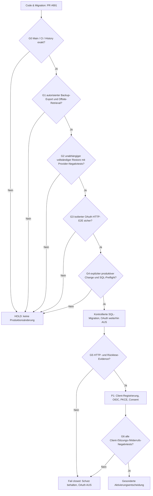

# CAPITAL-AI: kontrollierter P0-Cutover der OAuth-Client-RLS-Isolation

**Contract:** `CAPITAL_AI_OAUTH_RLS_CUTOVER_PLAN@1`  
**Datum:** 2026-11-13 · Domain TRUST / PLATFORM  
**Ziel:** Supabase `ryzywoktpmyhwzxmstyu` · PostgreSQL 17.11  
**Implementierung:** PR [#691](https://github.com/SvenKulessa/Capital-AI/pull/691), Branch `capital-ai-trust/oauth-server-consent-20261113`  
**Recovery-Abhängigkeit:** [Issue #664](https://github.com/SvenKulessa/Capital-AI/issues/664), synthetische Recovery [PR #676](https://github.com/SvenKulessa/Capital-AI/pull/676)  
**Autorität:** aktuelle `AGENTS.md` auf `main` (`SOLO_MAINTAINER_FLOW@2`).

> **HOLD / KEIN PRODUKTIVER SQL-CUTOVER.** Dieser Vertrag ist Planung und dokumentierte read-only Bestandsaufnahme. Er ist keine Autorisierung, produktive Backup-Credentials abzurufen, eine Datenbank zu exportieren, Rollen zu ändern, eine Migration auszuführen, OAuth zu aktivieren, einen PR zu mergen oder ein Deployment auszulösen.

## 1. Exakte Ausgangsevidence und Evidence-Grenze

| Gegenstand | Beobachtung (13.11.2026) | Status |
|---|---|---|
| Supabase-Projekt | `ryzywoktpmyhwzxmstyu`, PostgreSQL 17.11, ACTIVE_HEALTHY | VERIFIED |
| Remote-Migrationen | 128 Versionsnummern, alle im Feature-Branch vorhanden | VERIFIED (Versionen) |
| Repository-Migrationen | 129 SQL-Dateien; einziges Local-only-Delta `20261113152000_oauth_client_default_deny.sql` | VERIFIED (Versionen) |
| Vollständiger SQL-Text/DDL-Fingerprint aller 128 historischen Migrationen | Nicht durchgeführt | NOT_PROVEN |
| OAuth-Migration in `supabase_migrations.schema_migrations` | 0 | VERIFIED (nicht installiert) |
| Policy `oauth_client_default_deny` / Function `public.capital_ai_oauth_data_api_deny` | 0 / 0 | VERIFIED (nicht installiert) |
| `auth.oauth_clients` / `auth.oauth_authorizations` / `auth.oauth_consents` | 0 / 0 / 0 | VERIFIED (keine registrierten Clients) |
| `public` / `storage` | 65/65 public-RLS; 10/10 storage-RLS; 0 storage-Policies; 7 public-Tabellen mit `authenticated` SELECT-Grants | VERIFIED (Katalog) |
| `pgrst.db_pre_request` auf Rolle `authenticator` | Keine Rolleinstellung im abgefragten `pg_db_role_setting` sichtbar | VERIFIED für **diesen** Konfigurationspfad; andere Provider-Konfigurationen NOT_PROVEN |
| `capital_ai_backup_reader` | Existiert nicht; `PUBLIC` mit `net.USAGE` und DML auf `net.http_request_queue` | BLOCKED |
| Supabase-Provider-/Offsite-Restore mit echten Auth-/Storage-/Vault-Daten | Nicht nachgewiesen | BLOCKED |
| Isolierte PG17.11-Tests | PR #676: 76 synthetische PASS; PR #691: native Subjects A/B, OAuth Clients A/B, RLS-Read/Write/403 in separatem Supabase-Testprojekt mit ROLLBACK | VERIFIED, nur synthetisch |
| PR #691 CI | Docker Security Gate Run 43468768041 und Domain Governance Run 43468768467 am früheren Head `2f3a43e3a601b7dd9686ea496754ddefb8391805` SUCCESS | VERIFIED für **diesen Head**, nicht pauschal für spätere Commits |
| GitHub `main` | `866eaa481ada4084a66c6d0d19de1ac5f7030195`; Branch vor Planerstellung 1 Commit behind | Re-Sync erforderlich |

Die Supabase-Datenbank ist auf **Free-Tier** nicht als täglich wiederherstellbar anzunehmen. Offizielle Baseline:
https://supabase.com/docs/guides/platform/backups

Der existierende `scripts/platform/backup-stream-encrypt.sh` erzeugt clientseitig verschlüsseltes `age`-Archiv, benutzt jedoch `pg_dump --format=plain --no-owner --no-privileges` ohne vollständige, getestete Objekt-Allowlist. Ein SQL-Dump enthält keine Storage-Dateibytes, und `--no-owner --no-privileges` beweist keine Owner-/ACL-Rekonstruktion. Ausgabe des Skripts kennzeichnet `isolatedProductionRestore=NOT_PROVEN`.

## 2. Abhängigkeitsgraph: Stop auf dem ersten fehlenden Pflichtnachweis



Die Gates sind **konkrete Abnahmebedingungen innerhalb des existierenden PR-/Change-Prozesses**, keine neuen globalen GitHub-Required-Checks. Kein Gate gilt wegen eines grünen Testmocks oder eines veralteten SHAs als erfüllt.

## 3. G0 – Repository, Abhängigkeiten, Migration History

1. PR #691 gegen den **dann aktuellen** `main` abgleichen. Änderungen aus neuer `AGENTS.md`, Dockerfile, `.dockerignore` und `package.json` konfliktfrei erhalten. HEAD, BASE, Merge-Base und tatsächlichen Datei-Diff belegen.
2. Auf dem synchronisierten exakten Head: bestehende `Docker Security Gate`- und `Domain Governance`-Checks, OAuth-Consent-/RLS-Static-/Cross-User-Negativtests, Build/Lint und bei Bedarf PG17-Fixture nachweisen. Run-IDs und Check-Conclusions aufnehmen.
3. Unmittelbar vor DB-Change: Remote-Versionsmenge gegen Repository-Migrationsdateien vergleichen; Erwartung **128 identische Versionen + genau 1 OAuth-Datei** gilt nur für den Snapshot dieser Planung. Bei neuer Version Drift neu bewerten.
4. SQL-Definition der OAuth-Migration inklusive Git-Blob und separat berechnetem SHA-256 fixieren; den bisherigen `authenticator`-Pre-Request-Status auf Role-/Database-/Provider-Ebene lesen. Andere Hooks dürfen nicht überschrieben werden.
5. Remote-History nicht mit `migration repair`, `db reset` oder unbegründetem `db push` korrigieren. Der spätere Deploymentweg muss eine **einmalige, atomare und versionierte** Migration samt History-Eintrag und unabhängiger Nachprüfung garantieren.

**Abbruch:** Branch-Divergenz/CI-Fehler, unerklärte Versionen, DDL-Drift, anderer Provider-Hook, neue permissive Storage-Policy, nicht RLS-geschützte erreichbare Tabelle oder unklarer Backend-Pfad.

Read-only SQL-Preflight (keine Geheimnisse oder Nutzerzeilen):

```sql
SELECT version FROM supabase_migrations.schema_migrations ORDER BY version;
SELECT count(*) AS oauth_migration_applied
FROM supabase_migrations.schema_migrations
WHERE version='20261113152000';
SELECT schemaname, count(*) AS guarded_tables
FROM pg_policies WHERE policyname='oauth_client_default_deny'
GROUP BY schemaname;
SELECT n.nspname, c.relname, c.relrowsecurity
FROM pg_class c JOIN pg_namespace n ON n.oid=c.relnamespace
WHERE n.nspname='public' AND c.relkind IN ('r','p')
  AND (has_table_privilege('authenticated',c.oid,'SELECT')
    OR has_table_privilege('authenticated',c.oid,'INSERT')
    OR has_table_privilege('authenticated',c.oid,'UPDATE')
    OR has_table_privilege('authenticated',c.oid,'DELETE'))
ORDER BY 1,2;
```

## 4. G1 – Backup- und Offsite-Evidence: P0 BLOCKED

Vor einem produktiven DDL-/DCL-Cutover **muss ein tatsächlich autorisierter** Backup-Export vorliegen:

- Definierter RPO/RTO, Aufbewahrungsfrist, Lösch-/Datenschutzrahmen, Recovery-Verantwortliche und Break-Glass-Zugriff; Credentials kurzlebig und nur im autorisierten Runner. Keine Secrets oder Dumpdaten in GitHub/Chat/Logs.
- Quelle/PG-Version, SQL-Objekt-Allowlist, Include-/Exclude-Scope sowie vollständige Rücksicht auf `auth`, `private`, `fintech_core`, `stripe`, `storage`, `vault`, `cron`, `pgmq`, `net`, Sequenzen, FK, Trigger, Functions, Owner/ACL/Default Privileges und Extensions. Kein ungetestetes `pg_read_all_data` oder `BYPASSRLS`.
- Vor Verbindungsaufbau die `PUBLIC`-Vererbungsrisiken aus #664 schließen oder ein separat autorisiertes, eng begrenztes Verfahren mit technisch wirksamer Netz-/Credential-Isolation dokumentieren. `default_transaction_read_only=on` alleine genügt nicht.
- Clientseitig verschlüsselter Dump/Metadatenmanifest mit UTC, PG-Client/Server-Version, SHA-256, Quelle und nicht-geheimer Archividentität; Storage-Dateibytes und Hashliste getrennt; Vault-Root-Key-Portabilität **oder** autorisierte Re-Provisionierung ausdrücklich nachweisen.
- **Unabhängige Wiederbeschaffung** aus zugelassener privater Offsite-Ablage, überprüfter Ciphertext-Hash und entschlüsselbarer Restore-Eingang ohne Offenlegung der Schlüssel; bloßer Upload/Hochladenachweis ist nicht ausreichend.

**Abbruch:** fehlende Owner-Autorisierung, unvollständiger Dump-Scope, PUBLIC-`net`-Schreibpfade, nicht nachweisbare Schlüssel-/Dateibyte-Wiederbeschaffung, fehlender unabhängiger Archiv-Retrieval. Kein produktiver Dump in diesem Auftrag.

## 5. G2 – Realer isolierter Provider-Restore: P0 BLOCKED

- Separates löschbares, datenschutzrechtlich zulässiges Ziel mit **vor dem Import außerhalb der Datenbank erzwungener Egress-Sperre** für Cron, pg_net, Webhooks, Stripe, E-Mail/SMS, Edge Functions, Realtime und Queue-Worker; keine automatisch aktivierten Scheduler-Jobs.
- Das bestehende Projekt `wcvorlvhwvuprqsjcten` ist **nicht** ohne weiteres freigegeben: es enthält bereits Auth-Identitäten und benutzt laut #664 eine andere `supabase_vault`-Minor-Version. Kein `DROP`/`TRUNCATE`/Restore dorthin ohne eigene Freigabe.
- Auf dem freigegebenen Ziel restorefähige Daten *und* Schema/ACL/RLS/Owner/Sequence/FK/Trigger vergleichen; GoTrue-Login/MFA/OAuth-Sitzungen gegen reale Provider-Semantik prüfen, nicht nur synthetische Tabellen.
- Für private Storage-Objekte tatsächliche Bytes/Hashes und Zugriff durch fremde Benutzer prüfen; Vault mit Provider-Freigabe sicher re-provisionieren und Negativtest mit falschem Schlüssel durchführen; keinen Root-Key in Evidence erfassen.
- `cron`, `pg_net`, `pgmq`, Stripe-Webhooks: **keine** versehentlichen externen Aufrufe oder Replay/Doppelbuchungen. Reale Wiederherstellungszeit und Datenverlustgrenze messen.

**Ergebnis nur VERIFIED**, wenn Source → verschlüsseltes Archiv → unabhängiger Download → Restore → vollständige fachliche Negativtests und RPO/RTO mit reproduzierbarem Artefakt-/Zeit-/Hash-Nachweis vorliegen. Der 76-PASS-Fixture-Lauf aus #676 allein erfüllt G2 **nicht**.

## 6. G3 – Vorproduktive OAuth-E2E-Validierung

In einer ausdrücklich dafür autorisierten isolierten **OAuth-Testumgebung**, nicht mittels fingierter Produktions-JWTs:

1. Zwei ausschließlich synthetische Benutzer `U_A` / `U_B`, zwei getrennte registrierte OAuth-Testclients `C_A` / `C_B` mit unterschiedlichen **exakten** HTTPS-Callbacks und begrenzten Rechten. Token nur via Auth-Server Authorization Code + PKCE S256, keine manuell gefälschten Signaturen als HTTP-Evidence.
2. Die neue SQL-Migration versioniert im Test anwenden. Test-PostgREST muss den gesetzten Pre-Request-Hook **tatsächlich** ausgeführt haben (eine rein direkte SQL-`PERFORM`-Probe genügt nicht).
3. Gegen echte Test-REST-/RPC-/GraphQL-/Storage-/Realtime-Endpunkte und projektinterne API-/Edge-Adapter testen; keine ungeprüften BFF-Service-Role-Proxy-Pfade.
4. Auth-Server: registrierte Redirect-URI, fehlender/falscher `code_verifier`, PKCE-Replay, Cross-Client-Codeaustausch, Consent approve/deny, CSRF/Origin, Token-Rotation/Widerruf, OIDC discovery/JWKS/Signatur, issuer/audience/client_id/sub, ID-Token-Nonce, abgelaufene und fremde Sessions.

Die konkrete HTTP-Akzeptanzmatrix (JSON-/HTTP-Metadaten und bereinigte Testdaten, **keine** Token-Dumps):

| Identität / Pfad | Erwartung | Fail |
|---|---|---|
| Ohne Bearer `GET /rest/v1/profiles?select=id` | `401` oder nachweislich `403`, niemals geschützte Zeilen | Geschützte Zeile erscheint |
| Native Session `U_A`, eigene Profile/Subscriptions | Eigentümerzugriff unverändert; begrenzte Testdaten sichtbar | Fälschliche Default-Deny-Regressionssperre |
| Native `U_A` auf `U_B`-Zeilen | `200` mit leerem Ergebnis, oder rollenbedingt `403`; **niemals** `U_B`-Daten | Fremde Zeile |
| OAuth `U_A+C_A` und `U_A+C_B` auf `/rest/v1/profiles`, `subscriptions` | `403`, Fehler `oauth_client_data_api_forbidden` | `2xx` mit Daten oder `client_id`-Bypass |
| OAuth `U_B+C_A` auf `U_A`-Ressource | `403` | Fremde Daten |
| OAuth Clients A/B: `POST/PATCH/DELETE` synthetischer Zeilen | `403`, keine Änderung | Mutation; separate `SELECT`-Probe |
| OAuth A/B auf exposed `/rest/v1/rpc/<synthetic_readonly_rpc>`, `/graphql/v1` | Abgewiesen, kein Aufruf/Leak; Router-Ausnahme dokumentieren | `2xx` mit geschütztem Inhalt |
| Storage: private Buckets, Sign-URL-/Upload-/List-/Download-Versuche | Keine neue Datei, keine Metadaten, kein Tokenzugriff | Objekt-Bytes/URL an falschen Client |
| Realtime/Broadcast, Edge Functions, App-BFF mit User-Bearer | Provider-/Owner-Adapter nachweislich deny-by-default | Isolationsbypass via Service-Role |
| Ungültiger/abgelaufener/falsch signierter JWT | `401` (oder dokumentiertes Provider-Äquivalent), keine Daten | Akzeptiert |
| Falsche Client-ID/Redirect-URI/CSRF, PKCE falscher Verifier, Consent deny | Provider- oder App-Fehler ohne Code-/Token-Ausgabe | Code, Token oder Consent für falschen Client |

Ein authentifiziertes `GET` auf `/rest/v1` kann bei RLS-`SELECT` **200 mit leerer Liste** zurückgeben; für den PostgREST-Hook verlangt die Regression dagegen den **beobachteten HTTP 403**. Die exakte HTTP-Statuscode-Projektion der Storage-/Realtime- und OAuth-Endpoints ist separat zu protokollieren.

## 7. G4 – Produktiver SQL-Cutover, erst nach G0–G3 und separater Freigabe

Im freigegebenen Wartungsfenster, mit gesichertem Backup-/Restore-Snapshot und unverändertem **OAuth-Consent-Flag = OFF**:

1. Live-Referenz, frische Migration-History, Tabellen-/Storage-/`authenticator`-Settings und SHA erneut lesend prüfen. Bei Abweichung STOP.
2. Atomar und **genau einmal** die geprüfte Datei `supabase/migrations/20261113152000_oauth_client_default_deny.sql` über den autorisierten versionierten Migrationsweg anwenden. **In diesem Chat nicht ausführen.**
3. Nach Commit und PostgREST-Reload unabhängig prüfen: Migration-Version einmal vorhanden; `public`-RLS-Policies über alle RLS-fähigen App-Tabellen entsprechend Snapshot, Hook-Function und wirksame authenticator-Einstellung vorhanden; Storage unverändert und weiterhin fail-closed; bestehende First-Party-Auth erfolgreich.
4. Wenn irgendein SQL-Teilschritt/HTTP-Readback scheitert: **keine OAuth-Ausgabe aktivieren**. Eine Migration ist kein Test- oder Produktivfreigabesignal. Den kontrollierten Forward-Fix unter gesicherter Native-Auth-Grenze bevorzugen; keine blinde Rücksetzung von Tabellen, Usern oder Auth-Schlüsseln.

## 8. G5/G6 – HTTP-Canary, Client-Registrierung und Release

- Nach erfolgreichem SQL-Cutover eine kontrollierte native First-Party-/Owner-Regression gegen Produktion ausführen, ohne echte Kundenzeilen zu protokollieren. Der neue Pre-Request-Hook muss HTTP-seitig wirksam sein. OAuth-Server und Website-Consent bleiben bis dahin AUS.
- Erst nach G0–G5 registrierte, vollständig spezifizierte Clients (Name, Typ `public/confidential`, exakte Redirect-URIs, Auth-Methode, PKCE, Scopes, Owner/Datenschutz) autorisiert über offizielle Auth-Admin-API bereitstellen. Keine dynamische Registrierung und keine Platzhalter-IDs.
- Die Allowlists `CAPITAL_AI_OAUTH_ALLOWED_CLIENT_IDS` **und** `CAPITAL_AI_OAUTH_ALLOWED_REDIRECT_URIS` aus den vom Provider bestätigten Registrierungen erzeugen; keine freie Wildcard, keine ungeprüfte Social-Callback-Übernahme.
- Authorization Code+PKCE, Consent approve/deny, OIDC/JWKS, Revocation, Cross-Client- und Cross-User-Negativtests mit **zwei real vom Provider signierten, auf Testidentitäten begrenzten** Token-Sets im kontrollierten Canary prüfen. Bis zum Erfolg `CAPITAL_AI_OAUTH_SERVER_CONSENT_ENABLED` nicht auf `true` setzen.
- Explizites P1-Releasestatement mit Owner-/Change-Autorität, SHA, CI/HTTP/Restore-Befunden und rücklesbaren Konfigurations-**Booleans**, niemals Schlüsselwerte.

## 9. Rollback und Fail-Closed-Recovery – ohne Zugriffsöffnung

**R0 (vor SQL):** keine Datenbankänderung; PR bleibt offen, Flags AUS.

**R1 (SQL durchgeführt, OAuth noch AUS):** Bei Native-Regression nur auf freigegebenem isoliertem Testziel eine reversible Korrektur evaluieren. Falls nötig SQL-Rollback-Plan exakt gegen vorherigen Snapshot bauen und testen. Keine automatische Komplett-DB-Wiederherstellung mit Datenverlust. Keine unkontrollierte `DROP POLICY`-Aktion, solange OAuth-Tokens existieren könnten.

**R2 (OAuth Canary oder Aktivierung begonnen):**
1. Neue OAuth-Authorizations/Consent-Ausgabe sofort **AUS**, Client-Registrierungen/Grants providerseitig sperren und Serverfunktion nur über autorisierten Verwaltungsweg deaktivieren.
2. Bestehende Sessions/Refresh-Tokens gemäß Auth-Provider widerrufen. Bereits ausgestellte JWTs können bis zum Ablauf weiter gültig bleiben: **RLS/Pre-Request-Schutz beibehalten**, bis Ablauf/Blacklist/Clientstatus zweifelsfrei geprüft ist.
3. Von Kunden und Daten getrennte Sanitized-HTTP-Readbacks wiederholen. Erst nach Nachweis, dass kein OAuth-Token mehr wirksam ist, den separat getesteten SQL-Reversal in Betracht ziehen.
4. Bei Provider-/Restore-Versagen: fail closed, Datenbankstatus nicht durch ungetestetes GCS-/PITR-Rollback verschlechtern; Incident/Evidence und kontrollierte Wiederherstellung.

**Beobachtung/Alarm:** PostgREST-403-Anstiege nach Client-Rollout erwartet, First-Party-403-Anstieg nicht erwartet; `oauth_client_default_deny`-Policy-Drift, unerwartete Storage-Permissive-Policies, `pgrst.db_pre_request`-Override, neu exponierte Tabellen/RPCs und unerwartete OAuth-Clients als Stop-Signal melden.

## 10. Abnahmeprotokoll (an PR #691 / Issue #664 anhängen)

```text
Evidence schema: CAPITAL_AI_OAUTH_RLS_CUTOVER@1
timestamp_utc:
project_ref: ryzywoktpmyhwzxmstyu
repository: SvenKulessa/Capital-AI
main_sha:
pr_691_head_sha:
migration_version: 20261113152000
migration_sha256:
remote_migrations_count:
repo_migrations_count:
remote_only_versions:
local_only_versions:
docker_gate_run_id:
domain_governance_run_id:
backup_source_scope_and_hash:
encrypted_offsite_object_identity:
independent_download_verified:
restore_target_authorization_and_egress:
restore_fingerprint_and_object_bytes:
vault_auth_provider_compatibility:
rpo_rto_measured:
synthetic_pg17_rls_result:
isolated_http_matrix_result:
production_sql_cutover: BLOCKED
production_http_readback:
oauth_client_registration: BLOCKED
oauth_consent_flag: NOT_ENABLED
client_id_allowlist: NOT_CONFIGURED
client_redirect_allowlist: NOT_CONFIGURED
decision: HOLD
blocking_issue: 664
```

**Kleinster realer Next-Slice:** #664: autorisierten und nachweislich egress-isolierten Restore-Rahmen herstellen, durch einen unabhängigen echten Export/Download/Restore testen. Parallel unabhängig davon PR #691 auf aktuellen `main` synchronisieren und die regulären Checks am neuen SHA auswerten. **Kein PROD-Merge/Deployment/Migration/OAuth-Enable aus diesem Plan.**
