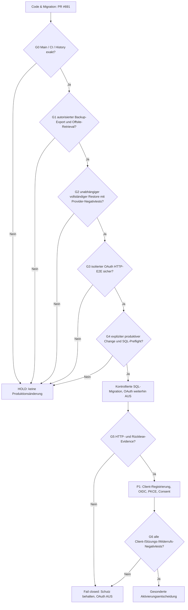

# CAPITAL-AI: kontrollierter P0-Cutover der OAuth-Client-RLS-Isolation

**Contract:** `CAPITAL_AI_OAUTH_RLS_CUTOVER_PLAN@1`  
**Datum:** 2026-11-13 · Domain TRUST / PLATFORM  
**Ziel:** Supabase `ryzywoktpmyhwzxmstyu` · PostgreSQL 17.11  
**Implementierung:** PR [#691](https://github.com/SvenKulessa/Capital-AI/pull/691), Branch `capital-ai-trust/oauth-server-consent-20261113`  
**Recovery-Abhängigkeit:** [Issue #664](https://github.com/SvenKulessa/Capital-AI/issues/664), synthetische Recovery [PR #676](https://github.com/SvenKulessa/Capital-AI/pull/676)  
**Autorität:** aktuelle `AGENTS.md` auf `main` (`SOLO_MAINTAINER_FLOW@2`).

> **HOLD / KEIN PRODUKTIVER SQL-CUTOVER.** Dieser Vertrag ist Planung und dokumentierte read-only Bestandsaufnahme. Er ist keine Autorisierung, produktive Backup-Credentials abzurufen, eine Datenbank zu exportieren, Rollen zu ändern, eine Migration auszuführen, OAuth zu aktivieren, einen PR zu mergen oder ein Deployment auszulösen.

## 1. Exakte Ausgangsevidence und Evidence-Grenze

| Gegenstand | Beobachtung (13.11.2026) | Status |
|---|---|---|
| Supabase-Projekt | `ryzywoktpmyhwzxmstyu`, PostgreSQL 17.11, ACTIVE_HEALTHY | VERIFIED |
| Remote-Migrationen | 128 Versionsnummern, alle im Feature-Branch vorhanden | VERIFIED (Versionen) |
| Repository-Migrationen | 129 SQL-Dateien; einziges Local-only-Delta `20261113152000_oauth_client_default_deny.sql` | VERIFIED (Versionen) |
| Vollständiger SQL-Text/DDL-Fingerprint aller 128 historischen Migrationen | Nicht durchgeführt | NOT_PROVEN |
| OAuth-Migration in `supabase_migrations.schema_migrations` | 0 | VERIFIED (nicht installiert) |
| Policy `oauth_client_default_deny` / Function `public.capital_ai_oauth_data_api_deny` | 0 / 0 | VERIFIED (nicht installiert) |
| `auth.oauth_clients` / `auth.oauth_authorizations` / `auth.oauth_consents` | 0 / 0 / 0 | VERIFIED (keine registrierten Clients) |
| `public` / `storage` | 65/65 public-RLS; 10/10 storage-RLS; 0 storage-Policies; 7 public-Tabellen mit `authenticated` SELECT-Grants | VERIFIED (Katalog) |
| `pgrst.db_pre_request` auf Rolle `authenticator` | Keine Rolleinstellung im abgefragten `pg_db_role_setting` sichtbar | VERIFIED für **diesen** Konfigurationspfad; andere Provider-Konfigurationen NOT_PROVEN |
| `capital_ai_backup_reader` | Existiert nicht; `PUBLIC` mit `net.USAGE` und DML auf `net.http_request_queue` | BLOCKED |
| Supabase-Provider-/Offsite-Restore mit echten Auth-/Storage-/Vault-Daten | Nicht nachgewiesen | BLOCKED |
| Isolierte PG17.11-Tests | PR #676: 76 synthetische PASS; PR #691: native Subjects A/B, OAuth Clients A/B, RLS-Read/Write/403 in separatem Supabase-Testprojekt mit ROLLBACK | VERIFIED, nur synthetisch |
| PR #691 CI | Docker Security Gate Run 43468768041 und Domain Governance Run 43468768467 am früheren Head `2f3a43e3a601b7dd9686ea496754ddefb8391805` SUCCESS | VERIFIED für **diesen Head**, nicht pauschal für spätere Commits |
| GitHub `main` | `866eaa481ada4084a66c6d0d19de1ac5f7030195`; Branch vor Planerstellung 1 Commit behind | Re-Sync erforderlich |

Die Supabase-Datenbank ist auf **Free-Tier** nicht als täglich wiederherstellbar anzunehmen. Offizielle Baseline:
https://supabase.com/docs/guides/platform/backups

Der existierende `scripts/platform/backup-stream-encrypt.sh` erzeugt clientseitig verschlüsseltes `age`-Archiv, benutzt jedoch `pg_dump --format=plain --no-owner --no-privileges` ohne vollständige, getestete Objekt-Allowlist. Ein SQL-Dump enthält keine Storage-Dateibytes, und `--no-owner --no-privileges` beweist keine Owner-/ACL-Rekonstruktion. Ausgabe des Skripts kennzeichnet `isolatedProductionRestore=NOT_PROVEN`.

## 2. Abhängigkeitsgraph: Stop auf dem ersten fehlenden Pflichtnachweis



Die Gates sind **konkrete Abnahmebedingungen innerhalb des existierenden PR-/Change-Prozesses**, keine neuen globalen GitHub-Required-Checks. Kein Gate gilt wegen eines grünen Testmocks oder eines veralteten SHAs als erfüllt.

## 3. G0 – Repository, Abhängigkeiten, Migration History

1. PR #691 gegen den **dann aktuellen** `main` abgleichen. Änderungen aus neuer `AGENTS.md`, Dockerfile, `.dockerignore` und `package.json` konfliktfrei erhalten. HEAD, BASE, Merge-Base und tatsächlichen Datei-Diff belegen.
2. Auf dem synchronisierten exakten Head: bestehende `Docker Security Gate`- und `Domain Governance`-Checks, OAuth-Consent-/RLS-Static-/Cross-User-Negativtests, Build/Lint und bei Bedarf PG17-Fixture nachweisen. Run-IDs und Check-Conclusions aufnehmen.
3. Unmittelbar vor DB-Change: Remote-Versionsmenge gegen Repository-Migrationsdateien vergleichen; Erwartung **128 identische Versionen + genau 1 OAuth-Datei** gilt nur für den Snapshot dieser Planung. Bei neuer Version Drift neu bewerten.
4. SQL-Definition der OAuth-Migration inklusive Git-Blob und separat berechnetem SHA-256 fixieren; den bisherigen `authenticator`-Pre-Request-Status auf Role-/Database-/Provider-Ebene lesen. Andere Hooks dürfen nicht überschrieben werden.
5. Remote-History nicht mit `migration repair`, `db reset` oder unbegründetem `db push` korrigieren. Der spätere Deploymentweg muss eine **einmalige, atomare und versionierte** Migration samt History-Eintrag und unabhängiger Nachprüfung garantieren.

**Abbruch:** Branch-Divergenz/CI-Fehler, unerklärte Versionen, DDL-Drift, anderer Provider-Hook, neue permissive Storage-Policy, nicht RLS-geschützte erreichbare Tabelle oder unklarer Backend-Pfad.

Read-only SQL-Preflight (keine Geheimnisse oder Nutzerzeilen):

```sql
SELECT version FROM supabase_migrations.schema_migrations ORDER BY version;
SELECT count(*) AS oauth_migration_applied
FROM supabase_migrations.schema_migrations
WHERE version='20261113152000';
SELECT schemaname, count(*) AS guarded_tables
FROM pg_policies WHERE policyname='oauth_client_default_deny'
GROUP BY schemaname;
SELECT n.nspname, c.relname, c.relrowsecurity
FROM pg_class c JOIN pg_namespace n ON n.oid=c.relnamespace
WHERE n.nspname='public' AND c.relkind IN ('r','p')
  AND (has_table_privilege('authenticated',c.oid,'SELECT')
    OR has_table_privilege('authenticated',c.oid,'INSERT')
    OR has_table_privilege('authenticated',c.oid,'UPDATE')
    OR has_table_privilege('authenticated',c.oid,'DELETE'))
ORDER BY 1,2;
```

## 4. G1 – Backup- und Offsite-Evidence: P0 BLOCKED

Vor einem produktiven DDL-/DCL-Cutover **muss ein tatsächlich autorisierter** Backup-Export vorliegen:

- Definierter RPO/RTO, Aufbewahrungsfrist, Lösch-/Datenschutzrahmen, Recovery-Verantwortliche und Break-Glass-Zugriff; Credentials kurzlebig und nur im autorisierten Runner. Keine Secrets oder Dumpdaten in GitHub/Chat/Logs.
- Quelle/PG-Version, SQL-Objekt-Allowlist, Include-/Exclude-Scope sowie vollständige Rücksicht auf `auth`, `private`, `fintech_core`, `stripe`, `storage`, `vault`, `cron`, `pgmq`, `net`, Sequenzen, FK, Trigger, Functions, Owner/ACL/Default Privileges und Extensions. Kein ungetestetes `pg_read_all_data` oder `BYPASSRLS`.
- Vor Verbindungsaufbau die `PUBLIC`-Vererbungsrisiken aus #664 schließen oder ein separat autorisiertes, eng begrenztes Verfahren mit technisch wirksamer Netz-/Credential-Isolation dokumentieren. `default_transaction_read_only=on` alleine genügt nicht.
- Clientseitig verschlüsselter Dump/Metadatenmanifest mit UTC, PG-Client/Server-Version, SHA-256, Quelle und nicht-geheimer Archividentität; Storage-Dateibytes und Hashliste getrennt; Vault-Root-Key-Portabilität **oder** autorisierte Re-Provisionierung ausdrücklich nachweisen.
- **Unabhängige Wiederbeschaffung** aus zugelassener privater Offsite-Ablage, überprüfter Ciphertext-Hash und entschlüsselbarer Restore-Eingang ohne Offenlegung der Schlüssel; bloßer Upload/Hochladenachweis ist nicht ausreichend.

**Abbruch:** fehlende Owner-Autorisierung, unvollständiger Dump-Scope, PUBLIC-`net`-Schreibpfade, nicht nachweisbare Schlüssel-/Dateibyte-Wiederbeschaffung, fehlender unabhängiger Archiv-Retrieval. Kein produktiver Dump in diesem Auftrag.

## 5. G2 – Realer isolierter Provider-Restore: P0 BLOCKED

- Separates löschbares, datenschutzrechtlich zulässiges Ziel mit **vor dem Import außerhalb der Datenbank erzwungener Egress-Sperre** für Cron, pg_net, Webhooks, Stripe, E-Mail/SMS, Edge Functions, Realtime und Queue-Worker; keine automatisch aktivierten Scheduler-Jobs.
- Das bestehende Projekt `wcvorlvhwvuprqsjcten` ist **nicht** ohne weiteres freigegeben: es enthält bereits Auth-Identitäten und benutzt laut #664 eine andere `supabase_vault`-Minor-Version. Kein `DROP`/`TRUNCATE`/Restore dorthin ohne eigene Freigabe.
- Auf dem freigegebenen Ziel restorefähige Daten *und* Schema/ACL/RLS/Owner/Sequence/FK/Trigger vergleichen; GoTrue-Login/MFA/OAuth-Sitzungen gegen reale Provider-Semantik prüfen, nicht nur synthetische Tabellen.
- Für private Storage-Objekte tatsächliche Bytes/Hashes und Zugriff durch fremde Benutzer prüfen; Vault mit Provider-Freigabe sicher re-provisionieren und Negativtest mit falschem Schlüssel durchführen; keinen Root-Key in Evidence erfassen.
- `cron`, `pg_net`, `pgmq`, Stripe-Webhooks: **keine** versehentlichen externen Aufrufe oder Replay/Doppelbuchungen. Reale Wiederherstellungszeit und Datenverlustgrenze messen.

**Ergebnis nur VERIFIED**, wenn Source → verschlüsseltes Archiv → unabhängiger Download → Restore → vollständige fachliche Negativtests und RPO/RTO mit reproduzierbarem Artefakt-/Zeit-/Hash-Nachweis vorliegen. Der 76-PASS-Fixture-Lauf aus #676 allein erfüllt G2 **nicht**.

## 6. G3 – Vorproduktive OAuth-E2E-Validierung

In einer ausdrücklich dafür autorisierten isolierten **OAuth-Testumgebung**, nicht mittels fingierter Produktions-JWTs:

1. Zwei ausschließlich synthetische Benutzer `U_A` / `U_B`, zwei getrennte registrierte OAuth-Testclients `C_A` / `C_B` mit unterschiedlichen **exakten** HTTPS-Callbacks und begrenzten Rechten. Token nur via Auth-Server Authorization Code + PKCE S256, keine manuell gefälschten Signaturen als HTTP-Evidence.
2. Die neue SQL-Migration versioniert im Test anwenden. Test-PostgREST muss den gesetzten Pre-Request-Hook **tatsächlich** ausgeführt haben (eine rein direkte SQL-`PERFORM`-Probe genügt nicht).
3. Gegen echte Test-REST-/RPC-/GraphQL-/Storage-/Realtime-Endpunkte und projektinterne API-/Edge-Adapter testen; keine ungeprüften BFF-Service-Role-Proxy-Pfade.
4. Auth-Server: registrierte Redirect-URI, fehlender/falscher `code_verifier`, PKCE-Replay, Cross-Client-Codeaustausch, Consent approve/deny, CSRF/Origin, Token-Rotation/Widerruf, OIDC discovery/JWKS/Signatur, issuer/audience/client_id/sub, ID-Token-Nonce, abgelaufene und fremde Sessions.

Die konkrete HTTP-Akzeptanzmatrix (JSON-/HTTP-Metadaten und bereinigte Testdaten, **keine** Token-Dumps):

| Identität / Pfad | Erwartung | Fail |
|---|---|---|
| Ohne Bearer `GET /rest/v1/profiles?select=id` | `401` oder nachweislich `403`, niemals geschützte Zeilen | Geschützte Zeile erscheint |
| Native Session `U_A`, eigene Profile/Subscriptions | Eigentümerzugriff unverändert; begrenzte Testdaten sichtbar | Fälschliche Default-Deny-Regressionssperre |
| Native `U_A` auf `U_B`-Zeilen | `200` mit leerem Ergebnis, oder rollenbedingt `403`; **niemals** `U_B`-Daten | Fremde Zeile |
| OAuth `U_A+C_A` und `U_A+C_B` auf `/rest/v1/profiles`, `subscriptions` | `403`, Fehler `oauth_client_data_api_forbidden` | `2xx` mit Daten oder `client_id`-Bypass |
| OAuth `U_B+C_A` auf `U_A`-Ressource | `403` | Fremde Daten |
| OAuth Clients A/B: `POST/PATCH/DELETE` synthetischer Zeilen | `403`, keine Änderung | Mutation; separate `SELECT`-Probe |
| OAuth A/B auf exposed `/rest/v1/rpc/<synthetic_readonly_rpc>`, `/graphql/v1` | Abgewiesen, kein Aufruf/Leak; Router-Ausnahme dokumentieren | `2xx` mit geschütztem Inhalt |
| Storage: private Buckets, Sign-URL-/Upload-/List-/Download-Versuche | Keine neue Datei, keine Metadaten, kein Tokenzugriff | Objekt-Bytes/URL an falschen Client |
| Realtime/Broadcast, Edge Functions, App-BFF mit User-Bearer | Provider-/Owner-Adapter nachweislich deny-by-default | Isolationsbypass via Service-Role |
| Ungültiger/abgelaufener/falsch signierter JWT | `401` (oder dokumentiertes Provider-Äquivalent), keine Daten | Akzeptiert |
| Falsche Client-ID/Redirect-URI/CSRF, PKCE falscher Verifier, Consent deny | Provider- oder App-Fehler ohne Code-/Token-Ausgabe | Code, Token oder Consent für falschen Client |

Ein authentifiziertes `GET` auf `/rest/v1` kann bei RLS-`SELECT` **200 mit leerer Liste** zurückgeben; für den PostgREST-Hook verlangt die Regression dagegen den **beobachteten HTTP 403**. Die exakte HTTP-Statuscode-Projektion der Storage-/Realtime- und OAuth-Endpoints ist separat zu protokollieren.

## 7. G4 – Produktiver SQL-Cutover, erst nach G0–G3 und separater Freigabe

Im freigegebenen Wartungsfenster, mit gesichertem Backup-/Restore-Snapshot und unverändertem **OAuth-Consent-Flag = OFF**:

1. Live-Referenz, frische Migration-History, Tabellen-/Storage-/`authenticator`-Settings und SHA erneut lesend prüfen. Bei Abweichung STOP.
2. Atomar und **genau einmal** die geprüfte Datei `supabase/migrations/20261113152000_oauth_client_default_deny.sql` über den autorisierten versionierten Migrationsweg anwenden. **In diesem Chat nicht ausführen.**
3. Nach Commit und PostgREST-Reload unabhängig prüfen: Migration-Version einmal vorhanden; `public`-RLS-Policies über alle RLS-fähigen App-Tabellen entsprechend Snapshot, Hook-Function und wirksame authenticator-Einstellung vorhanden; Storage unverändert und weiterhin fail-closed; bestehende First-Party-Auth erfolgreich.
4. Wenn irgendein SQL-Teilschritt/HTTP-Readback scheitert: **keine OAuth-Ausgabe aktivieren**. Eine Migration ist kein Test- oder Produktivfreigabesignal. Den kontrollierten Forward-Fix unter gesicherter Native-Auth-Grenze bevorzugen; keine blinde Rücksetzung von Tabellen, Usern oder Auth-Schlüsseln.

## 8. G5/G6 – HTTP-Canary, Client-Registrierung und Release

- Nach erfolgreichem SQL-Cutover eine kontrollierte native First-Party-/Owner-Regression gegen Produktion ausführen, ohne echte Kundenzeilen zu protokollieren. Der neue Pre-Request-Hook muss HTTP-seitig wirksam sein. OAuth-Server und Website-Consent bleiben bis dahin AUS.
- Erst nach G0–G5 registrierte, vollständig spezifizierte Clients (Name, Typ `public/confidential`, exakte Redirect-URIs, Auth-Methode, PKCE, Scopes, Owner/Datenschutz) autorisiert über offizielle Auth-Admin-API bereitstellen. Keine dynamische Registrierung und keine Platzhalter-IDs.
- Die Allowlists `CAPITAL_AI_OAUTH_ALLOWED_CLIENT_IDS` **und** `CAPITAL_AI_OAUTH_ALLOWED_REDIRECT_URIS` aus den vom Provider bestätigten Registrierungen erzeugen; keine freie Wildcard, keine ungeprüfte Social-Callback-Übernahme.
- Authorization Code+PKCE, Consent approve/deny, OIDC/JWKS, Revocation, Cross-Client- und Cross-User-Negativtests mit **zwei real vom Provider signierten, auf Testidentitäten begrenzten** Token-Sets im kontrollierten Canary prüfen. Bis zum Erfolg `CAPITAL_AI_OAUTH_SERVER_CONSENT_ENABLED` nicht auf `true` setzen.
- Explizites P1-Releasestatement mit Owner-/Change-Autorität, SHA, CI/HTTP/Restore-Befunden und rücklesbaren Konfigurations-**Booleans**, niemals Schlüsselwerte.

## 9. Rollback und Fail-Closed-Recovery – ohne Zugriffsöffnung

**R0 (vor SQL):** keine Datenbankänderung; PR bleibt offen, Flags AUS.

**R1 (SQL durchgeführt, OAuth noch AUS):** Bei Native-Regression nur auf freigegebenem isoliertem Testziel eine reversible Korrektur evaluieren. Falls nötig SQL-Rollback-Plan exakt gegen vorherigen Snapshot bauen und testen. Keine automatische Komplett-DB-Wiederherstellung mit Datenverlust. Keine unkontrollierte `DROP POLICY`-Aktion, solange OAuth-Tokens existieren könnten.

**R2 (OAuth Canary oder Aktivierung begonnen):**
1. Neue OAuth-Authorizations/Consent-Ausgabe sofort **AUS**, Client-Registrierungen/Grants providerseitig sperren und Serverfunktion nur über autorisierten Verwaltungsweg deaktivieren.
2. Bestehende Sessions/Refresh-Tokens gemäß Auth-Provider widerrufen. Bereits ausgestellte JWTs können bis zum Ablauf weiter gültig bleiben: **RLS/Pre-Request-Schutz beibehalten**, bis Ablauf/Blacklist/Clientstatus zweifelsfrei geprüft ist.
3. Von Kunden und Daten getrennte Sanitized-HTTP-Readbacks wiederholen. Erst nach Nachweis, dass kein OAuth-Token mehr wirksam ist, den separat getesteten SQL-Reversal in Betracht ziehen.
4. Bei Provider-/Restore-Versagen: fail closed, Datenbankstatus nicht durch ungetestetes GCS-/PITR-Rollback verschlechtern; Incident/Evidence und kontrollierte Wiederherstellung.

**Beobachtung/Alarm:** PostgREST-403-Anstiege nach Client-Rollout erwartet, First-Party-403-Anstieg nicht erwartet; `oauth_client_default_deny`-Policy-Drift, unerwartete Storage-Permissive-Policies, `pgrst.db_pre_request`-Override, neu exponierte Tabellen/RPCs und unerwartete OAuth-Clients als Stop-Signal melden.

## 10. Abnahmeprotokoll (an PR #691 / Issue #664 anhängen)

```text
Evidence schema: CAPITAL_AI_OAUTH_RLS_CUTOVER@1
timestamp_utc:
project_ref: ryzywoktpmyhwzxmstyu
repository: SvenKulessa/Capital-AI
main_sha:
pr_691_head_sha:
migration_version: 20261113152000
migration_sha256:
remote_migrations_count:
repo_migrations_count:
remote_only_versions:
local_only_versions:
docker_gate_run_id:
domain_governance_run_id:
backup_source_scope_and_hash:
encrypted_offsite_object_identity:
independent_download_verified:
restore_target_authorization_and_egress:
restore_fingerprint_and_object_bytes:
vault_auth_provider_compatibility:
rpo_rto_measured:
synthetic_pg17_rls_result:
isolated_http_matrix_result:
production_sql_cutover: BLOCKED
production_http_readback:
oauth_client_registration: BLOCKED
oauth_consent_flag: NOT_ENABLED
client_id_allowlist: NOT_CONFIGURED
client_redirect_allowlist: NOT_CONFIGURED
decision: HOLD
blocking_issue: 664
```

**Kleinster realer Next-Slice:** #664: autorisierten und nachweislich egress-isolierten Restore-Rahmen herstellen, durch einen unabhängigen echten Export/Download/Restore testen. Parallel unabhängig davon PR #691 auf aktuellen `main` synchronisieren und die regulären Checks am neuen SHA auswerten. **Kein PROD-Merge/Deployment/Migration/OAuth-Enable aus diesem Plan.**

## 11. Aktuelle Verifikations- und Offsite-Metadaten · 13.11.2026 (ohne Produktionsdaten)

**Vergleichsbasis:** aktueller GitHub-`main` `d0bdbf86bc28c6e68ad4ff9719a749c4656192b3`, PR-Feature-Branch nach kontrollierter Synchronisierung `b46b4f3afef4b4ef2d80d8c27052aaa08f132c5d` (vor diesem Evidence-Commit). Der PR unterscheidet sich zum abgeglichenen Main in **11 OAuth-Scope-Dateien**, Branch-Rückstand **0**. Main-Governance `SOLO_MAINTAINER_FLOW@2`, SEO-`isSeoPublicImage` sowie Docker-/Test-Wiring bleiben erhalten.

**Offsite-Fundstellen (ausschließlich Metadaten, kein Download):**
- [Privater Google-Drive-Ordner „CAPITAL-AI Supabase Backups“](https://drive.google.com/drive/folders/13HiWDBT2WAID_7l0TL2SjS2DiI5HlP_e): existiert; `list_folder` meldet **0 sichtbare Dateien**. Nicht als Backup, Archiv- oder Restore-Nachweis anerkannt.
- Dropbox-Suchen nach `capital-ai-supabase` und `backup-manifest`: **0 Treffer**. Das ist keine Aussage über nicht angebundene Ablagen, Buckets oder andere Namen.
- Für GCS fehlt ein autorisiert rücklesbares Objekt mit geprüftem `age`-Ciphertext-SHA, Versions-/Generation-Identität und unabhängigem Download. Kein GCS-Upload/Download in diesem Auftrag.

**Frische nur aggregierte Katalogverifikation:** Supabase PROD PG17.11: 8 Auth-Account-Metadaten, 2 private Storage-Buckets, 1 Storage-Objekt-Metadatensatz, 6 verschlüsselte Vault-Einträge, 3 aktive Cron-Jobs, 0 Backup-Reader-Rollen. Keine Datensätze, Token, Objektbytes oder Secretwerte gelesen. Separates `capital-ai-recovery-664-test` PG17.11: **1 bestehende Auth-Identität**, 0 Buckets, 0 Storage-Objekte, 0 Vault-Einträge, 2 Cron-Jobs mit **0 aktiven** Jobs. Dieses Ziel ist **nicht exklusiv/frei/egress-isoliert nachgewiesen** und darf nicht als Restore-Weg für echte Produktionsdaten genutzt werden. `pg_net`-/Stripe-/Webhook-Nicht-Replay bleibt unabhängig zu belegen.

**CI-Ursachenbefund nach Main-Synchronisierung:** `TRUST npm Update Capsule` [Run 43488478700](https://github.com/SvenKulessa/Capital-AI/actions/runs/43488478700), Job 132103087607 **FAIL**: `FINANCE-SOURCE-TARGET-MANIFEST target authority drift`, `server/auth.mjs` erwartete Blob `b9a3f8799c5dcc0ec0b8a76d082c976ced27e854`, tatsächlicher Blob `d5b272dd05c0361db162491e3f2c5b184a0b9e22`. 16 Manifest-Authority-Blobs direkt gegen GitHub-Objekte geprüft, 15 passend, nur `TA-AUTH` driftend. **Minimalfix:** ausschließlich `TA-AUTH`-Blob und korrelierte Erklärung im vorhandenen Source-to-Target-Manifest aktualisieren. Keine Finance-Zielrechte, Lizenzannahmen oder externen Quellen geändert. Die GitHub-CI muss am **neuen finalen Head** erneut grün sein. Docker Security Gate [Run 43488478852](https://github.com/SvenKulessa/Capital-AI/actions/runs/43488478852) und Domain Governance [Run 43488478578](https://github.com/SvenKulessa/Capital-AI/actions/runs/43488478578) gehören zum **vorherigen** Head; sie werden nicht als Freigabe für spätere Änderungen gezählt.


**Kanonische OCC548-Autorisierungskette aus Google Drive (read-only geprüft):**
- [`CAPITAL-AI-OCC548-RTO-RPO-AUTORISIERUNG@2`](https://docs.google.com/document/d/1ZBHEoI7dDN60s1tJBrPVfheK_YWa5YuQxDXnpMP5LEA/edit): Status `RECONCILED / REVIEW_REQUIRED`, operative Bewertung `NO-GO / AUTHORIZATION_PRIMARY_SOURCE_NOT_VERIFIED`. Zwei ältere `@1`-Dateien besitzen dieselbe Dokument-ID, jedoch widersprüchliche Statusangaben (`VORSCHLAG / NICHT AUTORISIERT` versus `AUTORISIERT`). Eine behauptete Chat-Bestätigung in einer Datei ist kein unabhängiger Primärnachweis. Das `@2`-Dokument ist ausdrücklich **keine** neue Autorisierung.
- [`CAPITAL-AI-OCC548-BACKUP-RUNBOOK@2-REVIEWED`](https://docs.google.com/document/d/16dMze0stUhY4I-9QLRIUMYm5bbd4FxxP_8xdEyMNTjs/edit): `TECHNICALLY_REVIEWED_FOR_PREPARATION / OPERATIVE_NO-GO / NOT_EXECUTED`. Die zwei zu unterscheidenden Scopes sind `OCC548_APPLICATION_RECOVERY` und `FULL_POSTGRES_LOGICAL_RECOVERY`. Keiner autorisiert stillschweigend die vollständige OAuth-/FinTech-Provider-Recovery.
- [`CAPITAL-AI-OCC548-EVIDENCE-MANIFEST@1`](https://drive.google.com/file/d/1mw-8jOAOR6FoWOUrEbdsc1-Ii1X3s5uY/view): Backup-ID, Snapshot, SHA-256-Original/Download und realer Restore **leer / NOT_PROVEN**. Für private Notes wurden RPO `≤ 60 Minuten` und RTO `≤ 4 Stunden` als Ziele **deklariert, nicht gemessen**; keine automatische Übertragung auf den OAuth-Produktions-Cutover.

**Gate-Wirkung:** `OPERATIVE_BACKUP_AUTHORIZATION=REVIEW_REQUIRED`, `REAL_CIPHERTEXT_AND_OFFSITE=NOT_PROVEN`, `FULL_PROVIDER_RESTORE=BLOCKED`. Keine Daten-/Schlüssel-Abfrage, keine GCS-/Drive-Archivmutation, kein OAuth-Server-Enable. Der kleinste nichtproduktive Folgeschritt ist die eindeutige primärquellengebundene Owner-Autorisierung **für den konkret erforderlichen Recovery-Scope** zusammen mit einem egress-isolierten Restore-Ziel; erst danach darf ein autorisierter Export geplant werden.

**G1 Offsite-Backup=BLOCKED, G2 unabhängig realer Restore=BLOCKED, G3 echte OAuth HTTP-E2E=NOT_PROVEN.** Selbst erfolgreiche PR-CI berechtigt nicht zum Merge, zur Produktionsmigration oder zum OAuth-Enable. **Kein externes Speichern/Teilen/Publizieren und keine produktive SQL-/OAuth-/Secrets-Mutation ausgeführt.**


## 11. Folge-Readback 2026-11-13: synchronisierter PR-Head und Backup-Ablage

**Scope:** nur Provider-/GitHub-/Drive-Metadaten, keine produktiven SQL- oder Storage-/Vault-Datenmutationen, kein Dump und keine Secrets.

- **GitHub `main`** `d0bdbf86bc28c6e68ad4ff9719a749c4656192b3`. **PR #691 Head vor diesem Evidence-Commit:** `53a61589348df5f6f45c0a3f6571b62bf26dcdfb`. GitHub compare: **ahead 25 / behind 0**, also bereits synchronisiert. Der Branch wurde nicht nochmals unnötig gemergt oder rebased.
- **CI auf diesem exakten Head:** `Docker Build Sicherheit` [43489580623](https://github.com/SvenKulessa/Capital-AI/actions/runs/43489580623) **SUCCESS**, Job `Docker Security Gate` inklusive Server-Regressionstests, Security-/Lizenz-/Secrets-Scan und Build; `Domain Governance` [43489580505](https://github.com/SvenKulessa/Capital-AI/actions/runs/43489580505) **SUCCESS**. Weitere PR-Workflows `43489580417`, `43489580223`, `43489580249`, `43489580690`, `43489580569` jeweils SUCCESS. Diese Aussagen gelten ausschließlich für den genannten Head, **nicht** für diesen nachfolgenden Dokumentationscommit. Die vorhandenen OAuth-Consent- und Isolationstests sind Teil des Repository-Test-Scopes; eine gesonderte echte HTTP-Cross-Client-Testausführung mit provider-signierten Tokens wurde nicht beobachtet und bleibt **NOT_PROVEN**.
- **Drive:** Privater Ordner [CAPITAL-AI Supabase Backups](https://drive.google.com/drive/folders/13HiWDBT2WAID_7l0TL2SjS2DiI5HlP_e) in der autorisierten Google-Drive-Suche gefunden (**VERIFIED: Ordner-Metadaten**). Direkte Metadatenauflistung mit `'13HiWDBT2WAID_7l0TL2SjS2DiI5HlP_e' in parents and trashed = false` ergab **0 sichtbare Dateien**. Damit **NOT_PROVEN:** ein existierendes verschlüsseltes Archiv, ein Manifest, Ciphertext-SHA-256, Objektgeneration, Download und ein unabhängiger Restore. Ordnerexistenz ist kein Backup.
- **Backup-Exporter:** `scripts/platform/backup-stream-encrypt.sh` verlangt explizite `OWNER_APPROVED_READONLY_EXPORT`-Freigabe für Produktionsmodus, `age`-Empfänger, `verify-full` TLS, `PGPASSFILE` mit Modus 0600 und projektgebundenen Host. Das Manifest setzt `storageUpload=NOT_CONFIGURED`, `isolatedProductionRestore=NOT_PROVEN`, `recoveryRtoRpo=NOT_MEASURED`. Kein produktiver Export ausgeführt. `pg_dump --no-owner --no-privileges` kann keine Provider-ACL-/Owner-Parität allein nachweisen.
- **Issue #664:** Synthetische PG17.11 Recovery (76 PASS) **VERIFIED**, vollständige echte Auth-/Storage-Bytes-/Vault-/ACL-/Scheduler-/Offsite-Recovery **BLOCKED/NOT_PROVEN**. `PUBLIC`-`net`-Berechtigungsrisiko für Backup-Reader unverändert.
- **Sicherheitsentscheidung:** `PRODUCTION_OAUTH_RLS_CUTOVER=BLOCKED`, `BACKUP_OFFSITE_RETRIEVAL=NOT_PROVEN`, `ISOLATED_PROVIDER_RESTORE=NOT_PROVEN`, `HTTP_CROSS_CLIENT=NOT_PROVEN`, `OAUTH_ACTIVATION=BLOCKED`.

**Kleinster autonomer Folgeschritt:** Im bestehenden Feature-Branch gezielt einen vollständig synthetischen, offline ausführbaren End-to-End-Test für verschlüsseltes Archiv → unabhängige Dateikopie → Hashprüfung → isolierten PG17.11-Restore ergänzen oder vorhandene Fixture entsprechend erweitern. Das ist zusätzliche *synthetische* Evidence, niemals Ersatz für einen autorisierten echten Provider-Restore. Die bereits grünen CI-Checks müssen nach diesem Evidence-Commit erneut auf dem neuen Head bewertet werden.


## 12. 2026-11-13 – Aktive P0-Fortsetzung: unabhängige Recovery-Fixture und Client-Bindung

### Recovery-Fortsetzung in Issue #664 / PR #698

- [Draft-PR #698](https://github.com/SvenKulessa/Capital-AI/pull/698), Feature-Head `f6aa222cf81fe33daf90f31283f12f4bd8f48f78`, enthält **nur** die Änderung an `scripts/platform/backup-synthetic-restore-test.sh`.
- [GitHub Drive Backup Encryption Test 43506651699](https://github.com/SvenKulessa/Capital-AI/actions/runs/43506651699), Job `132165971683` **SUCCESS**. Tatsächliche CI-Logmarker: `SYNTHETIC_OFFSITE_COPY_PASS`, `SYNTHETIC_WRONG_KEY_DENIED`, `SYNTHETIC_TAMPER_DENIED`, `SYNTHETIC_POSTGRES_RESTORE_PASS`. GitHub [Domain Governance 43506651645](https://github.com/SvenKulessa/Capital-AI/actions/runs/43506651645) und [Docker Security Gate 43506651965](https://github.com/SvenKulessa/Capital-AI/actions/runs/43506651965) ebenfalls SUCCESS.
- Vor dem Restore wurde im Test die lokale Klartext-/Ciphertext-Originaldatei gelöscht; der zweite lokale Kopierpfad überprüft den SHA-256 der ausschließlich verschlüsselten Daten und stellt synthetische PostgreSQL-Daten wieder her. Manipulierte Archive und falsche age-Identitäten werden verworfen. **Das Wort „Offsite“ ist hier ausschließlich eine lokale Simulation**. Kein tatsächlicher GCS-/Drive-Retrieval, keine echten Auth-/Storage-/Vault-Dateibytes oder Provider-Rollen getestet.
- Die tatsächlichen Recovery-Abnahmebedingungen G1/G2 bleiben **BLOCKED/NOT_PROVEN**, da primäre Owner-Freigabe für einen echten Export, egress-isoliertes Ziel, vollständige Provider-/Vault-Identitäts- und Storage-Bytes-Recovery sowie RTO/RPO-Evidence fehlen. [Issue #664 Evidence-Kommentar](https://github.com/SvenKulessa/Capital-AI/issues/664#issuecomment-6864878193).

### P0 OAuth-Mehrclient-Isolation in PR #691

- `main` bei Synchronisierung: `ed11b7525eee7a998843313227e59d2e95bc720d`. Security-Feature-Branch erhielt einen kontrollierten, nicht-produktiven Merge-Commit `370433dd298e1a76a8086ef4cb746850b15043a4`, GitHub-Compare danach **behind 0**. Der Resvg-GROWTH-Stand aus Main einschließlich `package-lock.json`, Lizenzhinweisen, Workflow und unverändertem `AGENTS.md` wurde erhalten; ebenso alle OAuth-Migrations-/Consent-Tests.
- Ergänzte Defense-in-Depth: **Mehr als ein zugelassener OAuth-Client darf ohne explizite exakte Client→Callback-Zuordnung nicht starten (503)**. Die separate, weiterhin standardmäßig nicht konfigurierte Variable `CAPITAL_AI_OAUTH_CLIENT_REDIRECT_BINDINGS` enthält künftig ein JSON-Objekt, dessen Schlüssel die **vom Provider tatsächlich registrierten** Client-IDs und dessen Werte Arrays der je Client registrierten, exakten HTTPS-Redirect-URIs sind. Sie wird mit `CAPITAL_AI_OAUTH_ALLOWED_CLIENT_IDS` und `CAPITAL_AI_OAUTH_ALLOWED_REDIRECT_URIS` abgeglichen. Keine Platzhalter-IDs in Produktion und keine OAuth-Registrierung durch diesen Commit.
- Im `server/oauth-consent.test.mjs` sind fünf weitere **synthetische** Fälle ergänzt: Mehrclient ohne Map → 503; beide getrennten Client-Callbacks zulässig; Callback B unter Client A → 403; Approval-Redirect A→B → 502; fehlerhafte/unvollständige Bindungen → 503. Das Test-Harness erzeugt keine echten Provider-Tokens.
- Eine CI-Regression beim ersten Implementierungsstand (`TRUST npm Update Capsule` Run `43507590094`, 14 fehlgeschlagene Consent-Assertions, tatsächlich alle `503` statt erwarteter Statuscodes) wurde auf die falsche `new Map`-Initialisierung im Einclient-Fallback zurückgeführt und mit einer minimalen Einzeilenkorrektur auf Head `c9af20a020de34cf78ffb6e0bf75d3f3e74ddbe1` repariert. CI am neuen finalen Head ist **separat neu zu verifizieren**; frühere grüne CI der synchronisierten Basis genügt nicht.
- **Grenze:** Das Supabase-Redirect-only-Verhalten nach bereits erfolgter Zustimmung liefert ggf. nur eine Provider-`redirect_url` ohne Client-ID. Dieser Fall bindet sich an die verifizierte Autorisierung des **vertrauenswürdigen Supabase-Auth-Servers**, nicht an einen im Antwortbody vorhandenen Client. Echte PKCE-/JWT-/OIDC-/Revocation-/Cross-Client-Provider-HTTP-Evidence bleibt **NOT_PROVEN**.

**Cutover-Entscheidung unverändert:** `PRODUCTION_SQL=BLOCKED`, `OAUTH_SERVER=OFF`, `CONSENT=OFF`, `MULTI_CLIENT_ACTIVATION=BLOCKED`. Keine produktive Datenbank-, Provider-, Runtime-, Deployment- oder Merge-Mutation ausgeführt.


## 13. 2026-11-14 – Mobile-QA-Hydration, aktueller Main und P0-Readback

**Scope:** nur Feature-Branch-Testkorrektur plus lesende GitHub-/Supabase-Evidence; keine produktive SQL-/DCL-/Provider-/Vault-/Storage-/OAuth-Mutation. Der folgende CI-Nachweis bezieht sich auf den **Testfix-Head vor diesem Dokumentationscommit** `bf8e135336f6ccdfc53a9d8ac7dd333a905fa7b2`.

### Mobile-Root-Cause und Fix (PR #691)

- Reproduzierter Fehler: [Run 43519078930](https://github.com/SvenKulessa/Capital-AI/actions/runs/43519078930), Job `132208459885`, `PRODUCT Blueprint Mobile No-JavaScript QA`. Das erste Szenario **320px/JS aus** war PASS; das nachfolgende Szenario **320px/JS an** scheiterte mit `article missing\nfalse !== true`; Exit 1. Derselbe Fehlertyp war auf einem früheren PR-Head sichtbar. Das betroffene QA-Skript war vor der Änderung bytegleich mit `main`.
- Belegter kontraktwidriger Prüfablauf: `server/index.mjs` liefert bereits bei HTTP-Ladevorgang den öffentlich indexierbaren Blogartikel in `#capital-ai-public-snapshot`; danach ersetzt `React.createRoot` diesen initialen Inhalt. `scripts/qa/blueprint-mobile-nojs.mjs` hatte mit `document.body.textContent.includes('Datenkonzept-Blueprint')` **bereits den SEO-Snapshot als Bereitschaftssignal für einen JS-hydrierten Artikel** akzeptiert und danach nur 500 ms gewartet. Die tatsächliche transiente React-Phase wurde im fehlgeschlagenen Log nicht einzeln aufgezeichnet; der Snapshot-/Hydration-Race ist die durch Code und nachfolgenden erfolgreichen Negativ-/Positivtest gestützte Ursache, nicht eine behauptete beobachtete Laufzeitspur.
- Minimaler, reversibler Fix auf `bf8e135336f6ccdfc53a9d8ac7dd333a905fa7b2`: ausschließlich `scripts/qa/blueprint-mobile-nojs.mjs`. **JS aus** wartet auf `#capital-ai-public-snapshot h1` mit Titel; **JS an** wartet auf `#root article[aria-labelledby="blog-title"] h1#blog-title` mit Titel. Bei tatsächlich fehlendem Artikel bleibt der Test fail-closed, statt ein SSR-Snapshot als React-Erfolg zu akzeptieren.
- [Neuer Browser-QA-Run 43530868855](https://github.com/SvenKulessa/Capital-AI/actions/runs/43530868855), Job `132247925113`: **SUCCESS**, 4/4 Szenarien PASS: 320px/390px × JS aus/an; alle vier mit `article=PASS`, `preview=PASS`, `pricing=PASS`, horizontalOverflow=0. Weiterhin `realDevice=NOT_PROVEN`, `production=NOT_PROVEN`. Keine Lockerung des Artikel-Assertions.
- [Domain Governance 43530868613](https://github.com/SvenKulessa/Capital-AI/actions/runs/43530868613) **SUCCESS**; [Drive Backup Encryption Test 43530868598](https://github.com/SvenKulessa/Capital-AI/actions/runs/43530868598) **SUCCESS**; [TRUST npm Update Capsule 43530868873](https://github.com/SvenKulessa/Capital-AI/actions/runs/43530868873) **SUCCESS**, inklusive synthetischer OAuth-Consent-, User-/Client-Bindungs- und SQL-Guard-Vertrags-Negativtests. `Docker Build Sicherheit` [43530868589](https://github.com/SvenKulessa/Capital-AI/actions/runs/43530868589) und Financial Learning Simulator Browser-QA `43530868591` waren zum Erfassungszeitpunkt noch **IN_PROGRESS**, keinesfalls VERIFIED für diesen Head. Der vorangehende Head `6dddec49` hatte Docker Security Gate [43519078935](https://github.com/SvenKulessa/Capital-AI/actions/runs/43519078935) und Domain Governance [43519078990](https://github.com/SvenKulessa/Capital-AI/actions/runs/43519078990) SUCCESS, aber die alte Mobile-QA FAILURE. Diese CI-Ergebnisse dürfen nicht headübergreifend kombiniert werden.

### Main-/Migration-/Recovery-Korrelation

- GitHub `main` zum Abgleich: `986038f3a734f9350418149440ac0327dfbe095a`, PR #691 Testfix-Head `bf8e135336f6ccdfc53a9d8ac7dd333a905fa7b2`: **ahead 40 / behind 1**. Der zusätzliche Main-Commit betrifft Google-Search-Config/API/-SEO-Verträge und hat keinen direkt gleichen geänderten Pfad wie der Feature-Diff. Ein Merge oder Rebase wurde in diesem Auftrag **nicht** durchgeführt; vor Merge wäre neue exakte CI auf synchronisiertem Head nötig.
- Supabase `ryzywoktpmyhwzxmstyu` PostgreSQL `17.11`: **128 Remote-Migrationsversionen** vs. **129 SQL-Dateien** im PR-Branch. Vollständiger **Versionsmengenabgleich**: 128/128 Remote-Versionen im Branch; nur `20261113152000_oauth_client_default_deny.sql` ist lokal-only. Die historische inhaltliche SQL-Parität ist **NOT_PROVEN**, ebenso echte provider-signierte OAuth-HTTP-/PKCE-/OIDC-/Storage-/RPC-/Realtime-Cross-Client-Tests.
- Produktiver Katalog-Readback: OAuth-Migration **0**, OAuth-RLS-Guard-Policies **0**, OAuth-Pre-Request-Hooks **0**, `capital_ai_backup_reader`-Rollen **0**, permissive Storage-Policies **0**. **VERIFIED nur der lesend beobachtete Zustand**, keine RLS-/OAuth-Activation.
- [PR #698](https://github.com/SvenKulessa/Capital-AI/pull/698) ist **merged**. Die synthetische Offsite-Kopier-/age-/Hash-/Negativ-Restore-Evidence ist damit als Test vorhanden; [Issue #664](https://github.com/SvenKulessa/Capital-AI/issues/664) ist weiter **OPEN**, weil ein real autorisierter verschlüsselter Export, tatsächlicher externer Provider-Abruf, vollständig egress-isolierter Restore von Auth/Storage-Dateibytes/Vault/ACL/Scheduler, RTO/RPO sowie wirksame Backup-Reader-/pg_net-/Cron-Grenzen nicht nachgewiesen sind.
- **Gates:** `MOBILE_QA=VERIFIED_ON_bf8e135`; `MIGRATION_VERSION_HISTORY=VERIFIED`; `DOCKER_SECURITY_ON_bf8e135=IN_PROGRESS`; `REAL_OFFSITE_RETRIEVAL=NOT_PROVEN`; `REAL_PROVIDER_RESTORE=BLOCKED`; `SIGNED_OAUTH_CROSS_CLIENT_HTTP=NOT_PROVEN`; `PRODUCTION_OAUTH_RLS_CUTOVER=BLOCKED`.

**Rollback:** Der Mobile-Testfix kann durch Revert des einen `scripts/qa/blueprint-mobile-nojs.mjs`-Commits `bf8e135` zurückgenommen werden; das würde die bekannte zeitabhängige Browser-QA allerdings wiederherstellen. Für SQL/Provider gibt es **keinen** Rollbackvorgang, weil nichts Produktives geändert wurde. Der neue Dokumentationscommit benötigt eigene exakte CI-Readbacks.
